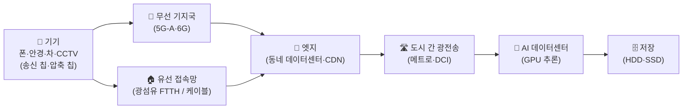

# 📤 AI 업로드 시대 — "위로 올라가는 데이터"는 누구에게 돈이 되나

> 작성 2026-11-04 · 테마 분석 · 주가·밸류에이션은 yfinance 조회값(2026-11-04, 장중일 수 있음)
> 함께 보기: [광통신 산업분석](./광통신_산업분석.md)(데이터센터 안쪽 광) · [온디바이스AI 산업분석](./온디바이스AI_산업분석.md)(업로드를 줄이는 쪽) · [AI인프라 풀스택맵](../배경지식/AI인프라_풀스택맵.md)

---

## 0. 한 줄 결론

**업로드는 "얼마나 많냐"보다 "얼마나 빨리 느냐"가 핵심이다. 지금 인터넷은 원래 '다운로드용'으로 설계돼서, 업로드는 비중이 작아도 금방 막힌다. 그래서 돈은 ① 업로드된 데이터가 결국 쌓이는 곳(저장), ② 원래부터 위·아래가 같은 길(광섬유), ③ 데이터를 가까운 곳에서 받아 처리하는 곳(엣지)에 먼저 들어오고, 무선 기지국·6G는 그다음 파도다.**

| 단계 | 시점 | 분야 | 한 줄 |
|---|---|---|---|
| 🥇 이미 실적으로 확인됨 | 지금~2027 | **저장(HDD)** · **광섬유/FTTH** · **엣지 클라우드** | 숫자가 이미 찍히고 있음. 대신 주가도 많이 올랐음 |
| 🥈 다음 파도 | 2027~2029 | **5G-Advanced 업링크** · **케이블 DOCSIS 4.0** · **스마트폰·안경 RF칩** | 통신사가 지갑을 열어야 시작됨 |
| 🥉 먼 옵션 | 2029~ | **6G** · **스마트글라스 대중화** · **위성 직접통신** | 맞으면 크지만 아직 꿈의 단계 |

---

## 1. 무슨 일이 벌어지고 있나 — 숫자로 확인

### 1.1 "업로드"부터 쉽게

- **다운로드** = 인터넷에서 내 기기로 **내려받기** (넷플릭스 보기, 웹페이지 열기)
- **업로드** = 내 기기에서 인터넷으로 **올려보내기** (사진 올리기, 영상통화에서 내 얼굴 보내기, AI에게 사진 보여주기)

> 🧒 **쉬운 말로**: 다운로드는 **택배를 받는 것**, 업로드는 **택배를 보내는 것**. 지금까지 우리는 받기만 엄청 많이 하고, 보내는 건 가끔이었다.

### 1.2 실측 데이터 — 업로드가 다운로드보다 3배 빨리 늘고 있다

**① 미국 유선 인터넷 (OpenVault, 2026년 2분기)**

| 항목 | 수치 | 의미 |
|---|---|---|
| 업로드 사용량 증가율 | **+19.2%** (전년 대비) | 3년 연속 최고 기록 경신 (15.9% → 17.9% → 19.2%) |
| 다운로드 사용량 증가율 | +6.1% | 업로드가 **3배 이상** 빨리 늘어남 |
| 가구당 월 업로드 | 58.2GB | 1년 새 +9.3GB, 역대 최대 증가폭 |
| 다운로드 : 업로드 비율 | 16.6 : 1 (2019) → **11.2 : 1** (2026) | 7년 만에 격차 32.5% 축소 |
| 전체 트래픽 중 업로드 비중 | **8.2%** | ⚠️ 아직은 작다 |

**② 전 세계 모바일 (에릭슨, 2026년 6월 모빌리티 리포트)**

- 통신사 55곳 중 **43곳**에서 업로드 증가율이 다운로드보다 높았고, **17곳**은 1.5배 이상 높았다.
- AI 기기가 퍼지면 2031년 업로드 트래픽은 2025년의 **3배(중간 시나리오)~5배(높은 시나리오)**. AI가 없을 때 전체 모바일 트래픽이 약 2배 느는 것과 비교하면 훨씬 가파르다.
- 중국 차이나텔레콤은 스마트글라스·산업용 로봇 같은 AI 에이전트 서비스에 **2024년 대비 5배의 업로드 용량**이 필요하다고 봤다.

### 1.3 왜 늘어나나 — 원인 4가지

| 원인 | 예시 | 왜 업로드인가 |
|---|---|---|
| **① AI에게 '보여주는' 시대** | "이 냉장고 재료로 뭐 해먹지?" 하고 사진을 찍어 AI에 올림 | 질문이 글자에서 사진·영상·화면으로 바뀜 |
| **② 늘 켜져 있는 AI 비서** | 스마트글라스가 내 시야를 계속 AI에 보냄 | 에릭슨 추정: 스마트글라스는 **다운로드 1 : 업로드 8**, 정반대 구조 |
| **③ 기계가 찍는 데이터** | 자율주행차·로봇·드론·CCTV가 영상과 센서값을 계속 올림 | 사람이 아니라 기계가 24시간 업로드 |
| **④ 클라우드 동기화·크리에이터** | 폰 사진 자동 백업, 유튜브·숏폼 업로드, 회의 녹화 | 원래 있던 흐름에 AI 편집·요약이 더해짐 |

**크기 감 잡기 (예시):**

| 행동 | 업로드 크기 |
|---|---|
| AI에게 글자로 질문 1번 | 약 1~2KB (A4 한 장 분량의 글자) |
| AI에게 폰 사진 1장 보여주기 | 약 3MB → **글자 질문 약 2,000번 분량** |
| HD 영상통화 1시간 (1~3Mbps) | 약 0.45~1.35GB |
| 스마트글라스로 1시간 계속 보여주기 (1~10Mbps) | 약 0.45~4.5GB |

> 🧒 **쉬운 말로**: AI가 "읽기"에서 "보기"로 진화하면서, 우리가 AI에게 보내는 택배가 **편지 봉투에서 이삿짐 박스로** 커졌다.

---

## 2. 냉정한 현실 체크 — 과장된 부분은 걷어내자

업계(장비 회사)는 업로드 폭증을 외칠 이유가 있다. 장비를 팔아야 하니까. 반대편 주장도 봐야 한다.

| 반론 | 내용 | 내 판단 |
|---|---|---|
| **아직 너무 작다** | 생성형 AI는 현재 네트워크 트래픽의 **0.06%** 정도(실측). 유선 업로드 비중도 8.2%뿐 | ✅ 맞다. "크기"로는 아직 주인공이 아님 |
| **실험해보니 영향이 작았다** | T-Mobile 망에서 AI 안경을 시험해 보니 업로드는 늘었지만 다른 트래픽보다 영향이 작았음 | ✅ 맞다. 다만 안경 보급률이 0에 가까울 때의 측정 |
| **기기가 못 버틴다** | 배터리·발열 때문에 영상을 계속 올리기 어렵다 → 필요할 때만 띄엄띄엄 보냄 | ⚠️ 일리 있음. 그래서 '업로드를 줄이는 기술'도 돈이 됨 (§4.7) |
| **온디바이스 AI가 대신한다** | 폰 안에서 AI가 처리하면 올릴 필요가 없다 | ⚠️ 일부 맞음. 다만 큰 모델은 결국 클라우드로 감 |

### 그런데도 투자 포인트가 되는 이유 — "작아도 막히는 구조"

지금 인터넷은 **처음부터 다운로드에 몰아주게 설계**돼 있다.

| 망 | 설계 | 비유 |
|---|---|---|
| **케이블 인터넷** (미국 주류) | 주파수 중 아주 좁은 구간만 업로드에 배정 | 고속도로 **시내 방향 8차선, 외곽 방향 1차선** |
| **5G 이동통신** | 시간을 쪼개 번갈아 쓰는데, 보통 다운로드 7 : 업로드 3으로 배정 | 한 차선을 시간제로 쓰는데 70%는 한쪽 방향만 통행 |
| **스마트폰 송신 출력** | 폰은 배터리 때문에 약하게, 기지국은 강하게 쏨 | 기지국은 **확성기**, 폰은 **속삭임** → 멀리서는 업로드가 먼저 끊김 |

> 🧒 **쉬운 말로**: 외곽 방향 1차선은 차가 조금만 늘어도 바로 막힌다. 업로드 비중이 8%밖에 안 돼도 매년 20%씩 늘면 **좁은 쪽 길이 먼저 터진다.** 그래서 돈은 "길 넓히기 공사"와 "애초에 양방향이 넓은 길"에 들어간다.

**결론**: 증가 속도는 진짜고, 크기는 아직 작다. 그러니 **"업로드 테마"라는 이름만 붙은 종목은 조심하고, 실제로 병목이 생기는 마디에 있는 회사**를 골라야 한다.

---

## 3. 돈의 지도 — 업로드된 데이터의 여행 경로

사진 한 장이 AI에게 도착해서 저장되기까지 거치는 곳마다 돈을 버는 회사가 있다.

| 마디 | 비유 | 업로드 증가의 영향 | 확신도 |
|---|---|---|---|
| 기기 (송신 칩·압축) | 택배 포장·발송 창구 | 보낼 짐이 커짐 | ★★★☆☆ |
| 무선 기지국 | 동네 골목 → 큰길 진입로 | 좁은 업로드 차선이 먼저 막힘 | ★★★☆☆ (시점이 늦음) |
| 유선 접속망 | 집 앞 도로 | 케이블(외곽 1차선) → 광섬유(양방향 8차선) 교체 | ★★★★☆ |
| 엣지 | 동네 우체국 | 먼 본사까지 안 보내고 가까이서 처리 | ★★★★☆ |
| 도시 간 광전송 | 고속도로 | 업로드도 늘지만 주된 동력은 데이터센터끼리의 AI 트래픽 | ★★★★☆ ([광통신 리포트](./광통신_산업분석.md)) |
| 저장 | 창고 | **올라온 건 거의 버리지 않는다** | ★★★★★ |

---

## 4. 분야별 분석

### 4.1 🗄️ 저장 (HDD) — 업로드의 최종 목적지, 가장 확실하다

**왜 수혜인가**: 사진·영상·로그·AI 대화 기록은 올라오면 **지워지지 않고 쌓인다.** AI 회사는 이 데이터를 다시 학습·분석에 쓰기 때문에 더 안 지운다. 대용량을 싸게 저장하는 데는 아직 **하드디스크(HDD)**가 SSD보다 훨씬 싸다.

> 🧒 **쉬운 말로**: 업로드는 강물, HDD는 그 물이 모이는 **저수지**다. 강이 어디로 흐르든 결국 저수지에 물이 찬다.

**현재 상황 (2026년)**
- 웨스턴디지털·씨게이트 모두 **2026년 생산분 완판**, 대형 고객과는 2027~2028년까지 계약.
- 데이터센터용 HDD 납기 **52주(1년) 이상**, 가격 평균 **+46%**.
- AI용 추가 저장 수요가 2026년 출하량의 약 18%에서 2028년 약 43%로 늘 것이라는 업계 추정.
- 씨게이트는 생산능력 증설 계획이 없다고 밝힘 → **공급이 수요를 못 따라감**.

| 종목 | 시총 | 매출 성장 | 영업이익률 | 선행 PER | 1년 주가 |
|---|---|---|---|---|---|
| 씨게이트 (STX) | $139B | +61% | 49% | 9.3배 | **+137%** |
| 웨스턴디지털 (WDC) | $130B | +56% | 48% | 8.6배 | **+123%** |

> 🧒 **선행 PER**: "내년 예상 이익의 몇 배 가격인가". 9배면 1년 이익 9년치 가격이라는 뜻으로, 성장률을 생각하면 싸 보인다. 하지만 **사이클 산업은 이익이 정점일 때 PER이 가장 싸 보이는 함정**이 있다 (반도체 메모리와 같은 원리 → [일일공부 D09](../../일일공부/2026-08-01_D09_반도체_사이클밸류에이션.md)).

**정직한 한계**: HDD 호황의 주된 동력은 사용자 업로드보다 **AI 학습용 데이터 저장**이다. 업로드 테마의 "최종 수혜"로 보는 게 맞고, 업로드만으로 설명하면 과장이다.
**리스크**: 이미 1년에 두 배 넘게 올랐다. 고객이 재고를 쌓은 뒤 주문을 끊으면 사이클이 꺾인다. **납기가 짧아지고 가격 인상이 멈추는 순간**이 경고 신호.

---

### 4.2 🏠 광섬유·대칭 인터넷 (FTTH) — "애초에 양방향이 넓은 길"

**왜 수혜인가**: 광섬유 인터넷은 업로드와 다운로드를 **같은 속도(대칭)**로 줄 수 있다. 케이블 인터넷은 구조상 업로드가 좁다. 업로드가 중요해질수록 사람들이 케이블에서 광섬유로 갈아탄다.

**증거 (실측)**
- 광섬유 가입자는 월 **94.1GB**를 업로드, 케이블 가입자는 58.2GB → 광섬유 쪽이 **61.6% 더** 올린다. 길이 넓으니 더 쓴다.
- 미국 최대 케이블사 **컴캐스트는 2026년 3분기에만 인터넷 가입자 14.4만 명이 순감**(전년 동기 9.1만 명보다 악화). 광섬유와 무선 고정 인터넷(FWA)에 뺏기고 있다.

> 🧒 **쉬운 말로**: 학교 앞 문구점(케이블)이 "보내기"가 불편한 택배만 받아주니까, 손님들이 받기·보내기 다 되는 새 편의점(광섬유)으로 옮겨가는 중.

**누가 버나**

| 구분 | 종목 | 하는 일 | 숫자 | 코멘트 |
|---|---|---|---|---|
| 광섬유 소재 | **코닝 (GLW)** | 광섬유 유리 세계 1위급 | 시총 $109B · 매출 +18% · 선행 PER 27.9 · 1년 +45% | 데이터센터 광 수요까지 겹친 1등주. 가장 무난한 선택 |
| PON 장비 | **Calix (CALX)** | 광섬유 가입자망 장비·소프트웨어 | 매출 +21% · 선행 PER 14.4 · 1년 **−45%** | 실적은 성장 중인데 주가는 빠짐 → 시장이 의심하는 구간. 확인 필요 |
| PON 장비 | **노키아 (NOK)** | 25G PON 등 광 가입자망 + 무선 | 매출 +10% · 선행 PER 17.5 | 유선·무선 양쪽 다 걸쳐 있음 |
| 국내 광섬유 | **대한광통신 (010170)** | 광섬유·광케이블 제조 | 시총 2.06조 · 최근 4분기 매출 1,557억 · **영업적자 −141억** · 1년 **+371%** | ⚠️ 실적보다 기대가 훨씬 앞서감 |
| 국내 유선장비 | **다산네트웍스 (039560)** | 유선 네트워크 장비(스위치·PON) | 최근 4분기 매출 5,720억 · 영업이익 440억 · 1년 −31% | 이익은 내는데 주가는 소외 |
| 국내 유선장비 | **유비쿼스 (264450)** | 통신사용 유선 스위치 | 최근 4분기 매출 1,218억 · 영업이익 273억 · 1년 +21% | 국내 통신사 투자에 좌우 |

> 🧒 **PON**: 광섬유 한 가닥을 여러 집이 나눠 쓰게 해주는 장비. 수도 본관 하나에서 여러 집으로 갈라지는 **분배기**라고 생각하면 된다. 세대가 GPON(2.5G) → XGS-PON(10G) → 25G/50G PON으로 올라가며 업로드도 같이 넓어진다.

**패자 쪽도 보자 — 케이블사**

| 종목 | 선행 PER | 1년 주가 | 해석 |
|---|---|---|---|
| 컴캐스트 (CMCSA) | 6.7배 | −7% | 싸 보이지만 가입자가 계속 줄어드는 중 |
| 차터 (CHTR) | 2.4배 | −48% | 극단적으로 싸다 = 시장이 "구조적 패자"로 본다는 뜻 |

> ⚠️ **싼 게 비지떡(가치 함정)**: PER이 낮은 이유가 "미래 이익이 줄어들 것"이라면 싼 게 아니다. 업로드 시대는 케이블사의 약점을 정확히 찌른다.

**케이블사의 반격 → 또 다른 수혜자**: 케이블사도 손 놓고 있진 않는다. **DOCSIS 4.0**으로 업그레이드하면 업로드 차선을 크게 넓힐 수 있다. 이 공사를 하는 장비사가 수혜다.
- **Harmonic (HLIT)**: 케이블망 가상화 장비. 매출 **+54%**, 선행 PER 11.9.
- **Vecima (VCM.TO)**: 케이블 분산 접속 장비. 선행 PER 9.6, 1년 +33%.

> 🧒 **쉬운 말로**: 문구점이 망하지 않으려고 가게를 리모델링한다. 리모델링 업자는 문구점이 살든 망하든 공사비를 받는다.

---

### 4.3 🏢 엣지 클라우드·CDN — "동네 우체국에서 바로 처리"

**왜 수혜인가**: 스마트글라스가 보내는 영상을 먼 미국 데이터센터까지 보내면 **늦고 비싸다.** 사람과 가까운 곳(엣지)에서 받아 AI가 바로 처리하면 빠르고, 비싼 장거리 망도 덜 쓴다. 대화형 AI(음성·영상)는 **지연(딜레이)에 민감**해서 더 그렇다.

> 🧒 **쉬운 말로**: 편지를 서울 본사까지 보내지 않고 **동네 우체국에서 바로 답장**해 주는 구조. 원래 CDN은 "영상 내려주기 창고"였는데, 이제 "올라온 걸 받아서 처리하는 곳"으로 바뀌는 중.

**현재 상황**
- **아카마이**: 엔비디아 블랙웰 GPU를 전 세계 약 20개 도시에 깐 'Inference Cloud' 출시, 정식 오픈 전 **베타 수요로 매진**. 클라우드 인프라 매출 **+40%**(2026년 1분기), 프런티어 AI 회사와 **7년 $18억 계약**.
- **클라우드플레어**: 매출 +34%, 경영진이 "AI가 역대 최대 순풍"이라고 언급. 매월 수천억 건의 AI 에이전트 요청이 네트워크를 지나감.

| 종목 | 시총 | 매출 성장 | 선행 PER | P/S | 1년 주가 | 코멘트 |
|---|---|---|---|---|---|---|
| 아카마이 (AKAM) | $12.4B | +5% (전체) | **12.7배** | 2.9 | +21% | 옛 CDN 사업이 정체, AI 부분만 고성장 → **전환이 성공하면 가장 싸다** |
| 클라우드플레어 (NET) | $97.4B | +36% | 161.7배 | **38.8** | +14% | 성장은 최고, 가격은 이미 매우 비쌈 |
| Fastly (FSLY) | $3.4B | +23% | 32.8배 | 4.9 | **+159%** | 이미 크게 반등 |
| 에퀴닉스 (EQIX) | $100B | +10% | 49배 | 9.9 | +20% | 네트워크끼리 만나는 '환승역' 데이터센터 |

> 🧒 **P/S**: "1년 매출의 몇 배 가격인가". 클라우드플레어 38.8배는 매출 39년치 가격이라는 뜻이라, 성장이 조금만 꺾여도 크게 떨어질 수 있다.

---

### 4.4 📶 무선 기지국 (5G-Advanced → 6G) — 크지만 늦게 오는 파도

**왜 수혜인가**: 모바일 업로드 병목을 풀려면 기지국을 바꿔야 한다.

| 해결책 | 쉬운 설명 | 필요한 것 |
|---|---|---|
| 시간 배분 바꾸기 (TDD 비율 조정) | 7:3이던 통행 시간을 업로드 쪽으로 더 줌 | 소프트웨어 + 장비 조정 |
| 업로드용 안테나 늘리기 (업링크 MIMO) | 받는 귀를 여러 개 달아 속삭임도 잘 듣기 | 새 무선장비(RU)·안테나 |
| 주파수 묶기·분리 | 업로드는 멀리 가는 낮은 주파수, 다운로드는 넓은 높은 주파수로 따로 | 다중 대역 장비 |
| 6G | 처음부터 업로드를 고려해 설계 (에릭슨: "AI 시대에 맞는 업로드") | 2029~2030년경 상용화 전망 |

> 🧒 **MIMO**: 안테나를 여러 개 써서 동시에 여러 길로 주고받는 기술. 귀가 하나일 때보다 **귀가 여덟 개면 작은 소리도 잘 들린다.**

**누가 버나**

| 구분 | 종목 | 숫자 | 코멘트 |
|---|---|---|---|
| 글로벌 장비 | 에릭슨 (ERIC) | 시총 $35B · 매출 +6% · 선행 PER 17.3 | 업로드 담론을 가장 크게 외치는 회사. 실적은 아직 완만 |
| 글로벌 장비 | 노키아 (NOK) | 매출 +10% · 1년 +22% | 무선 + 광 가입자망 + 광전송까지 분산 |
| 국내 증폭기 | **RFHIC (218410)** | 최근 4분기 매출 2,039억 · 영업이익 **378억** · 1년 +31% | 기지국용 GaN 증폭기(신호를 세게 만드는 부품). 방산 매출이 받쳐줘서 흑자 |
| 국내 중계기 | **쏠리드 (050890)** | 매출 3,167억 · 영업이익 313억 | 건물 안 이동통신 중계(DAS). 흑자 |
| 국내 측정장비 | **이노와이어리스 (073490)** | 매출 2,124억 · 영업이익 106억 | 새 통신 표준이 나올 때마다 먼저 팔리는 테스트 장비 |
| 국내 안테나·RU | 케이엠더블유 (032500) | 매출 919억 · 영업적자 −241억 | ⚠️ 통신사 투자 회복을 기다리는 중, 적자 지속 |
| 국내 안테나 | 에이스테크 (088800) | 매출 1,412억 · 영업적자 −275억 · 1년 −60% | ⚠️ 재무 위험 확인 필요 |

**가장 큰 리스크 — "통신사 지갑"**: 기지국 장비는 **통신사가 돈을 써야** 팔린다. 그런데 통신사는 5G 때 큰돈을 쓰고도 요금을 더 받지 못했다. 그래서 업로드가 늘어도 **"최대한 버티다가 막힐 때 찔끔 투자"**할 가능성이 크다. 5G 초기에 국내 장비주가 기대만 크고 실적이 따라오지 않았던 경험을 기억하자.

> 🧒 **쉬운 말로**: 도로가 막히는 건 맞는데, 공사비를 낼 사람(통신사)이 돈이 없다. 공사는 결국 하겠지만 **언제 하느냐**가 관건.

**순서 판단**: ① 측정장비(이노와이어리스)가 가장 먼저 → ② 증폭기·RU → ③ 안테나·중계기. 표준이 바뀔 때 테스트 장비가 늘 먼저 팔린다.

---

### 4.5 📱 기기 안의 송신 칩 (RF) — 폰과 안경이 "더 세게 보내야" 한다

**왜 수혜인가**: 업로드를 하려면 기기 안의 **송신 증폭기(PA)**와 **모뎀**이 일을 더 해야 한다. 업링크 MIMO가 기기에도 들어가면 송신 부품 수가 늘어난다. 스마트글라스 같은 새 기기가 생기면 칩이 들어갈 자리도 늘어난다 (ABI 리서치: 2030년 스마트글라스 7,000만 대 출하 전망).

| 종목 | 숫자 | 코멘트 |
|---|---|---|
| 스카이웍스 (SWKS, 코보 합병) | 선행 PER 11.5 · 매출 −3% | 2025년 10월 코보와 약 $220억 합병 합의, 2026년 9월 말 규제 승인 완료. 업계 재편으로 가격 협상력↑ 기대. 단 애플 의존도와 애플 자체 칩 전환이 리스크 |
| 퀄컴 (QCOM) | 선행 PER 16.2 · 매출 −4% · 1년 −6% | 모뎀 1위 + 메타 스마트글라스용 칩. 역시 애플 모뎀 이탈이 부담 |

**확신도 ★★★☆☆**: 방향은 맞지만 스마트폰 시장 자체가 거의 성장하지 않아서, 부품이 늘어나는 효과가 크지 않을 수 있다.

---

### 4.6 🛣️ 도시 간 광전송 (메트로·DCI) — 간단히

많은 사람의 업로드가 모이면 동네에서 지역 데이터센터로 가는 광 고속도로가 굵어져야 한다. **시에나(CIEN)**는 매출 **+37%**, 1년 +56%. 다만 이 분야의 주된 동력은 사용자 업로드보다 **데이터센터끼리 오가는 AI 트래픽**이다. 자세한 내용은 [광통신 산업분석 §3.5](./광통신_산업분석.md)와 국내 [오이솔루션](../종목분석/오이솔루션_심층분석리포트_v2.md)·[대한광통신](../종목분석/대한광통신_심층분석리포트.md) 리포트 참고.

---

### 4.7 🗜️ 반대로 베팅하기 — "덜 보내게 해주는 기술"도 돈이 된다

길이 막히면 **짐을 줄이는 기술**이 돈이 된다. 업로드 폭증 주장이 과장이라고 해도 이 분야는 수혜를 본다 (헤지 역할).

| 방법 | 예시 | 종목 |
|---|---|---|
| 기기 안에서 AI가 먼저 처리 | 카메라가 영상 전체가 아니라 "사람이 쓰러졌다"는 결과만 보냄 | 앰바렐라 (AMBA, 엣지 비전 칩): 매출 +13% · 아직 적자 · 1년 −25% |
| 온디바이스 AI | 폰 안 NPU가 사진을 먼저 요약 | 퀄컴·미디어텍·삼성전자 → [온디바이스AI 리포트](./온디바이스AI_산업분석.md) |
| 영상 압축 | 같은 화질을 더 작은 크기로 | 코덱·인코더 칩 회사 |

> 🧒 **쉬운 말로**: 택배비가 비싸지면 **이삿짐 전체 대신 사진 한 장만 찍어 보내는 방법**이 인기를 얻는다.

---

### 4.8 그 밖에

- **통신사 (SKT·KT)**: 업로드가 늘면 비용(투자)은 통신사가 내지만, 요금을 더 받기는 어렵다. 업로드 테마의 직접 수혜자는 아니다. SKT 선행 PER 11.5, KT 7.5. 통신사 주가는 배당·AI 데이터센터 사업 쪽에서 봐야 한다.
- **위성 직접통신 (AST SpaceMobile)**: 폰에서 위성으로 바로 연결. P/S 125배로 **완전히 꿈에 대한 가격**. 1년 −48%.

---

## 5. 종합 — 한눈에 보는 순위표

| 순위 | 분야 | 확신도 | 시점 | 이미 주가에 반영된 정도 | 대표 종목 |
|---|---|---|---|---|---|
| 1 | 🗄️ 저장 (HDD) | ★★★★★ | 지금 | 🔴 많이 반영 (1년 +120~140%) | 씨게이트, 웨스턴디지털 |
| 2 | 🏠 광섬유·FTTH | ★★★★☆ | 지금~2028 | 🟡 코닝은 반영, 장비주는 덜 반영 | 코닝, Calix, 노키아 / 다산네트웍스, 유비쿼스 |
| 3 | 🏢 엣지 클라우드 | ★★★★☆ | 지금~2028 | 🟢 아카마이는 덜 반영, 🔴 클라우드플레어는 과열 | 아카마이, 클라우드플레어 |
| 4 | 🔧 케이블 업그레이드 | ★★★☆☆ | 2026~2028 | 🟢 저평가 | Harmonic, Vecima |
| 5 | 📶 5G-A·6G 기지국 | ★★★☆☆ | 2027~2030 | 🟢 덜 반영 (대신 오래 기다려야 함) | 에릭슨, 노키아 / RFHIC, 이노와이어리스 |
| 6 | 📱 기기 RF칩 | ★★★☆☆ | 2027~ | 🟢 싸지만 성장 정체 | 스카이웍스, 퀄컴 |
| 7 | 🗜️ 업로드 줄이는 기술 | ★★★☆☆ | 지금~ | 🟢 | 앰바렐라, 온디바이스 AI 칩 |

### 사람별 가이드 (매매 추천 아님)

| 성향 | 접근 |
|---|---|
| **안정 추구** | 코닝(광섬유 1등 + 데이터센터 광) 위주. HDD는 이미 많이 올라서 사이클 꺾임에 주의 |
| **가치 발굴형** | 아카마이(AI 전환 성공 시 재평가), Harmonic(케이블 업그레이드 수혜), 다산네트웍스(이익 대비 소외) — 시장이 놓친 쪽 |
| **장기 테마형** | 6G·스마트글라스 시대를 보고 RFHIC·이노와이어리스·노키아를 조금씩. **2~3년을 기다릴 각오** 필요 |
| **피해야 할 것** | 적자인데 "업로드·6G 테마"로만 오른 종목, 싸 보이는 케이블사(가치 함정) |

---

## 6. 트래킹 체크리스트 — 이 신호를 보면 판단을 업데이트

| 지표 | 어디서 | 좋은 신호 | 나쁜 신호 |
|---|---|---|---|
| 다운로드:업로드 비율 | OpenVault 분기 보고서 | 11.2:1 → **10:1 이하** | 비율 하락이 멈춤 |
| 업로드 증가율 | 에릭슨 모빌리티 리포트 (6월·11월) | 업로드가 다운로드보다 빨리 느는 통신사 비중 증가 | 43/55 → 줄어듦 |
| 통신사 투자 계획 | SKT·KT·버라이즌·AT&T 실적 발표 | "업링크·5G-A 투자" 언급, 투자액 증가 | 투자 동결·감축 |
| TDD 비율 변경 | 통신사·화웨이 뉴스 | 업로드 시간 늘리는 상용 사례 확산 | — |
| 스마트글라스 판매 | 메타 실적, IDC | 판매량 연 두 배 이상 | 반짝 유행 후 정체 |
| HDD 납기·가격 | 씨게이트·WD 실적 | 납기 1년 유지, 가격 상승 | **납기 단축, 가격 인상 중단** (사이클 정점 신호) |
| 케이블사 가입자 | 컴캐스트·차터 분기 실적 | 순감 확대 = 광섬유 수혜 지속 | 순감 축소 = DOCSIS 4.0 반격 성공 |
| 6G 표준 | 3GPP Release 20~21 | 업로드 중심 설계 확정 | 일정 지연 |

---

## 7. 핵심 리스크

1. **과장 리스크**: 업로드 폭증은 대부분 장비사의 **시나리오 모델**이다. 실제 측정에서 생성형 AI 트래픽은 아직 0.06% 수준.
2. **온디바이스 AI**: 기기 안에서 처리하는 비중이 커지면 업로드 증가가 예상보다 완만해진다.
3. **통신사 투자 여력**: 병목이 생겨도 돈 낼 주체가 투자를 미룰 수 있다.
4. **이미 오른 주가**: HDD·광섬유는 AI 데이터센터 테마로 이미 크게 올랐다. 업로드는 "추가 이유"일 뿐, 새로 발견된 기회가 아니다.
5. **사이클**: HDD·광섬유 모두 공급이 늘면 가격이 떨어지는 전형적인 사이클 산업이다.

---

## 8. 출처

- OpenVault, [2Q26 Broadband Insights — 업로드 +19.2%, 비율 11.2:1](https://openvault.com/ovbi-upstream-growth-nears-20-yoy-tops-downstream-increase-by-3x/) · [광섬유 vs 케이블 업로드 격차](https://openvault.com/openvault-fiber-upstream-usage-widens-gap-over-docsis/)
- Ericsson, [Mobility Report 2026.6 — AI will drive future uplink](https://www.ericsson.com/en/reports-and-papers/mobility-report/articles/rising-uplink-demand-ai-driven-mobile-networks) · [AI-driven devices and uplink (2026.9)](https://www.ericsson.com/en/blog/2026/9/ai-driven-devices-and-uplink) · [6G uplink (2026.10)](https://www.ericsson.com/en/blog/2026/10/6g-uplink-performance)
- RCR Wireless, [Ericsson sees six-fold jump in uplink demand](https://rcrwireless.com/20261020/6g/ericsson-sees-six-fold-jump-in-uplink-demand-says-not-to-make-5g-mistakes-with-6g) · 반론: [The 6G AI uplink panic (Analyst Angle)](https://www.rcrwireless.com/20260729/analyst-angle/6g-ai-uplink-panic-nandlall)
- Counterpoint, [Agentic AI Driving Paradigm Shift in Mobile AI (차이나텔레콤 업링크 5배)](https://counterpointresearch.com/de/insights/Agentic-AI-Driving-Paradigm-Shift-in-Mobile-AI-Transforming-5G-Network-Evolution) · CCS Insight, [MWC Shanghai uplink](https://www.ccsinsight.com/blog/ai-initiatives-at-mwc-shanghai-drive-uplink-requirements/)
- Broadband Breakfast, [Comcast 3Q26 인터넷 가입자 14.4만 순감](https://broadbandbreakfast.com/comcast-loses-144-000-broadband-subscribers-in-third-quarter/)
- The Register, [HDD 2026년 완판](https://www.theregister.com/2026/02/20/ai_blamed_again_as_hard_drives_sell_out/) · TechRadar, [HDD 납기·가격](https://www.techradar.com/pro/surging-ai-demand-for-hdd-means-that-you-may-have-to-wait-up-to-a-year-for-32-tb-hard-disk-drives-warns-research-and-yes-prices-are-also-going-up)
- 아카마이·클라우드플레어 2026년 1분기 실적 요약: [vectorshift (Akamai 1Q26)](https://vectorshift.ai/research/companies/akamai/earnings/2026-q1) · [nameocean](https://nameocean.net/article/beyond-the-hype-what-q1-2026-earnings-tell-us-about-real-ai-value-in-infrastructure/)
- 스카이웍스·코보 합병: [Qorvo 10-Q (SEC)](https://www.sec.gov/Archives/edgar/data/0001604778/000162828026050166/rfmd-20260627.htm) · [GuruFocus](https://www.gurufocus.com/news/8934538/skyworks-solutions-swks-accelerates-qorvo-acquisition-timeline-to-2026)
- PON 시장: [Dell'Oro 광대역 장비 전망](https://www.delloro.com/news/broadband-equipment-spending-to-peak-at-18-8-b-in-2028/)
- 주가·밸류에이션·실적: yfinance (2026-11-04 조회). 국내 종목 매출·영업이익은 최근 4개 분기(2025.9~2026.6) 합산.

> ⚠️ 본 자료는 산업 구조를 이해하기 위한 공부 자료이며 **매수·매도 추천이 아니다.** 시나리오 수치(2031년 3~5배 등)는 회사 전망치로, 확정된 사실이 아니다. 주가는 조회 시점 기준이며 계속 변한다.
