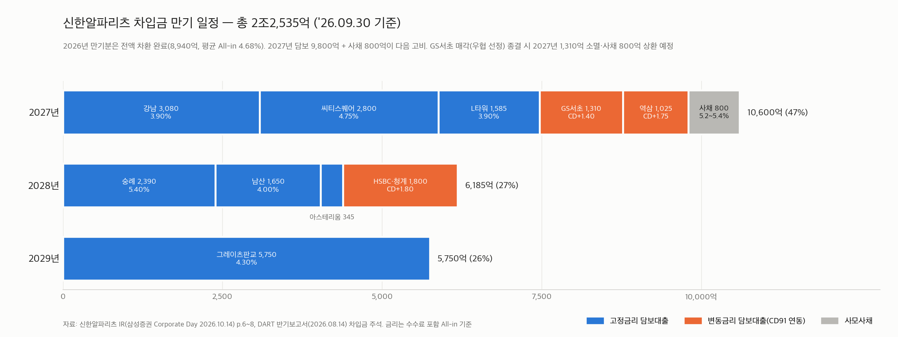
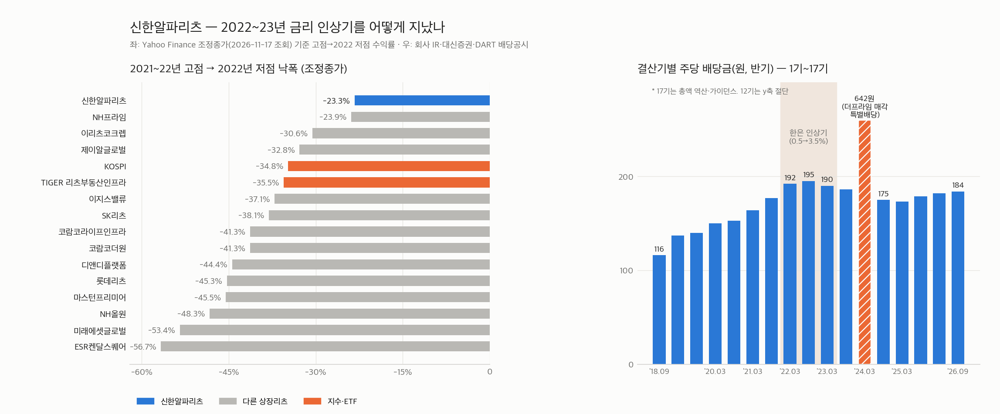

# 신한알파리츠 (293940) — v3: 차입 만기 로드맵 · 2022~23 고금리기의 교훈 · 정책 확률(보수적) · 공급→임대료

> 작성일: 2026-11-17 · 카테고리: 건설및부동산/종목분석 · **v3** (v1 = [배경지식](./신한알파리츠_293940_배경지식_v1.md), v2 = [3대 변수 양면 점검](./신한알파리츠_293940_v2_3대변수_금리정책공급.md). v3는 v2의 네 가지 미해결 질문을 1차 자료로 파고든 것. v1·v2는 수정하지 않고 보존, 정정 사항은 §6에 모음)
> **검증 메모**: 차입 일정은 **회사 IR(삼성증권 Corporate Day 2026.10.14, '26.09.30 기준)과 DART 반기보고서(2026.08.14) 차입금 주석·수시공시 원문**으로 확인. 2022~23년 수치는 당시 회사 IR·증권사 리포트(하이투자 2022.05, 이베스트 2022.05/11·2023.05·2024.04)·딜사이트·더벨 기사와 Yahoo Finance 조정종가(2026-11-17 조회, 유증 권리락 보정) 기준. 정책은 재정경제부 2026 세제개편안 상세본(2026.08.03) 원문·국회 일정 보도·국토부 관련 보도 기준. 공급·임대료는 §4 첫머리에 출처 일괄 표기. **DART 사업보고서 주석을 직접 열지 못한 2022~23년 리파이낸싱 금리(5.30% vs 4.8~4.9%)처럼 출처끼리 다른 숫자는 본문에 병기**. 확률 표기는 전부 필자 주관.

---

## 0-0. 이 문서에 새로 나오는 용어 (v1 §1, v2 §0-0에 없는 것만)

| 용어 | 뜻 | 왜 중요한가 |
|---|---|---|
| **선순위 / 중순위 / 후순위** | 같은 건물을 담보로 여러 대주가 돈을 빌려줄 때 갚는 순서. 선순위가 먼저 받으니 금리가 가장 낮고(3~4%), 후순위는 위험해서 비쌈(5~6%) | 신한알파가 2022·2026년에 한 일 = 비싼 후순위를 갚고 선순위로 통합 |
| **트랜치(Tranche)** | 한 대출을 금리·만기가 다른 묶음으로 쪼갠 단위. "단일 트랜치"는 쪼개지 않고 한 덩어리로 빌렸다는 뜻 | 숭례 2026.09 차환이 선·중순위를 합쳐 단일 트랜치가 됨 |
| **All-in 금리** | 표면금리 + 주선·자문 수수료를 합친 실제 부담 금리 | 회사 IR은 All-in, DART 주석은 표면 기준이라 같은 대출이 0.2~0.3%p 다르게 적힘 |
| **담보신탁 우선수익권** | 건물을 신탁회사에 맡기고, 대주가 "문제 생기면 먼저 가져갈 권리"를 받는 담보 방식 | 판교 대출 담보가 이것(차입금의 120%) |
| **전자단기사채 / 사모사채 / 공모채** | 전단채 = 3개월 안팎 초단기 채권. 사모사채 = 소수 기관에만 파는 회사채. 공모채 = 공개 시장에서 불특정 다수에게 파는 회사채(신용등급 필수, 보통 더 싸고 길게) | 신한알파는 전단채 → 사모사채(1년)로 갈아타는 중. 공모채는 "준비" 단계 |
| **대주단** | 한 대출에 돈을 함께 댄 금융기관들 | 대주가 바뀌면 조건도 바뀜. 2026 판교 대주단은 보험사 중심 |
| **EBITDA / ICR(이자보상배율)** | EBITDA = 이자·세금·감가상각 빼기 전 이익(≈ 임대료로 버는 현금). ICR = EBITDA ÷ 이자. 1.5배면 이자의 1.5배를 번다 | 신용등급·규제의 핵심 지표. 신한알파 약 1.5배(추정) |
| **회수원본 vs 매각차익** | 건물을 팔면 받은 돈 = 샀을 때 넣은 자기 돈(원본) + 남은 차익. 원본은 차입 상환·재투자, 차익은 특별배당이 관행 | GS서초 매각: 원본 863억 → 사채 상환, 차익 → 2027.12 특별배당 |
| **우선협상대상자(우협) / MOU / 거래종결** | 입찰에서 1등으로 뽑힌 매수 후보 → 양해각서 → 본계약·잔금(종결). 우협 선정 후 깨지는 경우도 흔함 | GS서초는 2026.10 우협 단계. 돈이 들어오는 건 2027.01 종결 때 |
| **청약률 / 권리락 / 조정종가** | 청약률 = 유상증자 때 신주를 사겠다고 몰린 비율(100% 넘으면 성공). 권리락 = 신주 받을 권리가 떨어져 나가며 주가가 기계적으로 내려가는 것. 조정종가 = 그 효과를 되돌려 비교 가능하게 만든 주가 | 2022·2023 유증 분석에 필요 |
| **조세소위 / 예산부수법안** | 국회 재정경제기획위원회 안의 세법 심사 소위원회. 예산부수법안으로 지정된 세법은 12.02까지 처리 안 되면 본회의에 자동 상정 | 세법 통과 시점을 가늠하는 열쇠 |
| **법 개정 vs 시행령 vs 가이드라인** | 법은 국회(6개월~2년), 시행령은 정부(입법예고 40일+, 3~6개월), 가이드라인은 부처 공문(수주~수개월) | 정책 '속도'를 따질 때 어느 단계인지가 결정적 |
| **입법예고 / 연구용역** | 입법예고 = 시행령·법안 초안을 공개하고 의견 받는 절차(법제처 사이트). 연구용역 = 부처가 외부 기관에 맡긴 정책 연구. 결과가 나와야 방안이 나옴 | 국토부 리츠 규제는 아직 연구용역 단계 |
| **세일앤리스백** | 건물을 팔고 그 건물을 다시 임차해 쓰는 거래 | 매각 후에도 임차인이 남는 구조 |

---

## 0. 한 장 요약 — 네 질문에 대한 짧은 답

| 질문 | 짧은 답 | 핵심 숫자 | 확신도(주관) |
|---|---|---|---|
| **① 대출 만기는 어떻게 되고, 연장·매각은 어떻게 할 것 같나** | 2026년 만기는 **전액 차환 완료**(8,940억, 평균 4.68%). 다음은 **2027년 1조600억(47%)** — 담보 9,800 + 사채 800. 회사 방침은 ⓐ 4%대 후반 대출(씨티스퀘어 4.75%)은 조기 차환 ⓑ GS서초 매각 원본 863억으로 **사채 800억 상환**(연 41억 절감) ⓒ 유증 없음 ⓓ 공모채는 A0 상향 후. 매각은 "5채 검토"에서 **GS서초 1채**로 좁혀졌고 우협(GRE파트너스, 약 2,400억) 선정, 2027.01 종결·2027.12 특별배당(주당 37~161원) 예정 | 차환 4.5%면 DPS **+20원**, 5.0%면 **−13원**(사채 상환 포함, §1-5) | 만기 구조·방침은 1차 자료로 확인(높음). 차환 금리는 시장 변수 |
| **② 2022~23 고금리기에 어떤 영향을 받았고 어떻게 버텼나** | 주가 **−23%**(리츠 중 가장 작은 낙폭, 롯데 −45%·ESR −57%), 배당은 **오히려 최고 195원**. 이유: 전액 고정·만기 3.3년이라 **2023년 하반기까지 갈아탈 빚이 없었다**. 충격은 2023.08 첫 차환(2.5→5.3%) → 1년 뒤 13기 DPS −11원으로 나타났고, 더프라임 특별배당 642원이 가렸다. 유증 2회(청약률 121%·138%)로 비싼 후순위를 갚았지만 2023.04 유증 땐 주가 −25% | 2022: 가중 2.9%·고정 100%·만기 3.3년 → 2026: 4.4%·82%·**1.6년** | 높음(당시 IR·리포트·기사 교차) |
| **③ 정책 — 보수적으로 어떤 제도가 어느 확률로 오나** | 2026년 안에 실제로 되는 건 **공모리츠 9% 특례 재설계·2029년 연장**(정부안, 12.02 시한, 통과 85~90%) 하나. 협회가 원한 **상장리츠 저율 분리과세는 재경부가 6월에 거절**(2027 재시도 20~25%). 국토부 **초과배당 재무요건**은 연구용역 단계(2027 발표 50%, 시행 2028 45%), **부채비율 하향 15% 이하**, **재투자준비금·배당유예**는 업계도 찬성(2027 발표 50~55%) | 세법 5개월 vs 국토부 12~17개월 | 중간(확률은 주관, 상태는 1차 자료) |
| **④ 공급 전망에 따른 임대료 영향** | **2027년까지 공급 공백** → 명목 +3~5%·실질 상승 지속. **2028년부터 CBD 공급 재개**(23만㎡), **2029년 72~130만㎡**(세빌스 실질 56%), **2030~31 서울역·양동권 약 85만㎡**가 신한알파 CBD 자산 바로 옆에 온다. 과거 선례(2010~13 CBD: 재고 7.6% 공급 → 공실 16~19%·8년 지속·실질 −20%, 렌트프리 1→3~6개월)로 보면 **명목은 안 떨어지고 렌트프리·공실로 조정**된다. 판교는 이미 조정(1Q26 −1.6%), 2028.12 판교세븐 2.3만평이 그레이츠판교 2.1만평 재계약과 겹침 | 2028 판교 재계약 +20% → DPS **+60원**, +30% → +90원, 동결 → 0 (§4-6) | 공급 수치 높음 / 영향 추정 낮음~중간 |

> **네 답을 겹치면**: 2027년(차환 47% + GS서초 종결 + 특별배당)은 '넘길 수 있는 해'이고, **2028~29년(판교 재계약 + 숭례·남산·HSBC 차환 + 판교 5,750억 차환 + CBD 공급 재개 + 규제안 시행)이 진짜 시험대**다. 2022년과 달리 시간 쿠션(만기 3.3년)은 없지만, 금리 점프 폭(2023년 +2.7%p → 2027년 +0.3~1.0%p)은 훨씬 작다. §5에 시점별 체크리스트.

---

## 1. 차입 만기 로드맵 — 2026년은 끝났고, 2027년 1조600억이 다음 고비

### 1-1. 쉽게 말하면
리츠는 건물값의 절반 이상을 빚으로 산다. 빚은 보통 2~3년짜리라 만기마다 그때 금리로 다시 빌려야 한다(리파이낸싱). 신한알파리츠는 2026년에 돌아온 빚 8,940억을 전부 갈아탔고, 그 과정에서 평균 금리가 2.7~3.0%에서 4.68%로 올랐다. 다음 고비는 **2027년에 몰린 1조600억(전체의 47%)**이다. 회사는 ① 비싼 대출부터 조기에 싸게 갈아타고 ② GS서초타워를 팔아 받는 원본으로 사채 800억을 갚고 ③ 유상증자는 안 하겠다고 말하고 있다.

### 1-2. 현재 차입 구조 ('26.09.30, 회사 IR 2026.10.14 p.6~8)

| 항목 | 수치 | 메모 |
|---|---|---|
| 총차입 | **2조2,535억** | 담보대출 2조1,735억(96.5%) + 사모사채 800억(3.5%) |
| 고정 : 변동 | **81.7% : 18.3%** | 고정분 가중평균 **4.42%**, 변동분 CD91 + 1.66%p |
| 평균 만기 | **1.61년** | 10월 월간보고서는 "약 1.5년". 2022년(3.1~3.3년)의 절반 |
| 만기 분포 | 2026 **0** / 2027 **10,600(47%)** / 2028 6,185(27%) / 2029 5,750(26%) | 회사채 포함, 비율은 필자 계산 |
| 감정가 기준 LTV | 약 57% (필자: 22,535 ÷ 39,448) | 대신 2H26은 58.6%(숭례 재평가 전). 취득가 기준 78.8% |
| 연결 부채비율 | 약 301% ('26.06, 부채 2.34조 ÷ 자본 0.78조) | 부투법 한도(100%, 주총 시 200%)와 기준이 달라 직접 비교 불가 — §3 참고 |

> v1·v2에서 쓴 "총차입 2.26조·가중 4.18%·2026년 만기 14.7%"는 대신증권 2H26(2026.07) 기준으로 **숭례 차환 전** 수치다. 차환 후 2026년 만기는 0, 총차입은 150억 줄었다.

### 1-3. 2026년 만기분 — 어떻게 처리됐나 (전액 차환 완료)

| 대출 | 전 | 후 | 핵심 | 출처 |
|---|---|---|---|---|
| **그레이츠판교** 선순위 | 4,850억 · 2.7% · '26.04 만기 | **5,750억 · All-in 4.3% 고정 · 3년('29.04.29)** · 한화생명 2,500(4.3%)·농협생명 500·KB손보 1,300(4.0%)·농협은행 1,150·중국은행 300 | 증액 900억으로 강남 자리츠 **후순위 720억(5.5%) 상환** + 전단채 180억 상환. 담보 감정가 1조원('26.02) | DART 2026.04.24 자금차입 공시(rcpNo 20260424800368), IR p.7 |
| 그레이츠강남 중순위 | 720억 · 5.5% · '26.06 만기 | 모리츠가 자리츠 보통주 450만주(720억) 인수 → 자리츠가 상환 | 반기보고서('26.06.30) 단기차입 0 확인 | DART 2026.04.24(타법인취득·종속회사 유증), 반기보고서 주석 12_1 |
| **그레이츠숭례** 선순위+중순위 | 2,190억 3.0% + 350억 4.5% · '26.09.15 만기 | **2,390억 · All-in 5.40% 고정 · 2년('28.09.15) · 선·중순위 통합 단일 트랜치** | 중순위 350억 = 선순위 증액 200 + 모리츠 증자 150(DART상 160억: 상환 150 + 운영 10). 숭례 감정가 3,595→4,350억('26.06 재평가). **삼성증권이 4월에 가정한 4.3%보다 1.1%p 높게 체결** | IR p.7~8, 3Q 보고서(2026.10.29) p.15, DART 2026.07.24(rcpNo 20260724800490·616) |
| 전자단기사채 | 580억 4.1%('25.12) → 580억 4.3%('26.03) → 400억 4.4%('26.04) | **2회차 사모사채 400억 · All-in 5.16% · 1년('27.07.30)** · 수협 200·현대차증권 200 | 회사: "단기차환부담 해소" | DART 20251217800419 / 20260319800995 / 20260430801372 / 20260724800457 |
| 1회차 사모사채 | 400억 · All-in 4.3% · '26.09 만기 | **3회차 사모사채 400억 · All-in 5.40% · 1년('27.09.23)** · 수협 150·NH 250 | 1년 새 사채 금리 +1.1%p | DART 2026.09.18(rcpNo 20260918800761), 딜사이트 2026.09.18 |
| **합계** | | **8,940억(담보 8,140 + 사채 800), 가중평균 All-in 4.68%** | | IR p.7 |

**읽는 법**
- 삼성증권(2026.04.02)은 "판교·숭례 차환으로 연 이자 116억 증가, 2025년 차환 절감 47억 + 그레이츠강남 배당수익 69억으로 완전 상쇄"라고 봤다. 그런데 숭례가 4.3%가 아닌 5.40%로 체결돼 **약 26억(2,390억 × 1.1%p, 필자 계산)이 추가로 붙었다**. 그래도 16·17기 DPS는 182·184원으로 가이던스를 넘겼으니 상쇄 논리는 대체로 작동한 셈.
- 숭례가 왜 5.4%인지 회사 설명은 없다. 추정 가능한 이유: ① 후순위 성격인 중순위를 선순위에 흡수(위험 혼합) ② 2년 단기 ③ 9월 체결 시점이 7·8월 기준금리 연속 인상 직후. 2년짜리로 짧게 가져간 건 "2028년에 더 싸게 갈아타겠다"는 베팅으로 읽힌다(필자 해석).
- 사채가 담보대출보다 비싸다(5.16~5.40% vs 담보 3.9~4.75%). 무담보라서다. 그래서 회사가 매각대금으로 사채부터 갚겠다는 것.

### 1-4. 2027년 만기 1조600억 — 대출별 조건과 처리 방향

| 만기 | 대출 | 금액(억) | 현재 금리 | 대주(반기보고서 '26.06.30) | 회사·증권사가 말한 처리 방향 |
|---|---|---|---|---|---|
| '27.03.11 | 삼성화재 역삼 | 1,025 | CD91+1.75%p 변동(≈5%대, 필자 추정) | 리치게이트와이에스 450·신한캐피탈 250·IBK캐피탈 325 | 2024.03 "금리 하락 대비 변동 선택"(딜사이트 2024.03.13). 명시 계획 없음. 변동이라 CD가 내리면 자동 절감 |
| '27.06.25 | 그레이츠강남 선순위 | 3,080 | 3.90% 고정 | 우리강남알파제일차 500·국민 500·신협 415·농협 300·기업 415·농협생명 400·부산 300·하나 250 | 2025.06 체결분. 지금 시장(4.1~4.7%)보다 낮아 **차환 시 상승 불가피** |
| '27.06.27 | GS서초타워 | 1,310 | CD91+1.40%p 변동 | 신한 410·수협 300·농협 300·국민 300 | **매각 종결('27.01 예정) 시 상환·소멸 추정**(회사 명시 발언은 없음) |
| '27.07.30 | 2회차 사모사채 | 400 | 5.16% | 수협 200·현대차증권 200 | **GS서초 회수원본 863억으로 상환 우선**(IR p.15, 이투데이 2026.10.19) |
| '27.07.31 | 씨티스퀘어 | 2,800 | 4.75% 고정 | 국민 450·삼성화재 500·기업 450·농협 500·수협중앙회 500·수협은행 200·산림조합 200 | "4%대 후반 대출은 **조기 리파이낸싱 추진**"(삼성증권 2026.04, 대신 2026.03). 2024.07 체결분 |
| '27.09.23 | 3회차 사모사채 | 400 | 5.40% | 수협 150·NH 250 | 상동(매각대금 상환) |
| '27.09.25 | 신한L타워 | 1,585 | 3.90% 고정 | 농협생명 800·국민 385·신협 300·하나 100 | 2025.09 체결분. 차환 시 상승 가능 |
| | **합계** | **10,600** | | | GS서초 매각·사채 상환 가정 시 **실제 차환 대상은 8,490억** |

**회사·운용사의 공식 입장(출처 순)**
1. "조기에 상환이 가능한 대출은 만기 전 낮은 금리로 대환하여 금융비용을 감소" — 신한리츠운용 IR(대신 Corp Day 2026.03.03 p.17·19)
2. "그레이츠판교 감정가 1조100억을 근거로 **약 1,000억 이상 추가 차입 여력**" + "유상증자는 최소화·지양" — 대신증권 2026.03.13
3. "유상증자 계획 없음, 확장보다 주주가치 극대화로 전환" — 삼성증권 2026.01.16 리포트 제목(본문 미확인)
4. "회수투자원본 863억은 차입금 상환을 우선 고려, 사채 상환 시 연 약 41억 이자 절감" — 회사 IR 2026.10.14 p.15 / 이투데이 2026.10.19
5. 공모 회사채: 2026년 발행 **없음**(DART 공시목록·반기보고서 "공모 미상환 잔액 —"). 회사 연혁 슬라이드는 "2025 공모회사채 발행 준비" 단계. 3,500억 사채 한도는 주총 승인(블로터 2025.05, DART 원문 미열람)
6. NH투자증권(2026.05.22): "A0 상향 시 약 50bp 절감", "앵커 테넌트 부재 → AUM 성장과 부채 관리 병행 필요"
7. 업계 전망: 리츠업계 가중평균 차입금리 2026 4.3% → **2027 4.7% → 2028 4.8%**(삼성증권, 이투데이 2026.10.19; 4Q26·1H27 기준금리 각 1회 인상 가정)

**정량적 비중(담보 연장 vs 회사채 vs 매각대금)을 밝힌 발언은 없다.** 확인된 방향은 ① 사채 800억 = 매각대금 상환, ② 씨티스퀘어 4.75% = 조기 차환, ③ 강남·L타워 3.9% = 만기 차환(상승 감수), ④ 공모채는 등급 A0 이후, ⑤ 유증 없음.

### 1-5. 2027년 차환 금리별 DPS 영향 (필자 계산)

가정: 차환 대상 8,490억(강남 3,080·씨티 2,800·L타워 1,585·역삼 1,025), 현재 연 이자 약 367억(가중 4.32%; 역삼 CD91 3.3% 가정), 발행주식 약 1.3억주, 사채 800억 상환으로 연 41억 절감은 별도.

| 2027 차환 평균금리 | 담보 이자 변화(연) | DPS 영향(연) | + 사채 상환 효과 | 합계 |
|---|---|---|---|---|
| 4.0% (강세) | −27억 | +21원 | +32원 | **+53원** |
| 4.5% (기본, 업계 2027 전망 4.7%에 근접) | +15억 | −12원 | +32원 | **+20원** |
| 5.0% (약세) | +58억 | −45원 | +32원 | **−13원** |
| 5.4% (숭례와 같은 조건) | +92억 | −70원 | +32원 | **−38원** |

- GS서초 매각은 대출 1,310억과 함께 그 건물 임대수익(삼성증권: 연 배당수익 기여 추정 미확인)도 사라지므로 위 표에 넣지 않았다. 특별배당은 §1-6.
- 한 줄 결론: **사채 800억 상환이 완충재** 역할을 해서, 2027년 차환이 4.5% 안팎이면 DPS는 지켜지고, 5%를 넘어야 마이너스로 돌아선다. v2에서 "4.5~5%면 −30~60원"이라 쓴 것은 사채 상환 효과를 빼고 2027 만기 전체(9,800억)에 적용한 수치라 더 보수적이었다.

### 1-6. 자산 매각 — 5채 검토에서 GS서초 1채로 좁혀졌다

| 항목 | 내용 | 출처 |
|---|---|---|
| 매각 대상 변경 | 2026.03 IR "자산가치 상승 예상 자산·구분소유 자산 중심 매각" → seoulpi(2026, 본문 403) "청계·남산·L타워·역삼·숭례 5개 검토" → **2026.10.14 IR: "오피스 매매가 급등기('19.3Q~'22.3Q)를 거친 구분소유자산을 매각대상으로 판단했었으나, 시장상황 변동으로 매각대상을 조정… 적정매각가 달성가능성이 제일 높은 GS서초타워 선정"** | IR 2026.03 p.12, IR 2026.10.14 p.10~11 |
| GS서초타워 | 매입 2,023억(2024.06.27). 2026.07.21 매각 개시(젠스타메이트·에스원 공동 주관) → 10.01 입찰 → **10.27 우협 GRE파트너스자산운용(한화갤러리아·우미글로벌 컨소시엄), 차순위 캡스톤**. 가격 "약 2,400억 안팎(평당 2,500~3,000만원)". 딜북: "임대 후 개발"(유료, 제목만) | 뉴스핌 2026.07.21, 서울경제 2026.10.27, 딜북 2026.10.28 |
| 일정(회사안) | '26.11 MOU → **'27.01 매매계약·거래종결** → **'27.12 특별배당 지급**. 11월 MOU 체결 여부는 11.17 현재 공시·보도 없음 | IR p.14 |
| 대금 용도 | "차입금 상환 및 우량자산 재투자 재원", "매각차익은 특별배당". 회수원본 863억 → 사채 상환(연 41억 절감) | IR p.12·14·15 |
| 특별배당 추정(회사) | 매각가 2,343억(평당 2,600만) → **주당 37원** / 2,433억(2,700만) → **99원** / 2,523억(2,800만) → **161원** | IR p.14 |
| 반영 시점 | 처분이익 배당은 "내년 9월 결산배당에 반영"(2027.12 지급) | 삼성증권, 이투데이 2026.10.19 |

**더프라임 선례(2023)**: 2,384억 매각, 차익 733억 → 12기 DPS 642원(정기분 186원 추정 제외 시 특별배당 약 456원). 하이투자(2023.08.09)는 배당가능이익 544억(차익 733 − 수수료 97 − 기타 15 − 누적감가 77)으로 주당 555~617원을 추정했고, 더프라임 관련 자리츠 차입 약 1,490억은 매각대금으로 상환. 잔여 원본은 2023.11 HSBC빌딩 매입에 재투자(이베스트 2024.04.30: "매각원본 150억 + 담보대출로 유증 없이 편입"). 비율을 명시한 1차 자료는 없음.

**보수적으로 읽으면**: ① GS서초 특별배당은 더프라임(456원)과 자릿수가 다르다 — 2년 보유라 차익이 작다(37~161원). ② 우협 선정은 계약이 아니다. 매수자가 "임대 후 개발" 컨소시엄이라 PF·인허가 변수가 있고, 2022년 더프라임도 마스턴 우협(2022.09) 후 무산되고 2023년 이지스에 팔렸다. ③ 나머지 4채(청계·남산·L타워·역삼·숭례) 매각은 사실상 보류 — 숭례는 2년 차환을 체결했고, L타워·남산도 2025년에 3년 차환을 했다.

### 1-7. 신용등급·합병 메모
- **한국기업평가 기업신용등급: BBB+(2021.07·2022.08·2023.08) → A-/안정적(2024.08.21 상향) → 유지(2025.08.29, 2026.07.30)**. 한신평·NICE 등급 없음(한기평 단독, 부투법 §25의3 의무평가). 평정 보고서 본문·트리거는 확인 불가. (v1의 "2024.06 상향"은 **2024.08이 맞음**, §6 정정)
- 커버리지(필자 계산): 2025 EBITDA 1,120억 ÷ 금융비용 760억 ≈ **1.47배**, 2026F 1,380 ÷ 890 ≈ 1.55배(대신 2026.03 추정치 기반). 싱가포르 규제선(1.5배)에 걸쳐 있다 — §3에서 중요.
- 신한리츠운용 → 신한자산신탁 흡수합병(2027.01.01, 주총 2026.08.14 승인, 인허가 대기). 한신평은 신한자산신탁에 A-/부정적 신규 부여. **신한알파리츠 차입·운용에 미치는 영향 언급은 회사·언론 어디에도 없음**(블로터 2026.10.20, 딜사이트 2026.08.03).

---

## 2. 2022~23년 고금리기 — 무엇이 흔들렸고 무엇이 버텼나

### 2-1. 쉽게 말하면
2022년 한은이 금리를 1년 반 만에 0.5%에서 3.5%로 올리자 상장리츠는 평균 30~50% 떨어졌다. 신한알파리츠는 **23% 빠져 가장 덜 떨어진 축**이었고, 배당은 오히려 역대 최고(195원)를 찍었다. 이유는 단순하다. **빚이 전부 고정금리였고 만기가 3년 넘게 남아 있어서 2023년 하반기까지 갈아탈 빚이 없었다.** 진짜 충격은 2023년 8~9월 첫 차환(2.5% → 5.3%)과 함께 왔고, 1년 뒤 배당(13기 175원)에 11원 깎인 흔적으로 남았다. 그 사이 용산 더프라임을 팔아 특별배당 642원을 줬기 때문에 투자자는 충격을 거의 못 느꼈다.

### 2-2. 주가 — 얼마나, 언제 떨어졌나

| 시점 | 신한알파리츠 | 무슨 일 | 출처 |
|---|---|---|---|
| 2021.06.03 | 약 8,750원(2021 종가 최고) | "상장 후 국내 상장리츠 주가 1위"(IR 2021.10) | Yahoo 역산, IR 2021.10.14 |
| 2022.04.25 | **8,060원(2022 고점)** | 3차 유증(발행가 7,280원) 청약 직전. 유증 공시에도 주가 상승 | 이베스트 2022.11.09 "52주 최고 8,060" |
| 2022.10.17 | **약 6,600원(상장 후 최저)** | 레고랜드 사태(10월) 직후. KRX리츠TOP10 10월 한 달 −16% | 뉴스토마토 2022.10.29, MTN 2023.01.09 |
| 2022.12.27 | 약 6,540원(2022 종가 최저) | 2022 연간 −15.2%(조정주가) | Yahoo |
| 2023.01.27 | 약 7,190원 | 채안펀드 이후 반등 | 딜사이트 2023.04.10 |
| 2023.04.07 | **5,360원(2023 저점)** | **4차 유증 발표(3월) 후 −25%**. "주주는 불안… 사전 소통 부족" | 딜사이트 2023.04.10, 이베스트 2023.05.09 |
| 2023.08.08 | 6,140원 | 더프라임 매각 공시일 | MTN 2023.08.09 |
| 2023.12.28 | 6,400원 | 2023 연간 +0.5% | Yahoo |
| 2024.04.22 | 공모가 대비 +20.4% | 상장리츠 23개 중 공모가 상회 3개(신한알파·한화·삼성FN), 나머지 평균 −22.8% | MTN 2024.04.22 |

**동종 비교(Yahoo 조정종가, 2021~22 고점 → 2022 저점)**: 신한알파 **−23.3%**, NH프라임 −23.9%, 이리츠코크렙 −30.6%, 제이알글로벌 −32.8%, KOSPI −34.8%, TIGER리츠ETF −35.5%, 이지스밸류 −37.1%, SK리츠 −38.1%, 롯데리츠 −45.3%, NH올원 −48.3%, 미래에셋글로벌 −53.4%, ESR켄달스퀘어 −56.7%. 2022·2023 2년 누적으로 보합권(−15.2% → +0.5%)인 종목은 신한알파가 유일.

### 2-3. 배당 — 인상기에 오히려 최고치

| 기 | 기간 | DPS | 무슨 일 | 출처 |
|---|---|---|---|---|
| 7기 | '21.04~09 | 177 | 가이던스 174 | IR 2022.07 |
| 8기 | '21.10~'22.03 | **192** | 가이던스 190 | IR 2022.07 p.5 |
| 9기 | '22.04~09 | **195 (역대 정기 최고)** | 한은 빅스텝 2회 중에도 상승. 총 160억 | 딜사이트 2023.05.16 |
| 10기 | '22.10~'23.03 | 190 | −5원은 **재산세·종부세(홀수기 납부, 토지가 상승)** 때문, 금리 아님 | 딜사이트 2023.05.16 |
| 11기 | '23.04~09 | 186 | | 더벨 2024.07.15 |
| 12기 | '23.10~'24.03 | **642** | 더프라임 특별배당 포함 | 더벨 2024.07.15 |
| 13기 | '24.04~09 | **175 (−11원)** | "지난해 만기 담보대출 리파이낸싱 금리 상승 → 이자비용 증가" | 더벨 2024.07.15 |
| 14기 | '24.10~'25.03 | 173 | 바닥 | FnGuide |
| 15·16·17기 | '25.04~'26.09 | 179 → 182 → 184 | 2025 차환(5.3→4.0%)·임대료 인상으로 회복 | 대신 2026.03, DART |

**다른 리츠는 어땠나(배당컷 사례)**: 롯데리츠 반기 163원(2022.06) → 95원(2023.12), 변동금리 59%, 이자비용 2022上 139억 → 2023下 322억(이베스트 2024.04.30). NH올원 162 → 138원(2023 상반기, 분당스퀘어 차환으로 이자 2배). 제이알글로벌 2024.12 벨기에 대출 1.05% → 5~6%대 차환으로 연 배당 약 40% 감소(딜사이트). 마스턴프리미어 2024.03부터 반기 150원대 → 절반. 더벨(2024.07.15): 신한알파는 "배당컷 전무"(상장 후 가이던스 미달 0회).

### 2-4. 차입 — 충격은 2023년 하반기에, 2년 걸려 복구

| 시점 | 내용 | 금리 | 출처 |
|---|---|---|---|
| 2021.04 | 판교 감정가 7,731억 재평가 → 담보한도 +1,450억으로 후순위·우선주·주식담보 정리 | 3.3% → **2.7%** (4,850억, '26.04 만기). 연 24~41억 절감 | 이데일리·이투데이 2021.04.21 |
| 2022.03 | 연결 차입 1조4,660억, 가중 **2.91%**, 잔존만기 31개월 | | 딜사이트 2022.08.08(8기 사업보고서 인용) |
| 2022.04~08 | **3차 유증 1,565억**으로 와이즈타워(숭례) 후순위 720억(4.5%)·역삼 후순위 485억(4.5%) 상환, 우선주 280억 소각 | 가중 **2.77%**, 평균만기 3.1~3.3년, **장기대출 전액 고정** | IR 2022.07.08 p.11, 이베스트 2022.11.09 |
| 2022.07~2023.07 | **리파이낸싱 0건**. 하이투자(2022.05): "2023년 하반기 3,555억(26%) 외 만기 2026년 집중 → DPS 감소 효과 매우 제한적" | | 하이투자 2022.05.31 |
| 2023.04 | 4차 유증 740억 → 캠브리지 브릿지론 300억·청계 선순위 상환 | 가중 2.77% 유지 | 이베스트 2023.05.09 |
| 2023.06 | 한투 강경태: "남산·L타워 3,115억을 5.2%에 차환하면 12기부터 배당 큰 폭 감소". 회사: "재계약 임대료 평균 20% 상승으로 방어" | 2.6/2.5% → 5.2%(추정) | 딜사이트 2023.06.08 |
| **2023.08~09** | **남산 1,650억·L타워 1,585억 첫 차환** | 2.6/2.5% → **5.30%**(대신 2026.03 표·블로터 2025.05) ※ seoulpi 2026.01은 4.9/4.8% — **상충, DART 미확인** | 대신 2026.03.13 |
| 2023.08 | 더프라임 매각 2,384억 → 관련 차입 상환. 부채비율(이베스트 기준) 293%(2022) → 202%(2023) | | 이베스트 2024.04.30 |
| 2023.11 | HSBC빌딩 1,810억 **유증 없이** 편입: HSBC 담보 1,200(CD+180bp) + 청계 담보 600(CD+196bp) + 매각원본 150 + 보증금 57 | 변동금리 첫 도입 | 이베스트 2024.04.30 |
| 2024.03 | 역삼 1,025억 차환 | 2.6% 고정 → **CD91+175bp(약 5.5%)**, 연 +30억. "금리 하락 대비 변동 선택" | 딜사이트 2024.03.13 |
| 2024.04 | 고정 79.4%, 평균만기 2년 | | 이베스트 2024.04.30 |
| 2025.08~09 | 5,380억 차환: 아스테리움 5.50→4.07, 남산 5.30→4.00, L타워 5.30→3.90, HSBC CD+180 유지, 청계 CD+196→180 | **연 46.5억 절감** | 대신 2026.03 그림36 |

### 2-5. 버틴 방법 다섯 가지 — 근거와 함께
1. **들어가기 전에 이미 방어 태세였다(사전 포지션)**: 2021.04 판교 재평가로 비싼 돈을 싼 돈으로 바꿔놨고, 2022.03 시점 가중 2.91%·전액 고정·만기 31개월. IR(2022.07 p.11) 스스로 "대출만기 분산 & 전액 고정금리 ▶ 금리상승기 RISK 분산". **금리가 오를 때 빚을 안 갈아탄 것 자체가 최대 방어**였다.
2. **유증을 '비싼 빚 갚기'에 썼다**: 3차 유증 1,565억(2022.04, **청약률 120.58%** — 당시 리츠 유증 역대 최고, 파이낸셜뉴스 2022.04.20) → 4.5% 후순위 1,205억 상환·우선주 소각. 4차 유증 740억(2023.04, **청약률 138.42%**) → 브릿지론 상환. 회사: "후순위 상환은 차환보다 유증이 유리"(딜사이트 2023.06.08). 상장 후 5차례 유증 모두 청약률 100% 초과(seoulpi 2024.11.05). 단 4차 유증은 주가 −25%(7,190 → 5,360)와 "사전 소통 부족" 불만을 남겼다.
3. **자산을 팔아 차익은 배당, 원본은 상환·재투자**: 더프라임 2,384억(2023.08, 2022.09 마스턴 우협 → 연말 무산 → 2023.05 이지스). 특별배당 약 456원 + 자리츠 차입 약 1,490억 상환 + 원본 150억을 HSBC 편입에 투입.
4. **임대료 인상으로 이자를 덮었다**: 2022.07 IR "재계약 시 NOC +16%/+17%/+36%"(더프라임·L타워·청계). 2023 회사 "재계약 평균 +20%". 2024 임대조건 32.8% 개선(42건·7,430평, 블로터 2025.05). 2025 E.NOC +29%. 반기 NOI 10기 411억 → 12기 458억(더벨). 임대율 96.6%(2022.05) → 98.9%(2022.11) → 99%(2023.07).
5. **차환 충격을 2년 안에 되돌렸다**: 2023년 5.3%로 올라간 남산·L타워를 2025년 4.0/3.9%로 재차환(연 46.5억 절감) + 2024.08 신용등급 A- 상향 + 2025.09 첫 사채(4.3%). 13·14기 175·173원 바닥 → 16·17기 182·184원.

### 2-6. 당시 시장은 뭐라고 했나
- 이베스트 김세련(2022.11.09, 주가 6,770): **리츠 Top pick**, TP 10,000. "미국 오피스 공실 16.4%·오피스리츠 YTD −30% vs 국내 공실 1%", "장기대출 전액 고정금리"
- 한투 강경태(2022.07.04): "불황형 인플레에서 기초자산 가격이 온전할까", 상장 시 2.5% 차입이 만기 시 6%로 → (2023.06.05) "리파이낸싱 첫 해… 12기부터 배당 큰 폭 감소" — **실제로는 −11원(13기)에 그쳤고 12기는 특별배당이 가렸다**
- 삼성 이경자(2022.10.26): "대부분 리츠 차입 만기 2023년부터 → 우려 과도", 평균 P/NAV 0.6배
- 2022년 유증 실패 사례(대비): 미래에셋글로벌 4,600억 유증 연기(2022.07), 코람코더원 1,000억 출자 철회(2022.10), 디앤디플랫폼 3자배정 부결(2023.05) → 6.5% 차입, SK리츠 2023.10 유증 실권 19.7%. 제이알글로벌은 2022.07 1,377억 유증 강행 → NAV·DPS 희석.

### 2-7. 그때와 지금 — 같은 금리 충격이 와도 결과는 다르다

| 항목 | 2022.03~2023.05 | 2026.09 | 의미 |
|---|---|---|---|
| 총 차입 | 1조4,660억 | 2조2,535억 | 1.5배. 금리 1%p당 이자 영향 147억 → 225억 |
| 가중평균 금리 | 2.91% → 2.77% | 고정 4.42%, 차환분 4.68% | **이미 시장금리 수준**이라 차환 때 점프 폭이 작다(2023년 +2.7%p vs 2027년 +0.3~1.0%p 예상) |
| 고정 비중 | 장기대출 100% | 81.7% | 변동 4,135억은 CD 변화에 즉시 노출 |
| 평균 만기 | 3.1~3.3년 | **1.61년** | **2022년의 '시간 쿠션'이 없다.** 2027년 47%가 돌아옴 |
| 기준금리 경로 | 1.25% → 3.50%(+2.25%p, 10개월) | 3.00% → 3.50% 전망(+0.5%p) | 충격 크기는 1/4 |
| 반기 DPS | 192 → 195 → 190 | 182 → 184 | 2022년엔 임대료 인상이 이자 증가를 앞섰다. 2027년도 그래야 한다 |
| 주가 | 8,060 → 6,540(−19%) → 5,360(유증) | 5,650 안팎 | 2022 고점 대비 이미 −30%. 배당률 6.5% |
| 쿠션 | 저금리 고정 장기대출 + 매각 가능 자산(더프라임) | 사채 상환 재원(GS서초 863억) + 판교 추가 차입 여력 1,000억 + 임대료 인상 사이클 | 쿠션의 종류가 바뀜 |

**교훈 세 줄**: ① 리츠의 금리 충격은 기준금리가 오를 때가 아니라 **빚을 갈아탈 때** 온다 — 2022년엔 갈아탈 게 없었고, 2027년엔 47%가 돌아온다. ② 차환 충격은 1년 뒤 배당에 나타나고(2023.09 차환 → 2024.09 결산 −11원), 특별배당이 그걸 가린다 — **2027.12 GS서초 특별배당이 2027년 차환 충격을 가릴 수 있으니 정기배당을 따로 봐야 한다**. ③ 유증 발표는 주가 −20~25%를 불렀다(2023.04) — 회사가 2026년 "유증 지양"을 못 박은 건 그 기억이다. 반대로 말하면, 2027년 차환이 꼬였을 때 쓸 수 있는 카드가 하나 줄었다는 뜻이기도 하다.

---

## 3. 정책 — 보수적으로 보면 어떤 제도가 어느 확률로 오나

### 3-1. 쉽게 말하면
리츠 정책은 ① **세금**(배당에 세금을 덜 물리기)과 ② **규제**(배당·빚 한도)와 ③ **절차**(유증 기간 단축)로 나뉜다. 2026년 11월 현재 실제로 국회에 올라가 있는 건 **①의 작은 버전(기존 공모리츠 9% 특례를 손질해 2029년까지 연장)** 하나뿐이다. 리츠협회가 원하는 큰 버전(상장리츠 배당 전체를 9%로)은 재정경제부가 6월에 공식 거절했다. ②는 국토부가 연구용역만 맡겨 놓은 상태이고, ③은 가이드라인 단계다. 아래 확률은 전부 필자 주관이며 "통과·시행된다"에 대한 것이다.

### 3-2. 제도별 상태·확률 표

| 제도 | 2026.11 상태 | 다음 절차 | 보수적 확률(주관) | 근거 요약 | 신한알파 영향 |
|---|---|---|---|---|---|
| **① 공모리츠 9% 특례(조특법 §87의7) 재설계·연장** | **정부안 국회 제출(2026.09.03)**. 내용: 일몰 '26.12.31 → **'29.12.31**, "3년 보유" 요건 삭제, 증권사 **전용계좌 자동 적용**, 한도 5천만원 유지, **해외부동산 리츠·펀드 제외**, '27.1.1 가입분부터 | 재경위 조세소위 **11.19 심사 착수**, 예산부수법안 시한 **12.02** | **통과 85~90% / 2027.01 시행** | 정부안이고 '감면 정비' 성격. 2021·2023년 두 차례 연장 모두 원안 통과. 2026 국회 쟁점(종부세·장특공제·가상자산)에 없음. 리스크는 여야 대치로 12월 중하순 지연 정도 | 수혜 대상(국내 자산). 단 2023년 특례 혜택 총액이 전체 리츠 4억원(협회)이라 **실수요 효과는 미미**. 전용계좌 자동적용이 얼마나 바꿀지는 미지수 |
| **② 상장리츠 저율 분리과세 신설**(협회안: 배당 2천만원 이하 9%) | 1.9 경제성장전략 "추진" → **6.30 재경부 불수용**(뉴스핌 단독: "리츠는 이미 90% 의무배당이라 추가 세제지원 유인 효과 없음") → 8.3 개편안 미포함. 의원 발의 법안 확인 불가 | 2027.7~8 세제개편안 재논의가 최단 → 2028.1 시행 | **2027 개편안 포함 20~25%, 2028년 내 시행 15~20%** | 재경부 반대 논리가 2025.11("이미 5천만 특례")·2026.06 두 해 일관. 세수(협회 추산 20억)보다 '부자감세' 프레임(예정처: 배당분리과세로 5년 1.9조 감소)이 장벽. 재경부 입장에선 ①로 "약속 이행" 논리 성립. 2028.04 총선 직전 국회는 양방향 | 2027년 주가 재료로 기대하지 않는 게 안전 |
| ③ 고배당기업 분리과세(§104의27)에 리츠 편입 | 2025.12 통과 시 리츠·ETF·펀드 제외. 2026 개편안도 불수용 확정 | — | **10% 미만** | ②와 같은 논리 | — |
| **④ 초과배당 최소 재무요건**(차입의존도·ICR 충족 시만 초과배당 허용) | 5.12 국토부 "건전한 재무구조 범위에서 배당되도록 제도개선 검토" → **7.05 부동산원 연구용역 발주** → 8~11월 진전 없음. 2026 국감 리츠 건전성 질의 확인 불가 | 용역 결과(빠르면 2027.1) → 방안 발표 → 시행령 개정(법 §28③ 위임) | **2027년 방안 발표 50%, 2027년 내 시행 25~30%, 2028 시행 45%** | 국토부 공식 톤이 "채무관리는 기업 자율"(이투데이 2026.05.21), "제이알은 시총 3% 미만"(4.29). 선례: 국토부 리츠 제도는 발표→시행 12~17개월(프로젝트리츠 2024.06 → 2025.11) | **직접 영향권**: 현금배당성향 345%(2025.4~9, 블로터 2026.05.14), ICR 약 1.5배. 요건이 "ICR 1.5배"면 경계선. 반기 14원(초과배당분) 한도 |
| **⑤ 부채비율·gearing 한도 하향**(싱가포르식 50%) | 한신평·이투데이가 비교 사례로 인용. **국토부가 벤치마크로 언급한 1차 자료 없음** | 법 개정 사항(§25) | **15% 이하** | 한도 축소 시 다수 리츠 위반 → 업계 반발. 정부가 2026 초 공모 인프라펀드 차입한도를 30→100%로 '완화'한 것과 방향 상충 | 도입돼도 유예기간이 관례. 현실적 위험은 낮음 |
| **⑥ 재투자준비금·매각차익 유보·배당 유예** | 7.05 뉴스1 "유력 검토". **업계도 찬성**(협회 4.20·5.28·6.11 건의: 매각차익 배당의무 제외, 처분기간 연장) — 규제 완화 성격 | 법인세법 배당소득공제 요건과 연동 → 재경부 협의 → 2027 세제개편 또는 부투법 개정 | **2027 발표 50~55%, 2028 시행 40%** | 당국·업계 이해 일치(드문 경우). 걸림돌은 재경부(도관성 논리)와 2024년 코람코 법인세 172억 추징 소동 선례 | GS서초 특별배당('27.12) 전에 시행될 가능성은 낮음. 시행되면 이후 매각은 "특별배당 대신 상환"으로 기울 수 있음 |
| ⑦ 매각차익 용도 제한(부채상환·재투자 우선, 강제) | 한신평 제안 수준 | — | **의무화 10~15%** | 배당수익률 하락 → 투자자 반발 | — |
| **⑧ 유상증자 절차 단축** | 국토부 연구용역 완료(2026.01)·내부검토(2026.02). 10.09 허영 의원 국감: 상장리츠 유증 25건 이사회→발행가 평균 **49.9일**, 92%에서 주가 하락(평균 10%), "용역은 진단에 그쳐 단축안 미제시" | 가이드라인(법 개정 불요) + 거래소·금융위 협의 | **2027년 가이드라인 50~60%** | 2009년 기준가 산정의무 폐지 후 '관행'이라 부처 공문으로 가능. 금융위 협의가 변수 | 회사가 "유증 지양"이라 당장 수혜 작음. 2028년 이후 매입 재개 시 의미 |
| ⑨ 연금저축·IRP 리츠 유증 참여 | 용역 과업 예시에 포함. 금융위 움직임 없음 | 금융위 규정 | **20~30%** | | |
| ⑩ 코스피200 리츠 편입 / 공매도 제외 / 지정감사 완화 | 거래소 "투자회사 편입 검토 안 함"(2025.08). 공매도·감사 건의에 당국 무응답 | | **각 10~20%** | | |
| ⑪ 부투법 시행령 2026.10.13 시행 | 담보부 채권 유동화증권·양로시설 취득 허용. **건전성 무관** | 끝 | 시행됨 | | 무관 |

### 3-3. 왜 이렇게 보는가 — 세 가지 구조
1. **세법은 빠르고(5개월) 국토부 제도는 느리다(12~17개월)**: 조특법은 7~8월 개편안 → 12월 통과 → 1월 시행이 정형(2019 신설·2021·2023 연장·2025 배당분리과세 모두 5개월). 국토부는 방안 → 입법예고 → 시행까지 1년 이상(2024.06 활성화 방안 → 2025.11 시행). 따라서 **2027년에 실제로 바뀌는 건 ①(세금, 1월)뿐이고, ④⑥(규제)은 2027년에 '윤곽'만 나온다**고 보는 게 보수적이다.
2. **재경부의 반대 논리는 '정치'가 아니라 '제도 취지'**: "90% 의무배당이라 유인 효과 없음"은 정권이 바뀌어도 유지되는 관료 논리다. 이걸 넘으려면 "리츠 활성화 = 국장 수급"이라는 정치적 결정이 필요한데, 2026년엔 그 결정이 안 내려졌다. 2027년 재시도 시에도 같은 벽.
3. **규제는 '강화'와 '완화'가 섞여 있다**: 제이알 사태 후 국토부 메뉴 중 ④(초과배당 요건)는 강화, ⑥(재투자준비금·배당유예)는 완화다. 업계가 ⑥을 원하기 때문에 **⑥이 ④의 '당근'으로 묶여 나올 가능성**이 있다. 신한알파에게 ④는 반기 14원 한도의 손실, ⑥은 장기적 LTV 개선 재료라 합산하면 중립~소폭 긍정.

### 3-4. 제이알글로벌리츠 후속 — 규제 압력의 온도계
- 회생: 2026.04.27 신청, 법원 개시 여부 결정 보류 **12.13까지 연장**(4회째). 변제계획 11.06 수정안: 2028년 말 전액 변제, 완제까지 배당 중단·AMC 보수 포기. 사채권자집회 **12.02**. 주주연대는 "빚내 빚 갚는 구조"(변제재원 5,791억 중 62%가 신규차입·주주자금)라며 반대 의견서.
- 감사: 2026사업연도 **의견거절** → 9.22 상폐 기준 해당 → 10.19 이의신청 → 개선기간 부여 여부 미결정. 11.16 반기검토도 의견거절.
- 제재: 국토부·금감원 특별검사(4.28~) 결과 미발표. 금감원 회계심사 → **감리 전환**(서울경제 2026.11.10). 소액주주 2.8만명, 10.09 이사진 경찰 고발. 2026 국토위 국감에서 리츠 감독 질의 **확인 불가**.
- 해석: 감리·형사·상폐 심사가 동시 진행이라 2027년 초까지 뉴스는 계속 나온다. 그러나 국감이 조용했고 국토부 톤이 "자율"이라 **규제 압력은 '중간 이하'**. 제이알 변제계획이 가결(12.02)되면 "시장이 자체 수습했다"는 논리로 규제 강도가 더 낮아질 수 있다(추정).

---

## 4. 오피스 공급 → 임대료: 2027년까지 오르고, 2028년부터 '렌트프리'로 조정된다

### 4-1. 쉽게 말하면
사무실 임대료는 "빈 사무실이 얼마나 있나"가 정한다. 비어 있는 비율(공실률)이 5% 아래면 집주인이 갑이라 재계약 때 올려 받고, 5%를 넘기 시작하면 세입자가 갑이 된다. 다만 한국 오피스 시장의 특징은 **명목 임대료(계약서의 숫자)는 거의 안 내린다**는 것이다. 대신 "첫 3개월 공짜"(렌트프리) 같은 혜택을 늘려 **실질 임대료가 조용히 내려간다**. 그래서 공급 폭탄이 와도 뉴스엔 "임대료 상승"이 나오고, 리츠의 실제 수입(E.NOC)은 그보다 먼저 꺾인다. 2010~13년 도심에 그런 일이 있었고 회복에 8년 걸렸다. 지금 2028~31년에 비슷한 규모가 예고돼 있다.

**출처 일괄**: 세빌스코리아 〈CBD 신규공급 스포트라이트〉(2025.11), 〈2026 전망〉(2026.03), 분기 브리핑 4Q13·4Q15·4Q16~18·4Q24·4Q25·1Q26·3Q26 · 뉴마크 2Q26 리포트·2026 권역별 전망(딜북 2025.12.29)·3Q26(피플뷰) · 젠스타메이트(이데일리 2025.10.05, 뉴스핌 2026.01.02) · 알스퀘어(서울경제·헤럴드 2025.12.02~03, 벤처스퀘어 2026.11.13) · 쿠시먼앤드웨이크필드(스페셜타임스·이투데이 2026.11.16) · JLL(한경·아시아타임 2026.11.11, 이투데이 2026.09.14) · CBRE Figures 4Q25·2Q26·3Q26 · 매경 2026.04.15(서울역북부·서소문·봉래) · 이데일리 2026.04.08(G1 공실)·2026.03.28·2026.09.27(제3판교) · 뉴시스 2026.07.11·07.13(판교) · 비즈워치 2025.08.20·핀포인트 2026.03.07(그레이츠판교) · 과거 선례: Korea Times 2011.03.18·2011.11.17·2013.04.14, 한국일보 2012.03.13, 부동산114 4Q11, 이투데이 2009.10.14·2013.04.09·2014.01.08·2018.04.25·2019.09.19·2020.01.24, 머니투데이 2013.07.09, 인베스트조선 2014.08.14, 아시아경제 2015.05.29·2021.12.07, KB증권 2022.11.04 · 학술: 김경민·박정수(국토연구 62, 2009), 임재만·서윤희(한국지역개발학회지 23-2, 2011), 국토연구원(2007.12).

### 4-2. 앞으로의 공급 — 연도별로 무엇이 어디에 오나

| 준공 | CBD(도심) | GBD(강남) | YBD(여의도) | 판교 | 비고 |
|---|---|---|---|---|---|
| **2026** | 약 **24.6만㎡**: G1서울 14.3만(공평), 르네스퀘어 5.8만(을지로, 중수청 전층 선임차), 이을타워 4.5만(4Q) | — | — | 2TV 잔여(연말) | G1은 2026.04 기준 **임대율 14%**(메트라이프 1.3만㎡뿐). 이을타워 "렌트프리·핏아웃 협의 가능" |
| **2027** | 디타워 효제 7.6~9.0만㎡뿐. **세빌스: 프라임 공급 0** | — | — | 판교641(엔씨 RDI센터·PSM타워 3개동, 2027.09; 넥슨 1개동 장기임차) · 제3판교 퍼시픽 4개동 약 2만평 | **공급 공백기**(세빌스·뉴마크·쿠시먼 공통) |
| **2028** | 약 **23만㎡**: 서소문10(JB금융) 4.0만, 명동1구역 4.5만, 을지로3가9 2.8만, **세운6-3-3 Tower E 8.8만**, 무교다동31 3.0만 | 역삼 아스터 5.2만(**넥슨게임즈 전면 선임차** → 시장 공급 아님) | 키움파이낸스스퀘어 5.5만, 메리츠 사옥 3.5만(자가) | **제3판교 자족7-3 '판교세븐' 2개동 7.6만㎡(2.3만평), 2028.12** | 쿠시먼: "준공 재개로 공실 상승 전환" |
| **2029** | 약 **118만㎡(계획)**: 세운3-8·9·10 22.9만, 세운3-2·3 17.0만(착공), **원엑스(수표) 17.2만**, **서울역 북부역세권(양동) 14.8만**(2027→2029 지연), 서소문11·12 13.7만, 공평3 7.0만, 관수3·8 11.9만, 을지파이낸스센터 6.5만, 서린3·4·5 4.3만, 센트럴오피스2 3.1만 | 한은 강남본부 8.7만(자가) | — | — | **세빌스: 130만㎡ 중 42만㎡가 2025.09 기준 본PF 미전환, 선임차·사옥 15만 제외 시 실질 72.6만㎡(56%)** |
| **2030** | **서대문1·2(옛 삼성생명 서소문) 21~25만**, 수송1-7(코리안리) 11.3만, **봉래2 7.3만(메리츠 사옥)·봉래3 7.4만(SK디앤디 사옥)**, 남산스퀘어 리모델링 9.8만, 을지로3가13 4.3만 | **서리풀(정보사 부지) 51.4만㎡**(2025.07 착공, 오피스 5개동 구분 매각) | — | — | 세빌스: 2030 이후 봉래·양동 중심 약 80만㎡ |
| **2031~** | 세운4구역 31만(인가 유보 반복, 2031 이후), **남산힐튼 재개발(양동) 34.9만**, 메트로·서울로타워 12.1만, 신한금융타워 17.3만(사옥), 명동2 4.7만 | **현대차 GBC 50.7만㎡(2031 말)**, 르메르디앙 3.6만, 감정원 부지 12.7만 | 미래에셋증권빌딩(우리금융 제2사옥) | **제3판교테크노밸리 44만㎡(2027 하반기 착공·2031)**, 4TV 57만㎡ | 용산 IBD 2030년부터 순차 입주(오피스 면적 미확정) |

**규모 감각(필자 계산)**: 세빌스가 "2026년 21.1만㎡ = CBD 프라임 재고의 4.5%"라 했으니 CBD 프라임 재고는 약 470만㎡. 2029년 실질 72.6만㎡는 **재고의 15%**, 2013년(60만㎡, 재고의 7.6%)의 두 배다. CBD의 25년 평균 순흡수(새로 채워지는 면적)가 연 10.7만㎡이므로 **2029년 한 해 공급이 7년치 흡수량**이다. 다만 역사적으로 서울 CBD 공급 계획은 항상 밀렸다(서울역 북부 2027→2029, 원엑스 3년 연기, 세운4 인가 유보) — 젠스타메이트도 2026~31 예측을 430만→150만㎡로 내렸다.

**신한알파 CBD 자산과의 거리**: 6채 중 숭례·남산·HSBC가 **서울역-남대문권**, 씨티스퀘어·L타워가 **시청-을지로권**, 청계가 종각. 2029년 공급의 53%가 시청-을지로(세운), 29%가 서울역-남대문이지만, **2030~31년엔 서울역 북부(14.8만)·봉래2·3(14.7만)·서대문1·2(21~25만)·힐튼(34.9만)·메트로타워(12.1만) 등 약 85만㎡가 서울역-남대문권에 집중**된다. v2에서 "서울역권은 공급 비중이 작다"고 쓴 것은 2029년까지만 맞고, 2030년 이후는 반대다(§6 정정).

### 4-3. 과거 공급 집중기에 임대료는 어떻게 움직였나 — 선례 6건

| 선례 | 공급 규모 | 공실률 경로 | 명목 임대료 | 실질(렌트프리) | 회복 기간 | 교훈 |
|---|---|---|---|---|---|---|
| **(a) CBD 2010~13** (센터원·그랑서울·페럼·트윈트리·시그니처·스테이트타워남산·청진지구) | 2011 서울 108만㎡, 2013 CBD 프라임 60만㎡(재고 7.6%) | CBD 4.9%(1Q10) → **18.8%(3Q11)** → 16.2%(4Q13) → 15.6%(4Q15) → 16.4%(1Q19) → 5% 미만(2020~22). 세빌스 프라임 기준; 전등급 집계는 7~10% | 연 +0.4~2.9%(CPI 수준) — **연간 하락 없음** | 렌트프리 1개월 미만(2008) → 2개월(2010) → 2~4개월(2013) → **3~6개월·최대 12개월(2014~15)**. 센터원 SK건설 17개월. 쿠시먼: 금융위기 후 실질 **−20%**, 프라임 11만→9만원대 | **약 8년**(2011~19) | 2029년 시나리오의 원형. 수요가 약하면(금융위기 후) 흡수가 극단적으로 느리다 |
| **(b) 여의도 IFC 2012** (3개동 26.4만㎡ = YBD 프라임 19%) | 재고 19% | 3.2%(4Q11) → **22.6%(4Q12)** → 21.9%(2Q13) → **24.4%(1Q18, 역대 최고)** → 8.2%(2Q19) | YBD 2017 **−0.4%**(IFC 인하, 드문 명목 하락) | IFC 신규 3개월 + TI 평당 50만원(2019) | **약 7년** | 한 권역 재고의 20%가 한꺼번에 오면 명목도 깨진다 |
| **(c) 여의도 파크원 2020** (39만+KB 6.8만+포스트 6.8만 = 재고 30~38%) | 재고 30%+ | **27.2%(4Q20)** → 17.4%(2Q21) → **2.2%(3Q22)** | 파크원 호가 11~14만원 유지 | 초기 렌트프리·인테리어 지원 | **약 2년** | 같은 규모라도 공급 공백·금융권 집적·확장 수요가 겹치면 2년에 끝난다 |
| **(d) 판교 알파돔 2015~18** | 알파리움 I·II(2015 말), 알파돔타워·크래프톤타워(2018) | 자연공실률 하회 4Q16 → 0%대 2017~18 | 5.55만(2Q17) → 7.3만(2Q21) → 9.3만(2Q22) → 11.1만원/평(2026.08 실질) | 렌트프리 거의 없음(2020) | **1~2.5년** | IT 수요가 강한 권역은 공급을 빨리 삼킨다 — 단 그 수요가 지금 흔들리는 중 |
| **(e) 금융위기 2008~10** | 공급보다 수요 충격 | 0.3%(2008, 사상 최저) → 4.7%(3Q09) → 10.3%(4Q10, 교보) | 2009 +3.5%, 2010 +2.1%. 3Q09 액면 −0.2% qoq 한 번 | 2010 2개월로 확산 | — | **명목은 수요 충격에도 안 내린다**. 조정은 전부 실질 |
| **(f) 마곡 2024** (원그로브 46만+케이스퀘어 13만+르웨스트 17만) | 신규 권역 | **76.6%(3Q24)** → 50%대(2025 말) → 기타권역 10.0%(3Q26 알스퀘어) | 신축 15~17만원 | E.NOC 13만원/평(도심의 40~50%) | 진행 중(2~3년+) | 신규 권역은 가격으로 채운다 — CBD 구축에 '값싼 대안'이 생긴다는 뜻 |

**공실률과 임대료의 관계(근거)**
- 자연공실률 5%: 국토연구원(2007) "업계 통념", JLL(2Q26 서울 6.6%로 "2022.1Q 이후 첫 상회"), 젠스타, 쿠시먼 공통. 학술 추정(임재만·서윤희 2011)은 강남 7.8%·CBD 9.1%로 더 높다.
- **탄력성**: 김경민·박정수(2009, 1994년 이후 분기 자료): 공실률이 자연공실률보다 1%p 높으면 실질임대료 **분기 −0.22~0.25%(연 약 −1%)**. 즉 CBD 공실 15%(자연공실 +10%p)가 3년 지속되면 실질 −25~30% — 2013년 실측(−20%)과 같은 자릿수.
- **시차**: 알스퀘어 "대규모 공급 → 공실 반영 약 2년", 세빌스 "프라임 안정화 1~1.5년", 상암·판교 "최대 14분기".
- **2026년 현재 브로커 코멘트**: JLL(3Q26) "CBD 공급 증가로 렌트프리 등 인센티브 확대, 임대인은 명목 하락 방어" · CBRE(3Q26) 명목 +0.4% qoq로 **2021.2Q 이후 최저 상승률** · 세빌스(3Q26) 명목 +5.5%이나 "공실 많은 건물은 렌트프리 증가" · 이데일리(2026.03.28) "임차인이 선택지 확대로 계약을 미루는 흐름, 2030년 전후 임차인 우위".

### 4-4. 기관별 2027~2031 전망 한눈에

| 기관 | 2027 | 2028 | 2029~31 | 임대료 |
|---|---|---|---|---|
| 세빌스(2025.11/2026.03) | CBD 신축 중심 점진 하락, 안정화 1~1.5년 | 2028까지 저공실·CPI 상회 상승 | 2029 실질 공급 계획의 56% | 2026 명목 +2~4%(2025 +4.3%) |
| 젠스타메이트(2025.10/2026.01) | — | CBD 12%(전량 준공)/**9%**(지연 반영) | CBD **2029 15%**, 2030 전후 피크 | 2024 +7% 정점 → **2026 연 1~2%대 회귀**, 임차인 협상력↑ |
| 쿠시먼(2026.11.16) | 핵심권역 타이트, **프라임 공실 2~3%까지 하락 가능** | 준공 재개로 공실 상승 전환 | 선택지 확대 | 프라임 연 +3.0%(실질 +5.0%). 개발 마진 26% → 2030 6% |
| 뉴마크(2025.12/3Q26) | 제한적 공급, 기존 공실 해소 국면 | 원엑스·세운 등 대규모 재개 | 2028~29 CBD 집중 | 신축 고임대료로 평균 상승, 실질은 GBD > CBD |
| 알스퀘어(2025.12) | — | — | **2031 서울 6.5%, GBD 6%, YBD 3%, CBD 두 자릿수** | 고용 둔화로 신규 수요 제한 |
| JLL(2026.11) | — | — | CBD 공급 증가 | 인센티브 확대, 명목 하락은 방어. 투자심리 연말부터 약화 |

공통분모: **2027년까지 임대인 우위 → 2028년 전환 → 2029~30년 CBD 임차인 우위.** 갈리는 건 "2029년 공급이 얼마나 실제로 나오느냐"(세빌스 56% vs 젠스타 지연 반영 9% vs 알스퀘어 두 자릿수)와 "GBD가 CBD 이탈 수요를 얼마나 받느냐".

### 4-5. 판교 — 수요가 먼저 흔들리고, 2028년 말 경쟁 공급이 온다

| 항목 | 사실 | 출처 |
|---|---|---|
| 임대료 수준 | JLL 2026.08 실질 **110,900원/평(강남의 약 70%)**. 알스퀘어 1Q25 BBD 83,631 vs GBD 110,847(75%), BBD +7.8% yoy(권역 최고) → **1Q26 BBD −1.6% qoq(주요 권역 중 유일 하락, 소형 제외 전 면적대)**. 판교 초대형 NOC 30.8만 vs 강남 전체 30.1만(뉴시스) — 강남과 같아지자 꺾였다 | 이투데이 2026.09.14, 이코노믹리뷰 1Q25, 뉴시스 2026.07.13 |
| 공실 | JLL 2026.08 **1.2%**(IT·통신 73%). 그러나 판교역 핵심 오피스 1~2개월 내 약 3만㎡ 공실 발생, 분당 1Q26 10.3% | 뉴시스 2026.07.11 |
| 수요 이탈 | 2025.12~2026.05 본사 이전 241개사(IT 40%, 5년 미만 스타트업 47%). 서울행 61곳 중 강남3구 48곳, 판교→분당 52곳, 2TV 시흥동 23곳. SK바이오사이언스 송도행(576명). 카카오 성수·강남 검토. 쿠시먼: "판교는 면적이 작아 대형 임차인 이동 변동성 큼, IT 비용효율화" | 뉴시스 2026.07.11, 쿠시먼 2026.09.14 |
| 경쟁 공급 | **2027.09 판교641(엔씨 RDI센터 + 넥슨 1개동 장기임차)** → 넥슨이 기존 GB1·GB2 면적을 반납할지 **확인 불가**(알스퀘어 3Q26은 "넥슨 GB1 2031년까지 전체 임차" 계약 기반 리츠 매입 보도 — 상충). **2028.12 판교세븐(제3판교 자족7-3) 2개동 7.6만㎡ = 2.3만평**. 2031 제3판교 44만㎡, 2TV 잔여, 4TV 57만㎡ | 이데일리 2026.09.27, MTN 2025.12.15, 벤처스퀘어 2026.11.13 |
| 그레이츠판교 | 연면적 30,146평. 현대제철 8,808평(29%) **2027.09~2032 재계약, NOC +약 50%, 연 3% 인상**. **2028년 크래프톤 등 약 2.1만평 만기**. 현 E.NOC 평당 20만원대 초중반 vs 인근 프라임 30만원 중반(대신), 33~34만(핀포인트). 판교역 직결 | 비즈워치 2025.08.20, 핀포인트 2026.03.07, 대신 2026.03 |

**읽는 법**: ① 판교 임대료는 "강남의 70~84%"에서 멈췄다. 강남 실질이 +12%(JLL)로 뛰는 동안 판교가 −1.6%인 건 **임차인이 "이 돈이면 강남 간다"고 판단**하기 시작했다는 뜻. ② 그래도 그레이츠판교는 시장가(30만원대)보다 **30~40% 싸게** 임대 중이라, 시장이 5~10% 조정돼도 재계약 인상 여력은 남는다. ③ 문제는 타이밍: **2028.12 판교세븐 2.3만평은 그레이츠판교 재계약 면적(2.1만평)과 거의 같은 크기**다. 제3판교(금토동)는 판교역에서 멀고 신축 프리미엄도 있어 직접 대체재는 아니지만, 크래프톤 같은 대형 임차인에게 "대안이 있다"는 협상 카드가 된다. ④ 현대제철 +50%는 판교 상승기(2025.08) 체결이고 2028년엔 같은 폭을 기대하기 어렵다 — v2의 "+20~30% 기본값"을 유지한다.

### 4-6. 신한알파리츠 임대료에 미칠 영향 — 시나리오 (필자 근사)

**전제**: 임대차 만기 2026~28년 56%(판교 2.1만평 2028), 기존 계약은 만기까지 명목 유지(연 3% 인상 조항 일반). 영향은 "만기 도래분의 재계약 조건"에만 생긴다. 발행주식 약 1.3억주.

| | 2027년까지 | 2028년 | 2029~2031년 |
|---|---|---|---|
| **시장(기본 시나리오)** | 공급 공백. CBD 명목 +3~5%, 렌트프리 1개월 안팎. 판교 보합~−5% | CBD 23만㎡ + 판교세븐. CBD 공실 7~9%, 렌트프리 2개월. 쿠시먼 "공실 상승 전환" | CBD 공급 72~130만㎡ + 서울역권 85만㎡(2030~31). CBD 공실 9~15%(젠스타), 명목 정체(+0~2%), **렌트프리 3~4개월 → 신규계약 실질 −10~20%**. GBD 1~3% 유지 |
| **신한알파 CBD 6채(취득가 51%)** | 2026~27 만기분 재계약 = 2025년 E.NOC +29%의 축소판(+10~20%) 가능. **2027년 안에 5년 계약으로 묶는 게 최선** | 2028 만기분은 아직 임대인 우위 끝자락. 보합~+10% | 2029~31 만기분(2027년에 5년 계약 시 2032 이후라 회피 가능)은 렌트프리 확대로 **실질 −10% 안팎**. 구축(HSBC 1992·숭례 2003·청계)이 '값싼 대안'으로 밀릴 위험. 서울시청(씨티스퀘어)·신한라이프(L타워) 앵커는 공급과 무관하게 유지 전제 |
| **그레이츠판교(26%)** | 2027.09 현대제철 +50% 발효 → 연 NOI +약 30억 추정(8,808평 × 약 11만원 × 12 × 0.7, 필자) ≈ **+23원/주** | **2.1만평 재계약**: +20%(기본) → 연 NOI +78억 ≈ **+60원/주** / +30% → +117억 ≈ **+90원** / 동결(약세) → 0 / 시장가 수렴 +40% → +120원 (가정: E.NOC 22만원, 인상분의 70%가 NOI 귀속) | 2031 제3판교 44만㎡가 다음 사이클 변수 |
| **GBD 3채(23%, GS서초 매각 후 2채)** | 강남 실질 +12%의 수혜. 역삼·강남 재계약 +10~15% | 아스터는 선임차라 시장 공급 아님. 저공실 유지 | 서리풀 51만㎡(2030)·GBC 51만㎡(2031)이 2030년대 초 GBD 변수 |
| **DPS 합산 방향(연, 2027~28 발효분)** | **+20~40원** | **+60~90원**(판교) ± CBD 0~+10원 | 2029~31 신규 재계약분 −10~20원(CBD 실질 조정), 판교 효과는 유지 |

**세 줄 결론**
1. **2028년 판교 재계약 한 건이 CBD 공급 리스크 전체보다 크다.** +20%만 받아도 연 60원으로, CBD 실질 −10%의 손실(−10~20원)을 세 배 덮는다. 다만 이 계산은 "2.1만평이 공실 없이 재계약된다"는 전제이며, 앵커 1곳이 판교세븐·강남으로 빠지면 부호가 바뀐다.
2. **CBD 리스크는 2029년이 아니라 2030~31년이 더 크다.** 서울역-남대문권 85만㎡가 숭례·남산·HSBC 반경 1km에 온다. 2027년 재계약을 5년으로 묶어 2032년 만기로 넘기면 1차 파동은 피하고, 그 사이 구축 매각(청계·남산·역삼은 이미 검토 대상이었다)이 출구다.
3. **명목 임대료 뉴스에 속지 말 것.** 2013년에도 "CBD 임대료 +1.1%" 보도 속에 실질은 −20%였다. 신한알파의 E.NOC(렌트프리 반영)와 임대율을 분기마다 보는 게 유일한 방법이다.

---

## 5. 네 가지를 겹친 시점별 체크리스트 (2026.12~2031)

| 시점 | 차입(§1) | 정책(§3) | 공급·임대(§4) | 봐야 할 것 |
|---|---|---|---|---|
| **2026.11~12** | GS서초 MOU(11월 예정) | 조세소위 11.19~ → 12.02 §87의7 연장 처리 / 제이알 사채권자집회 12.02·법원 12.13 | 4Q26 이을타워 준공 | 금통위 11.26. MOU 공시 여부 |
| **2027.01** | **GS서초 거래종결 → 사채 800억 상환 착수** | §87의7 재설계 시행(전용계좌) / 국토부 연구용역 결과(빠르면) | 공급 공백 시작 | 종결 공시·매각가(2,343/2,433/2,523억 → 특별배당 37/99/161원) |
| **2027.03** | 역삼 1,025억 차환(변동 CD+1.75) | 금통위 추가 인상 여부 | | CD91 방향 |
| **2027.06~09** | **강남 3,080·GS 1,310(소멸)·씨티 2,800·L타워 1,585·사채 800 만기** | 7~8월 2027 세제개편안(분리과세 재시도) | 2027.09 판교641 준공, **현대제철 +50% 발효** | 차환 금리 4.5% 이하면 안도, 5% 이상이면 경고(§1-5) |
| **2027.12** | 특별배당 지급(17기·18기 결산) | 조특법 12월 통과 여부 | | 정기배당(특별배당 제외)을 따로 볼 것 — 2024년 교훈 |
| **2028** | 아스테리움 345(5월)·남산 1,650(8월)·**숭례 2,390(9월, 5.40%)**·HSBC·청계 1,800(12월) 차환 — 6,185억(27%) | 초과배당 재무요건 시행령(45%) / 재투자준비금 | CBD 23만㎡, **판교세븐 2.3만평(12월)**, **그레이츠판교 2.1만평 재계약** | 판교 재계약 NOC(+20% 기준선). 숭례 5.4%→4%대 재차환 여부 |
| **2029** | **판교 5,750억(4.3%) 차환(4월)** | 2029.12.31 §87의7 재일몰 | CBD 72~130만㎡, 서울역 북부 | CBD 공실 9% 넘는지. 판교 차환 금리 |
| **2030~31** | 2028 차환분 재만기 | — | 서울역-남대문권 85만㎡, 서리풀·GBC, 제3판교 44만㎡ | 구축(HSBC·숭례·청계) 매각 또는 리모델링 결정 |

**v3 판정(주관)**: 2027년은 넘긴다 — 차환 대상이 8,490억으로 줄고 사채 상환·특별배당·현대제철 인상이 같은 해에 들어오며, 공급은 공백기다. **2028~29년이 시험대**다: 차환 1조2천억(숭례 5.4% 포함) + 판교 재계약 + CBD 공급 재개 + 규제안 시행이 겹친다. 그 해를 결정하는 단일 변수는 "2028년 판교 2.1만평을 몇 %에 재계약하느냐"이고, 2026년 판교 임대료가 꺾인 건 그 변수에 대한 첫 경고다. 정책은 2027년 안에 리츠에 유리하게 바뀌는 게 §87의7 연장뿐이라 주가 재료로 기대하지 않는 게 안전하다.

---
## 6. v1·v2 정정 사항 (원문은 보존, 여기에만 기록)
| 문서 | 원문 | 정정 | 근거 |
|---|---|---|---|
| v2 §2-1 ① | "8.3 세제개편안 요약에 상장리츠 항목 없음(BDC만 신설)" | **신설은 없으나 공모리츠 9% 특례(§87의7)를 재설계해 '29.12.31까지 연장하는 항목 있음**(상세본 p.146). 협회가 요구한 '2천만원 이하 9%' 저율 분리과세는 미반영 | 재정경제부 2026 세제개편안 상세본(2026.08.03), 법률신문 2026.08.10, KPMG 2026.08 |
| v2 §2-1 | "기재부" | 2026.01.02부터 **재정경제부**(재경부). 국회 소관위는 재정경제기획위원회 | 대통령령 제35947호 |
| v2 §2-2 ① | "일반 고배당주 분리과세(14~30%)" | 확정 세율 14/20/25/30%(정부안 35%에서 하향), 리츠·ETF 제외, '26.1.1~'28.12.31 지급분 | 조세일보 2025.12.01, 예정처 |
| v1 §2 연혁 | "2024.06~11 … 신용등급 A-(BBB+에서 상향)" | 상향 시점은 **2024.08.21**(한국기업평가, BBB+ → A-) | DART 반기보고서(2026.08.14) 신용평가에 관한 사항 |
| v1 §4-2 / v2 §1 | "총차입 2.26조, 가중 4.18%, 만기 2026 14.7%·2027 43.2%" | '26.09.30 기준 **2조2,535억, 고정 4.42%/변동 CD+1.66%, 만기 2026 0 / 2027 47% / 2028 27% / 2029 26%**(숭례 차환 반영) | 회사 IR 2026.10.14 |
| v1 §8 / v2 §2-3 ⑤ | "청계·남산·L타워·역삼·숭례 5개 자산 매각 검토" | 회사가 2026.10 IR에서 **매각 대상을 GS서초타워 1건으로 조정**했다고 명시 | IR 2026.10.14 p.10~11 |
| v2 §3-2 ④ | "서울역-남대문권은 예정 공급의 29%로 상대적으로 적다" | 2029년까지는 맞으나 **2030~31년 서울역 북부·봉래2·3·서대문1·2·힐튼·메트로타워 약 85만㎡가 서울역-남대문권에 집중**(§4-2) | 세빌스 2H25 스포트라이트, 매경 2026.04.15, 뉴마크 2Q26 |
| v2 §1-2 | 2027 만기 9,800억 차환 시 "4.5~5%면 −30~60원" | 사채 800억 상환(+32원) 효과와 GS서초 매각(1,310억 소멸)을 반영하면 **4.5%에서 +20원, 5.0%에서 −13원**(§1-5) | 필자 재계산 |

---

## 참고 (검증 출처)
- **회사 1차 자료**: 신한알파리츠 IR 〈2026 하반기 K-REITs Corporate Day(삼성증권)〉 2026.10.14 https://www.shalphareit.com/kr/sub/disclosure/disclosure.php?mode=view&bid=7&idx=557 · 〈대신증권 Corp Day〉 2026.03.03 · 3분기 보고서 2026.10.29(idx=560) · 10월 월간보고서 2026.11.11(idx=564) · 신한리츠운용 3Q 영업보고서 2026.11.09(idx=563) · IR 2021.05.25 / 2021.10.14 / 2022.07.08(alphasquare 보관본)
- **DART**: 반기보고서 2026.08.14(rcpNo 20260814002042, 주석 12_1 차입금·12_2 사채·22 약정·신용평가) · 자금차입 2026.04.24(20260424800368) · 타법인주식취득·종속회사 유증 2026.04.24(20260424800655·661) · 2026.07.24(20260724800490·616·457) · 2026.09.18(20260918800761) · 전단채 20251217800419 / 20260319800995 / 20260430801372 · 금전배당결정 2026.10.26(20261026800263)
- **증권사**: 대신증권 K-REITs Guide Book 2H26(2026.07.15)·K-REITs 리포트(2026.03.13) · 삼성증권 Corporate Day 후기(2026.04.02~03) · NH투자증권(2026.05.22, 머니투데이·이투데이) · 하이투자 2022.05.31 / 2023.08.09 · 이베스트 2022.05.09 / 2022.11.09 / 2023.05.09 / 2024.04.30 · 한국투자(딜사이트 2023.06.08)
- **차입·매각 기사**: 딜사이트 2022.08.08 / 2023.06.08 / 2024.03.13 / 2026.09.18 · 이데일리 2021.04.21 / 2026.01.28 · 이투데이 2021.04.21 / 2026.10.19 · 뉴스핌 2026.07.21 · 서울경제 2026.10.27 · 딜북 2026.10.28 · 머니투데이 2023.08.16 · MTN 2023.08.09 · 블로터 2025.05 / 2026.10.20 · 딜사이트 2026.08.03(합병)
- **2022~23 시황**: 뉴스토마토 2022.03.23 / 2022.10.29 / 2023.10.20 · 파이낸셜뉴스 2022.04.20 / 2022.09.21 / 2023.01.03 · 딜사이트 2022.04.13 / 2022.05.27 / 2022.07.15 / 2022.10.21 / 2023.04.10 / 2023.04.25 / 2023.05.16 / 2023.08.14 · 데일리안 2022.07.17 · 비즈워치 2022.10.26 / 2025.08.20 · MTN 2022.07.04 / 2023.01.09 / 2024.04.22 · 이코노미스트 2022.05.18 / 2022.07.06 / 2023.06.23 · 더벨 2024.07.15 · seoulpi 2024.11.05 · 롯데리츠 이베스트 2024.04.30 · Yahoo Finance 조정종가(2026-11-17 조회)
- **정책**: 재정경제부 2026년 세제개편안 상세본(2026.08.03) p.23·146·158·197 · 법률신문 2026.08.10 · 헤럴드경제 2026.08.04 · KPMG Tax Brief 2026.08 · 뉴스핌 2026.06.30 / 2026.07.08 · 더벨 2026.01.16 · 한국경제 2025.11.14 · 조세일보 2025.12.01 · 국회예산정책처 2025 개정세법 심의결과 · fn뉴스 2026.07.22 / 2026.08.03 / 2026.10.26 / 2026.11.17 · 경향(네이트) 2026.11.15 · 이데일리 2026.05.12 · 뉴스1(네이트) 2026.07.05 · 블로터 2026.05.14 · 이투데이 2026.05.21 / 2026.10.28 · 대한경제 2026.04.20 · 인베스트조선 2026.02.24 · 데일리안 2026.10.09 · 서울경제 2025.08.07 / 2026.11.10 · 법제처 국가법령정보 부투법 개정이력 · MAS 2024.11.28(Allen & Gledhill, Rajah & Tann) · 제이알: 뉴스톱 2026.11.06, 디지털데일리·EBN 2026.10.21, 딜사이트 2026.10.13, 머니투데이 2026.08.04, 스페셜타임스, 인베스팅 2026.10.15
