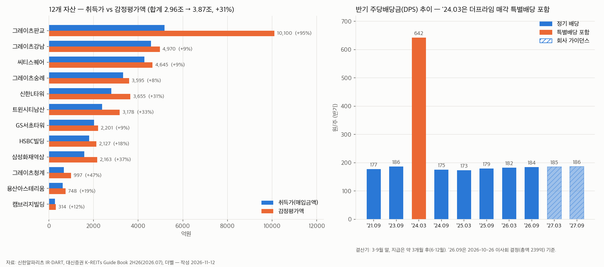

# 신한알파리츠 (293940) — 배경지식 v1: 한국 1호 금융지주 오피스 리츠, 구조부터 숫자까지

> 작성일: 2026-11-12 · 카테고리: 건설및부동산/종목분석 (v1 = 배경지식 위주 개괄. 밸류에이션·투자판단은 v2에서)
> **검증 메모**: 자산 목록·취득가·감정가·차입금·LTV·임대율은 대신증권 《K-REITs Guide Book 2H26》(2026.07.15)과 회사 IR 사이트·DART 공시로 교차 확인. 배당은 DART 금전배당결정 공시(2025.10.28 179원·총 233억, 2026.10.26 총 239억) 기준이며, **'26.09 결산 DPS 184원은 총액÷주식수로 역산한 값 + 회사 가이던스 일치**로 기재(공시 원문 미열람, 확인 필요). 발행주식수는 배당 총액 역산(약 1.30억주)과 5% 보고서 역산(약 1.21억주)이 서로 달라 "약 1.2~1.3억주"로 표기. 시황(기준금리 3.00%, 서울 오피스 공실률)은 2026년 10~11월 보도 기준. 해석·판정 절은 필자 정리(주관 표기).

---

## 0. 아주 쉬운 버전 — 이 회사는 무엇인가

**한 줄**: 신한금융그룹(신한리츠운용)이 굴리는, 서울·판교 프라임 오피스 12채를 담은 상장 리츠. 임대료를 받아 **1년에 두 번(6월·12월) 주당 180원 안팎**을 배당한다. 주가 5,600원대 기준 연 6.5% 안팎.

- **리츠(REITs)** = 부동산을 주식처럼 쪼개 파는 회사. 법으로 이익의 90% 이상을 배당해야 하고, 그 대신 법인세를 안 낸다. 그래서 "건물주의 월세를 주주가 나눠 갖는 구조"
- **신한알파리츠는 어떤 리츠인가** — 세 가지 키워드
 1. **오피스 100%**: 물류·리테일 없이 서울 도심(CBD)·강남(GBD)·판교(BBD) 사무실만. 공실률 2% 안팎
 2. **금융지주 1호**: 2017년 12월 신한금융이 만든 국내 최초 금융지주 계열 리츠. 2018년 8월 코스피 상장(공모가 5,000원)
 3. **외부 매입형 성장**: 대기업 스폰서 리츠(SK·롯데·한화)가 "그룹 사옥을 넘겨받는" 구조라면, 신한알파는 **시장에서 건물을 사서 키운** 리츠. 상장 후 유상증자 5회, 자산 2채 → 12채, 취득가 0.68조 → 2.96조
- **배당 이력**: 상장 후 배당컷 없음. 2024년 3월엔 용산 더프라임 매각차익(약 733억)을 특별배당(주당 642원)으로 지급
- **지금 뭐가 이슈인가**: ① 2028년 판교 핵심 임차인 만기 = 임대료 인상 기회(현재 평당 20만원대 초중반 vs 인근 프라임 30만원대 중반) ② 2026년 4월 제이알글로벌리츠 회생 신청 이후 리츠 섹터 전체가 디레이팅(실적과 무관하게 시장이 매기는 값이 낮아짐) ③ 금리가 올라(기준금리 2.50→3.00%) 차입 비용 부담 — 리츠는 건물값의 절반 이상을 빚으로 사므로 이자가 곧 배당을 깎는다 ④ 보유자산 선별 매각 + 특별배당 검토 중 ⑤ 상장리츠 배당소득 분리과세 입법 대기

---

## 1. 리츠 기초 — 리포트를 읽기 위한 최소 개념

| 개념 | 쉬운 설명 | 신한알파리츠에 대입 |
|---|---|---|
| **위탁관리리츠** | 리츠 회사는 서류상 회사(직원 없음). 자산운용은 **AMC(자산관리회사)**에 맡김 | AMC = 신한리츠운용. 법인명은 '신한알파위탁관리부동산투자회사' |
| **90% 배당 의무** | 배당가능이익의 90% 이상 배당 → 법인세 면제 | 매 결산기 거의 100%+ 배당 |
| **초과배당** | 감가상각비(현금 안 나가는 비용)만큼 이익보다 더 배당 가능(부동산투자회사법) | '25.4~9월 별도 배당성향 110%. 국토부 규제 검토 변수 |
| **자(子)리츠** | 모(母)리츠가 건물별로 작은 리츠를 만들어 그 지분을 보유 → 공동투자·대출 구조화 용이 | 판교 1채만 직접 보유, 나머지 11채는 자리츠. 아스테리움 30.8%·씨티스퀘어 47.5%·신한L타워 80.2%는 **지분 투자** |
| **LTV** | 자산가치 대비 차입금 비율. 낮을수록 안전 | 취득가 기준 78.8%, **감정가 기준 58.6%** (대신 2026.07) |
| **NOI / E.NOC** | NOI = 임대수익 − 운영비. E.NOC = 무상임대 등을 뺀 **실질 순임대료(평당)** | 판교 E.NOC 평당 20만원 초중반, 인근 프라임 30만원 중반 |
| **WALE** | 가중평균 잔여 임대기간. 길수록 현금흐름 안정, 짧을수록 인상 기회 | 3.0년 |
| **P/NAV** | 주가 ÷ 주당 순자산(감정가 − 차입금). 1 미만 = 자산가치보다 싸게 거래 | 약 0.73(더벨 2025.11, 주가 5,580원 기준) |
| **Cap rate** | NOI ÷ 자산가격. 금리가 오르면 cap rate↑ → 건물값↓ | 서울 프라임 오피스 4%대 초중반(통용 근사) |
| **배당소득세** | 일반 15.4%(지방세 포함). 공모리츠 투자금 5천만원 이하·3년 보유 시 9% 분리과세(조특법, 일몰 확인 필요) | 상장리츠 전면 저율 분리과세는 2026년 정부 추진 과제, 미확정 |

**리포트에 자주 나오는 축약어·업계 용어 (위 표에 없는 것)**

| 용어 | 쉬운 설명 | 이 리포트에서 |
|---|---|---|
| **CBD / GBD / YBD / BBD** | 서울 도심권(광화문·시청·을지로·서울역) / 강남권(테헤란로·서초) / 여의도권 / 분당·판교권 | 신한알파는 CBD 51%·BBD 26%·GBD 23%. 여의도 자산 없음 |
| **프라임·A급 오피스** | 규모·입지·연식이 상위인 대형 빌딩. 기관마다 기준이 달라 공실률 수치가 다름 | 12채 모두 프라임~A급 |
| **공실률 / 임대율** | 비어 있는 면적 비율 / 그 반대(100% − 공실률). 5% 안팎은 정상 이사 수요로 생기는 '자연공실' | 포트폴리오 임대율 97.8% |
| **유상증자(유증) / 희석** | 새 주식을 발행해 돈을 모으는 것. 주식 수가 늘어 기존 주주의 지분·주당 배당이 희석됨 | 상장 후 5회. 건물 살 때마다 유증 → 주가 하락 요인 |
| **리파이낸싱(차환)** | 만기가 된 대출을 새 대출로 갈아타는 것. 그때의 시장금리가 적용됨 | 2026.04 판교 2.7→4.3%. 2027년 만기 43%가 다음 차례 |
| **bp(베이시스포인트)** | 0.01%p. 100bp = 1%p | "민평 +20bp" = 0.2%p 높게 조달 |
| **CD91 / 고정·변동금리** | CD91 = 은행 양도성예금증서 91일물 금리, 변동금리 대출의 기준. 고정은 만기까지 금리 동일, 변동은 3개월마다 CD에 맞춰 변동 | 변동 19%가 "CD + 1.4~1.8%p" |
| **신용등급 A- / 민평** | 신평사가 매기는 등급(AAA > AA > A+ > A0 > A- > BBB+). 민평 = 민간채권평가사가 매긴 그 등급의 적정금리 | A-(2024.06 상향). A0 되면 3%대 조달 목표 |
| **구분소유** | 건물 전체가 아니라 특정 층만 소유. 매각·관리가 번거로움 | 삼성화재역삼 10~20층, 캠브리지. 매각 1순위 후보 |
| **앵커 임차인(앵커 테넌트)** | 건물 대부분을 쓰는 핵심 세입자. 나가면 그 건물 공실 급증 | 씨티스퀘어의 서울시청(80%), L타워의 신한라이프 |
| **렌트프리** | 계약 시 "첫 N개월 임대료 면제" 같은 무상임대. 공실이 늘면 임대인이 늘림 = 숨은 임대료 인하 | E.NOC는 이걸 뺀 실질 임대료 |
| **재계약 / 임대차 만기** | 사무실 임대는 보통 2~5년 계약. 만기에 시장가로 다시 협상 | 2026~28년 면적의 56~59% 만기, 2028 판교 2.1만평 |
| **IRR** | 내부수익률. 투자 기간 전체를 연환산한 수익률 | 더프라임 매각 IRR 22% = 5년간 연 22%씩 번 셈 |
| **결산기 / 기준일 / DPS** | 결산기 = 배당을 계산하는 6개월 단위(3·9월 말). 기준일 = 이 날 주주명부에 있어야 배당 받음. DPS = 주당 배당금 | 17기('26.04~09) DPS 184원, 기준일 12.14 |
| **가이던스** | 회사가 미리 제시한 목표치 | 2027년 185·186원 |
| **디레이팅 / 리레이팅** | 실적은 그대로인데 시장이 매기는 값(P/NAV, 배당률)이 낮아짐 / 높아짐 | 제이알 사태 후 섹터 디레이팅, 분리과세 통과 시 리레이팅 재료 |
| **캐시트랩** | 해외 자산의 대출 약정 때문에 현금이 현지 법인에 묶여 모회사로 못 올라오는 상태 | 제이알글로벌리츠 회생 원인. 신한알파는 해당 없음 |
| **스폰서 리츠** | 대기업이 자기 그룹 건물을 넣고 그룹이 임차인이 되는 리츠(SK·롯데·한화) | 신한알파는 스폰서가 금융사라 "건물을 사서 키우는" 구조 |
| **FTSE EPRA Nareit / 패시브** | 글로벌 부동산 지수. 편입되면 이 지수를 그대로 따라 사는 해외 펀드(패시브)가 자동 매수 | 2024.03 편입 |
| **조특법 / 분리과세** | 조세특례제한법 = 세금 감면 특례법. 분리과세 = 다른 소득과 합산(종합과세, 최고 49.5%)하지 않고 낮은 단일세율로 끝내는 것 | 공모리츠 5천만원 한도 9.9%는 이미 있음. 상장리츠 전면 저율 분리과세는 미입법 |
| **시총(시가총액)** | 주가 × 발행주식수 = 회사 전체의 시장 가격 | 약 7천억원 |

## 2. 연혁 — 2채로 시작해 12채가 되기까지

| 시점 | 사건 | 메모 |
|---|---|---|
| 2017.12 | 발기설립(자본금 3억) | 신한금융지주 주도 |
| 2018.04 | **그레이츠판교**(옛 알파돔타워IV/크래프톤타워) 취득 5,182억 | 지금도 포트폴리오의 핵심 |
| 2018.08 | 코스피 상장, 공모가 5,000원 | |
| 2018.10 | 용산 더프라임타워 취득 | → 2023.08 매각(2,384억, 차익 733억, IRR(연환산 수익률) 22%) |
| 2019.01 | 1차 유상증자 952만주 | 더프라임 지분 76→100% |
| 2020.03~09 | 그레이츠청계(680억)·트윈시티남산(2,386억)·신한L타워(2,798억) 취득, 2차 유증 470만주 | 신한L타워는 미래에셋 펀드와 공동투자 |
| 2021.03~09 | 삼성화재 역삼빌딩(1,584억)·그레이츠숭례(3,330억) 취득 | |
| 2022.04~07 | 3차 유증 2,150만주, 캠브리지빌딩(280억, 구분소유) 취득 | |
| 2023.04~11 | 4차 유증 1,427만주, 용산아스테리움(627억, 지분 30.8%)·HSBC빌딩(1,810억) 취득, 더프라임 매각 | |
| 2024.03 | FTSE EPRA Nareit 지수 편입 | 글로벌 패시브 자금 유입 통로 |
| 2024.06~11 | GS서초타워(2,023억) 취득, **신용등급 A-**(BBB+에서 상향), 5차 유증 3,284만주, 씨티스퀘어(4,281억, 지분 47.5%) 취득 | |
| 2025.05~06 | 주총서 회사채 한도 3,500억 승인, **그레이츠강남**(옛 BNK디지털타워, 4,578억·평당 4,070만원) 취득 | 12번째 자산 |
| 2026.04 | 그레이츠판교 리파이낸싱: 4,850억→5,750억, 금리 2.7%→4.3% | 자산가치 7,702억('20.12)→1.1조('26.02) |
| 2026.07 | 한기평 신용등급 A- 유지 | A0 상향 시 3%대 조달 가능(회사 목표) |

**패턴**: "1~2년에 1채 매입 + 유증"을 8년간 반복. 유증(새 주식 발행)은 기존 주주의 지분과 주당 배당을 희석하는 요인이라 2025년부터 "증자는 시총의 20% 이하, 가급적 차입·매각 재원으로" 방침 전환(삼성증권 2026.01 "유상증자 계획 없음").

## 3. 보유 자산 12채 — 어디에 무엇이 있나

| # | 자산 | 권역 | 취득 | 연면적(평) | 취득가(억) | 감정가(억) | 임대율 | 특징 |
|---|---|---|---|---|---|---|---|---|
| 1 | **그레이츠판교** | BBD(판교) | 2018.04 | 30,146 | 5,182 | **10,100** | 100% | 판교역 직결, 크래프톤·현대제철 등. 포트폴리오의 간판 |
| 2 | 그레이츠청계 | CBD | 2020.03 | 2,688 | 680 | 997 | 92% | 종각역, 2018 리모델링 |
| 3 | 트윈시티남산 | CBD(서울역) | 2020.08 | 11,360 | 2,386 | 3,178 | 100% | 서울역 지하 직결 |
| 4 | 신한L타워 | CBD(을지로) | 2020.09 | 9,327 | 2,798 | 3,655 | 100% | **신한라이프 본사** 장기임차. 리츠 지분 80.2% |
| 5 | 삼성화재 역삼빌딩 | GBD | 2021.03 | 5,279 | 1,584 | 2,163 | 100% | 강남역 1분, 10~20층 구분소유. 삼성화재·삼성카드 |
| 6 | 그레이츠숭례 | CBD(서울역) | 2021.09 | 12,802 | 3,330 | 3,595 | 98% | 세종대로변 |
| 7 | 캠브리지빌딩 | GBD | 2022.07 | 903 | 280 | 314 | 79% | 강남역 2분, 소형 구분소유 |
| 8 | 용산아스테리움 | 용산 | 2023.05 | 3,065 | 627 | 748 | 77% | 2~8층, 지분 30.8%. **가장 낮은 임대율** |
| 9 | HSBC빌딩 | CBD(서울역) | 2023.11 | 7,506 | 1,810 | 2,127 | 91% | 고층부 소유, 저층은 HSBC 자가 |
| 10 | GS서초타워 | GBD(서초) | 2024.06 | 9,010 | 2,023 | 2,201 | 100% | GS건설 연구소 40% |
| 11 | 씨티스퀘어 | CBD(시청) | 2024.07 | 11,571 | 4,281 | 4,645 | 100% | **서울시청 제3청사** 80%, 지분 47.5%, LEED 플래티넘 |
| 12 | 그레이츠강남 | GBD(서초대로) | 2025.06 | 11,248 | 4,578 | 4,970 | 95% | 옛 BNK디지털타워, 강남역 4분 |
| | **합계** | CBD 51%·BBD 26%·GBD 23% | | | **29,559** | **38,693** | **97.8%** | 감정가/취득가 +31% |

*자료: 대신증권 2H26 가이드북(2026.07), 회사 IR. 합계 취득가 2조9,559억·감정가 3조8,693억은 블로터(2026.05) 기준. 지분 투자 자산은 100% 기준 금액이므로 지분 조정 AUM은 이보다 작다(더벨 2025.11: 지분 조정 감정가 약 3.2조).*

**읽는 법 3가지**
- **판교 한 채가 절반**: 감정가 1.01조로 전체의 26%, 평가차익(+4,900억)의 절반 이상이 판교에서 나왔다. 판교 임대료·임차인 뉴스 = 이 리츠의 뉴스
- **임차인이 '기관'**: 서울시청·신한라이프·삼성화재·GS건설·HSBC 등 신용도 높은 장기 임차인 비중이 큼 → 공실 위험 낮음. 단, 그룹 앵커 테넌트(스폰서가 통째로 빌리는 구조)는 없어 **재계약 협상력이 곧 실적**
- **구분소유·지분 투자 자산은 매각 1순위 후보**: 회사 스스로 "초기 편입 자산·구분소유 자산 중심 선별 매각" 방침

## 4. 돈의 흐름 — 임대료에서 배당까지

### 4-1. 수입: 임대료는 오르는 중
- 2025년 전체 연면적의 34%(약 3.8만평)를 신규·재계약 → **E.NOC +29.0%**(임대료 +32.6%, 관리비 +19.1%). 2024년에도 42건·7,430평 임대조건 32.8% 개선
- **2026~2028년 면적의 56~59%가 만기**: 특히 2028년 그레이츠판교 2.1만평(크래프톤 등). 현대제철은 2027~2032년 5년 재계약을 미리 체결하며 NOC 약 50% 인상(대신증권 추정)
- 반기 NOI는 2기('18.10~'19.03) 177억 → 12기('23.10~'24.03) 458억으로 2.6배(더벨)

### 4-2. 비용: 이자가 핵심 변수
| 항목 | 수치 (대신 2026.07) |
|---|---|
| 총차입금 | **2.26조원** |
| 가중평균 금리 | **4.18%** (2026.01 3.76% → 상승) |
| 고정 : 변동 | 81% : 19% (변동은 CD91 연동, CD+1.4~1.8%p) |
| 만기 분포 | 2026년 14.7% · **2027년 43.2%** · 2028년 16.7% · 2029년 25.3% |
| 주요 대출 | 판교 5,750억 4.3%('29.04), 강남 3,080억 3.9%('27.06), 씨티스퀘어 2,800억 4.75%('27.07), 숭례 2,540억('26.09 만기·리파이낸싱 대상) |
| 금리 민감도 | 회사 설명: 금리 1%p 하락 시 연 이자 약 35억 절감(배당 재원 약 27원/주 상당, 필자 계산) |

- 2026년 7·8월 기준금리 연속 인상(2.50→3.00%)으로 **리파이낸싱 금리가 3%대 후반~4%대**로 올라옴. 2027년 만기 집중(43%)이 다음 배당의 최대 변수
- 신용등급 A-(민평 +20bp = 같은 등급 적정금리보다 0.2%p 높게 조달, 3년물 4.5% 안팎). A0로 오르면 3%대 조달 가능 — 회사의 숙원

### 4-3. 배당: 상장 후 한 번도 깎지 않았다
| 결산기 | 기간 | DPS(원) | 비고 |
|---|---|---|---|
| 7기 | '21.04~09 | 177 | |
| 11기 | '23.04~09 | 186 | |
| 12기 | '23.10~'24.03 | **642** | 더프라임 매각 특별배당 포함(연환산 25.7%) |
| 13기 | '24.04~09 | 175 | 리파이낸싱 금리 상승으로 소폭 감소 |
| 14기 | '24.10~'25.03 | 173 | |
| 15기 | '25.04~09 | 179 | 총 233억, '25.12 지급 |
| 16기 | '25.10~'26.03 | 182 | 총 237억(감가상각 초과배당 18억 포함), '26.06.12 기준일 |
| 17기 | '26.04~09 | **184(역산·가이던스)** | 2026.10.26 이사회 총액 239억 결정, 기준일 12.14, 12월 말 지급 예정 |
| 가이던스 | '27.03 / '27.09 | 185 / 186 | 회사 제시(2026년 연 366원 → 2027년 371원) |

- 공모가 5,000원 기준 누적 배당 2,442원(12기까지, 더벨) → 상장 6년 만에 원금의 절반 회수
- 상장 시 약속한 수익률 로드맵: 2018년 5%대 → 2021~22년 7%대 → 2026~27년 최고 9.3%. 특별배당 제외 시 현재 연 6.5~7% 수준이라 **로드맵엔 못 미치지만 배당컷은 없었다**
- 배당수익률(연 366원 ÷ 5,650원) ≈ **6.5%**. 5개년 평균 7.2%(특별배당 포함, 대신)

## 5. 지배구조·주주 — 누가 주인인가

- **AMC 신한리츠운용**(신한금융지주 100% 자회사, 2027.01 신한자산신탁에 흡수합병 예정). 신한은행·신한투자증권이 비즈니스 파트너(대출·판매). 즉 **스폰서=신한금융**이지만 그룹 사옥 리츠가 아니라 그룹의 '부동산 금융 플랫폼'
- **주요 주주(2026)**: 미래에셋자산운용 20.6%('26.08, 2월 15%에서 꾸준히 확대), 삼성자산운용 5.0%('26.02 신규). 신한 계열 지분은 5% 보고 기준으로 드러나지 않음(사업보고서 확인 필요). 2019년엔 유진자산운용 8.6%·한화손보 6.3%·신한리츠운용 5.7% 등 기관 분산
- **발행주식 약 1.2~1.3억주, 시총 약 7천억원**(주가 5,650원 기준). 상장리츠 중 상위권 시총이지만 한화리츠·SK리츠 등 대기업 스폰서 리츠보다 작음

## 6. 2026년의 리츠 시장 — 신한알파를 둘러싼 날씨

| 변수 | 상황 (2026.11 기준) | 신한알파에의 의미 |
|---|---|---|
| **제이알글로벌리츠 회생 신청(4.27)** | 벨기에 자산 캐시트랩(현지 대출 약정으로 현금이 묶여 본사로 못 올라옴) → 단기사채 400억 미상환. 이후 상장리츠 시총가중 -26.9%(6월 말까지), 신한알파도 -17% | 해외자산 0%인데도 섹터 동반 하락 = **펀더멘털과 무관한 디스카운트** |
| **기준금리** | 2.50% → 7·8월 연속 인상 → **3.00%**(10.22 동결, 11.26 추가 인상론) | 리파이낸싱 비용↑, 리츠 요구수익률↑. NH투자는 무위험수익률 3.0→3.4%로 목표가 하향(8,000→7,400) |
| **서울 오피스 공실률** | A급 3~6%(기관별: CBRE 3.1%, 쿠시먼 5.0%, JLL 5.8%). CBD 7%대, GBD 1~3%. 임대료 전년비 +4~5%, 강남 +12% | 2028년까지 신규 공급 제한 → 임대료 협상력 유지 |
| **국토부 리츠 재무구조 개선 검토** | 제이알 사태 계기로 감가상각 초과배당·유동성 규제 검토(공식 발표 없음) | 초과배당 제한 시 DPS 수원 감소 가능(16기 기준 18억≈14원/주) |
| **상장리츠 배당소득 분리과세** | 2026.01 경제성장전략에 '저율 분리과세 추진' 명시. 리츠협회 "2천만원 이하 9%" 건의(7월). 8월 세제개편안 확정 여부 미확인 | 통과 시 고액 배당투자자 수요 유입 = 섹터 리레이팅 재료 |
| **섹터 양극화** | 국내자산·대기업 스폰서 리츠(한화·삼성FN·SK·롯데) 강세 vs 해외자산 리츠 급락 | 신한알파는 '국내 오피스·금융사 계열'로 중간 지대 |

## 7. 팩트체크 — 흔한 오해 5개

| 통념 | 팩트체크 |
|---|---|
| "신한알파리츠 = 신한은행 지점 건물 리츠" | **아님.** 그룹 사옥은 신한L타워(신한라이프) 1채뿐. 나머지는 시장에서 매입한 제3자 건물(서울시청·삼성·GS·HSBC 임차) |
| "리츠는 배당률만 보면 된다" | 배당은 임대료 − 이자. **총차입 2.26조·금리 4.18%**라 금리 1%p가 배당 약 27원/주를 흔든다. 배당률 뒤의 LTV·만기 분포를 봐야 함 |
| "연 9% 배당 약속" | IPO 때 제시한 2026~27년 최고치 로드맵. 실제 정기 배당은 연 6.5~7%대. 9%는 특별배당이 있던 해에만 달성 |
| "제이알 사태로 신한알파도 위험" | 해외자산 0%, 캐시트랩 구조 없음, 신용등급 A-. 주가 하락은 섹터 심리 전이. 단 **2027년 차입 만기 43% 집중**은 실제 리스크 |
| "감정가 3.87조 − 차입 2.26조 = NAV 1.6조, 시총 0.7조니 절반값" | 감정가 합계는 **지분 100% 기준**. 지분 조정하면 감정가 약 3.2조, NAV 약 0.93조, P/NAV 약 0.73(더벨 2025.11). 싸긴 하지만 '절반'은 과장 |

## 8. 투자자용 체크리스트 — v2에서 파고들 것 (주관)

1. **2028 판교 재계약**: 크래프톤 등 2.1만평 임대료를 평당 20만원대 → 30만원대로 올리면 NOI가 어느 정도 늘고 DPS로 얼마가 되는가 (현대제철 선례 +50%)
2. **2027년 만기 43%의 리파이낸싱 금리**: 기준금리 경로(11.26 금통위)와 A0 상향 여부
3. **매각·특별배당**: 청계·남산·L타워·역삼·숭례 5개 자산 매각 검토(seoulpi 2026). 2026.11.12 현재 매각 공시는 확인되지 않음. 매각 시 재투자 vs 특별배당 비중
4. **초과배당 규제**: 국토부 제도 개선안 발표 여부
5. **분리과세 입법**: 조특법 개정 시 적용 시점(2026 vs 2027 귀속)
6. **P/NAV 0.7대 디스카운트 해소 촉매**: 자산 재평가(회사 준비 중), FTSE EPRA Nareit 패시브 수급, 신한자산신탁 합병 후 AMC 체제 변화

---

## 참고 (검증 출처)

- 신한알파리츠 IR 사이트 (연혁·구조도·자산 상세·공고): https://shalphareit.com/kr/
- DART 공시: 부동산투자회사 금전배당결정 2026.10.26(총액 23,904,982,632원), 주주명부폐쇄 기준일 2026.12.14 / 2025.10.28(179원, 총 233억)
- 대신증권 《K-REITs Guide Book 2H26》 2026.07.15 — 자산표·차입금·LTV·임대차·배당 가이던스
- 더벨 〈신한알파리츠, 배당컷 '전무'…2026년 '연 9%' 도전〉 2024.07 / 〈'그레이츠 판교' 몸값 얼마나 뛰었을까〉 2025.11 (P/NAV 0.727)
- 블로터 〈회사채 발행한도 3500억…사업계획〉 2025.05 / 〈초과배당 규제 변수 '촉각'〉 2026.05.14
- 이투데이 NH투자증권 노트 2026.05.22 (목표가 7,400원) · 삼성증권 2026.01.16 (목표가 7,800원, 유증 계획 없음) · 핀포인트뉴스 2026.03.07 (판교 현대제철 재계약)
- 머니투데이·한국경제 BNK디지털타워 매각 2025.06 (4,578억, 평당 4,070만원)
- seoulpi 〈2026년 K리츠 시장 동향 — 편입과 매각〉 2026 (5개 자산 매각 검토)
- 한국은행 2026.10.22 금통위(기준금리 3.00%) · 쿠시먼앤드웨이크필드·JLL·CBRE·뉴마크 3Q26 서울 오피스 리포트
- 리츠 분리과세: 더벨 2026.01.15, 뉴스핌 2026.07.08, 서울경제 2026.01.16
