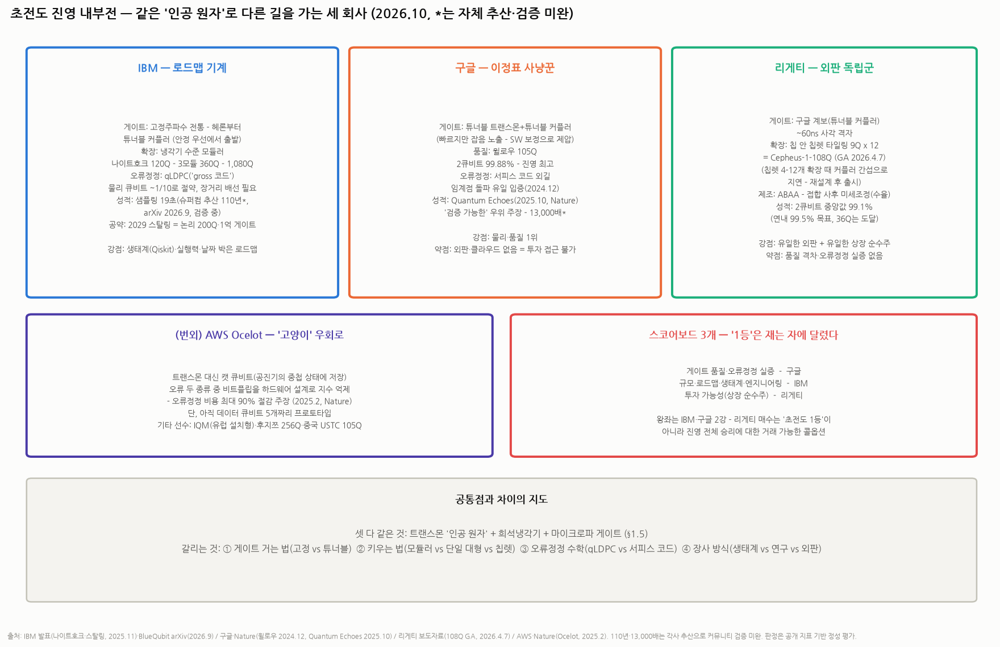

# 배경지식 — 양자컴퓨터 작동 방식 유형별 지도: 6+1 진영, 선수 명단, 그리고 같은 진영 안의 차이

> 작성일: 2026-10-12 · 카테고리: 해외주식/배경지식 (☞ `종목분석/리게티컴퓨팅_심층분석리포트`의 배경지식편)
> **검증 메모**: 2026년 각 진영 최신 좌표(IBM 나이트호크 120Q·2026 말 '검증된 양자우위' 목표·2029 FT 목표, 퀀티뉴엄 헬리오스 98Q·2큐비트 피델리티 99.921%·논리 48큐비트, IonQ 템포 64AQ, QuEra 논리 96큐비트 보고, PsiQuantum 브리즈번·시카고 센터 착공, MS 마요라나 1(8Q), 리게티 Cepheus-108Q·99.1%)는 업계 2차 소스(Quantum Insider·Quantumzeitgeist 등) 종합 — **일부 수치는 소스 간 충돌(QuEra 원자 수 등)이 있어 * 표기**. 물리 원리 설명은 표준 지식. 승자 전망류 서술은 주관 표기.

---

## 0. 아주 쉬운 버전 — 전체 그림 먼저

양자컴퓨터의 공통 과제는 하나다: **"양자 상태(중첩·얽힘)를 유지하는 '큐비트'를 어떻게 물리적으로 만들고, 오래 살려두고, 정확히 조작하느냐"**. 이 '어떻게'의 답이 6개 진영으로 갈라져 있고, 아직 승자가 정해지지 않았다 — 비유하면 **1900년대 초 자동차 산업**이다: 증기차·전기차·가솔린차가 공존했고, 당시엔 어느 엔진이 이길지 아무도 몰랐다.

읽는 데 필요한 용어 둘만 먼저:
- **피델리티**: 연산 1회의 정확도. 99%와 99.9%는 오류율 10배 차이 — 큐비트 '수'보다 중요한 품질 지표
- **논리 큐비트**: 물리 큐비트 여러 개(수십~수천 개)를 묶어 오류정정한 '진짜 쓸 수 있는' 큐비트 — 업계의 진짜 스코어보드는 이제 물리 개수가 아니라 **논리 큐비트 수**로 넘어가는 중

---

## 1. ① 초전도 — 주류 1강 (IBM·구글·리게티)

- **원리**: 금속 회로를 절대영도 근처(-273°C)로 식히면 저항이 0이 되고(초전도), 그 회로를 도는 전류가 양자적으로 행동한다 — 이 '인공 원자'가 큐비트. 마이크로파 펄스로 조작한다
- **장점**: 게이트 속도 최강(나노초 — 이온트랩의 수천 배), 반도체 공정으로 제작(집적·양산 친화), 가장 성숙한 생태계
- **단점**: 거대한 희석냉각기(샹들리에처럼 생긴 그것) 필수, 큐비트 수명이 짧아(마이크로초) 빠른 오류정정 필수, 칩이 커질수록 배선 지옥
- **같은 진영 안의 차이 (질문의 핵심)**:
 - **IBM — '로드맵 기계'**: 매년 로드맵을 공표하고 기계처럼 집행하는 정공법. 나이트호크(120Q, 사각 격자 — 기존 헤비헥스보다 회로 깊이에 유리)로 2026년 말 '검증된 양자우위', **2029년 결함허용(FT) 컴퓨터**(스탈링)가 공약. 강점은 소프트웨어(Qiskit)+기업 생태계
 - **구글 — '이정표 사냥꾼'**: 판매보다 과학 이정표에 집중 — 2019 양자우위 선언, 2024 **윌로우**(오류정정의 핵심 증명: 큐비트를 늘릴수록 논리 오류가 '줄어드는' 임계점 통과). 상업화는 느긋, 연구는 최선두
 - **리게티 — '외판하는 독립군'**: 셋 중 유일하게 **칩·시스템을 외부에 판다**(Novera·Cepheus). 전략도 다름 — 큰 칩 대신 **9큐비트 칩렛을 타일링**(12개=108Q)해 수율로 승부. 체급(R&D 자금)은 거인의 수십 분의 1 (☞ 리게티 리포트)
 - 기타: IQM(유럽 관학 시장), 중국 오리진·USTC(주쿵즈 계열)
- **투자 접근**: IBM·구글은 양자가 주가에 '옵션'일 뿐인 거대 기업 — 순수 노출은 리게티가 사실상 유일한 상장 초전도 순수주

### 1.5 심화 — 초전도 큐비트는 정확히 어떻게 작동하나 (단계별 해설, 배경지식 0 기준)

**[1] 먼저 큐비트가 뭔지부터.** 고전 비트는 동전이 책상에 놓인 상태다 — 앞(0) 아니면 뒤(1). 큐비트는 **지구본에 꽂힌 화살표**다 — 북극(0)과 남극(1)뿐 아니라 그 사이 어디든 가리킬 수 있다(중첩). 단, 측정하는 순간 화살표는 북극 아니면 남극으로 '찰칵' 쓰러지고, 어디로 쓰러질지의 확률만 화살표 방향이 정한다. 양자컴퓨터는 이 화살표들을 측정 전에 정교하게 돌리고 서로 얽어서, 쓰러뜨렸을 때 정답이 높은 확률로 나오게 안무를 짜는 기계다.

**[2] 큐비트의 자격 = '2칸짜리 에너지 계단'.** 물리적으로 큐비트가 되려면 에너지 상태가 딱 두 개(바닥층=0, 1층=1)인 시스템이 필요하다. 자연의 원자는 이 계단을 공짜로 준다(이온트랩이 그걸 쓴다). 초전도 방식의 야심은 — **전기 회로로 그 계단을 '제작'하겠다**는 것. 그래서 초전도 큐비트의 별명이 **'인공 원자'**다.

**[3] 왜 하필 초전도인가 — 군중을 군무로.** 보통 전선 속 전자 수십억 개는 제각각 움직이는 군중이라, 양자적 성질이 서로 상쇄돼 사라진다. 그런데 특정 금속(알루미늄·나이오븀)을 극저온으로 식히면 전자들이 둘씩 짝을 지어(쿠퍼쌍) **수십억 개가 마치 하나의 파동처럼** 움직인다 — 저항 0(초전도)이 되면서, 손톱만 한 회로 전체가 '하나의 양자 입자처럼' 행동하게 된다. 군중이 한 몸처럼 군무를 추기 시작하는 것 — **눈에 보이는 크기의 물체에서 양자역학을 꺼내 쓰는 유일한 방법**이 이것이다.

**[4] 전기 그네를 만든다 (LC 회로).** 코일(L)과 축전기(C)를 이으면 전류가 좌우로 왔다갔다 진동하는 '전기 그네'가 된다. 양자 세계에서 진동의 에너지는 연속이 아니라 계단식인데 — 문제가 하나 있다: 보통 LC 회로의 **계단은 간격이 전부 똑같다**(0→1층과 1→2층이 같은 높이). 그러면 0→1로 올리려고 민 에너지가 1→2, 2→3으로도 줄줄이 올라가 버려서, '아래 두 칸만' 쓸 수가 없다.

**[5] 조셉슨 접합 — 이 방식의 심장.** 해결책: 초전도체 두 조각 사이에 나노미터 두께의 절연막을 끼운 부품(**조셉슨 접합** — 쿠퍼쌍이 막을 '터널링'으로 통과한다). 이게 회로에서 **비선형 스프링** 역할을 해서, 에너지 계단의 간격을 **불균등하게** 만든다 — 0→1층 간격과 1→2층 간격이 달라진다. 이제 0→1층 간격에 '정확히 맞는' 에너지만 쏘면 **아래 두 칸만 선택적으로 오르내릴 수 있다.** 이 순간, 전기 회로가 '2칸 계단을 가진 인공 원자'가 된다 — 초전도 큐비트의 탄생이다(현재 표준 설계가 '트랜스몬', 2007년 예일대 발명).

**[6] 조작 = 그네를 공명 주파수로 밀기.** 계단 간격에 해당하는 주파수(통상 ~5GHz 마이크로파 — 와이파이의 2배쯤)의 펄스를 쏘면 0↔1이 뒤집힌다. **펄스를 절반 길이만 쏘면?** 화살표가 적도에 멈춘다 — 그게 중첩이다. 즉 게이트 연산이란 '마이크로파 펄스의 주파수·세기·길이를 조각하는 일'이고, 나노초면 끝난다 — **초전도가 속도 1등인 이유**. 2큐비트 게이트(얽힘)는 이웃 큐비트 사이의 커플러 회로를 잠깐 열어 두 그네가 서로 영향을 주게 만드는 것.

**[7] 읽기 = 종을 울려 음높이 듣기.** 큐비트 옆에 작은 공진기(종)를 붙여 두면, 큐비트가 0이냐 1이냐에 따라 그 종의 공명 주파수가 미세하게 달라진다. 약한 마이크로파를 흘려 '종소리의 음높이'를 들으면 큐비트를 직접 건드리지 않고 상태를 읽을 수 있다.

**[8] 왜 -273°C인가 — 속삭임을 들으려면 도서관이 필요하다.** 계단 간격 5GHz를 온도로 환산하면 약 0.24K(켈빈)다. 주변 온도가 이보다 높으면 **열 잡음이 멋대로 큐비트를 1층으로 밀어 올린다** — 상온(300K)은 간격의 1,200배가 넘는 소음이다. 그래서 간격의 1/20 수준인 **~15mK(밀리켈빈)**까지 식힌다 — 우주 배경(2.7K)보다 100배 이상 차가운, 희석냉각기(그 샹들리에)의 바닥층. 비유: 5GHz 속삭임을 들으려면 콘서트장(상온)이 아니라 절대 정적의 도서관이 필요하다.

**[9] 그래도 큐비트는 금방 죽는다 — 디코히어런스.** 외부(불순물·배선·우주선 입자까지)와 조금만 얽혀도 중첩이 깨진다. 초전도 큐비트의 수명은 **~100마이크로초** 수준 — 찰나다. 그런데 게이트가 나노초라, 죽기 전에 수천~수만 번 연산이 가능하다. **초전도의 본질 전략 = '짧은 수명을 압도적 속도로 보상'**이다 (이온트랩은 반대로 '긴 수명, 느린 속도').

**[10] 이걸 알면 리게티의 칩렛 전략이 이해된다.** 인공 원자의 숙명적 약점 — 자연 원자와 달리 **하나하나가 공장 제작품이라 미세하게 다 다르다**(접합 두께 1nm 편차가 주파수를 바꿈). 큐비트 수백 개짜리 큰 칩은 하나라도 불량이면 통째로 버려야 해서 수율이 급락한다. 그래서 리게티는 9큐비트짜리 작은 칩을 검사해서 좋은 것만 타일처럼 이어 붙인다(12개=108Q) — 반도체 칩렛과 똑같은 수율 논리다. 또한 [6]의 '펄스 조각'이 곧 제어 전자장치 비용이라, 큐비트가 늘수록 배선·제어가 지옥이 되는 것(확장성 ★★의 이유)까지 — 이 방식의 장점과 약점 전부가 '인공 원자'라는 한 단어에서 나온다.

### 1.6 심화 — 초전도 진영 내부전: 같은 트랜스몬인데 뭐가 다른가, 누가 앞서나

모두 §1.5의 트랜스몬('인공 원자') 계열 + 희석냉각기를 쓴다는 점은 같다. 차이는 네 겹에서 난다: **① 게이트를 거는 방식 ② 칩을 키우는 전략 ③ 오류정정 코드(= 어떤 수학으로 '안 죽는 논리 큐비트'를 조립할 것인가) ④ 비즈니스 모델**.

**IBM — 안정 우선에서 출발한 '로드맵 기계'**
- **게이트 방식**: 전통적으로 **고정주파수 트랜스몬**(큐비트의 계단 간격을 제조 때 고정) — 주파수를 흔드는 자기장(플럭스) 잡음을 원천 차단해 안정성이 높은 대신, 2큐비트 게이트가 느렸다(크로스 레조넌스, 수백 ns). 헤론(2023)부터 **튜너블 커플러**(이웃 큐비트 사이의 '스위치' 회로)를 도입해 속도를 끌어올렸고, **나이트호크**(2025.11 발표, 120Q)는 격자를 헤비헥스→**사각 격자**로 바꿔(튜너블 커플러 218개) 한 회로에 **2큐비트 게이트 5,000개**까지 담게 했다
- **확장**: 모듈러 — 나이트호크를 3모듈(360Q)→9모듈(1,080Q)로 '레고처럼' 이어 붙이는 로드맵. 리게티의 칩렛(칩 안에서 타일링)과 달리 **냉각기 수준에서 모듈을 연결**하는 더 큰 단위의 모듈화
- **오류정정(차별점의 핵심)**: 구글식 서피스 코드가 아니라 **qLDPC(바이베리엇 바이시클, 통칭 'gross 코드')** — 같은 논리 큐비트를 만드는 데 물리 큐비트가 **약 10분의 1**로 줄어드는 대신, 멀리 떨어진 큐비트끼리의 장거리 배선이 필요하다(룬 칩이 그 배선 실험용). 2025년에 **480ns 실시간 디코딩**(오류를 죽기 전에 해독하는 속도)도 입증. 2029년 **스탈링 = 오류정정된 논리 큐비트 200개로 1억 게이트 실행**이 공약
- **2026 현재 성적**: 나이트호크 r2에서 랜덤 회로 샘플링 100만 개를 19초에 생성 — 저자들 추산으로 슈퍼컴(프론티어) **약 110년** 분량이라는 arXiv 논문(2026.9, BlueQubit — 커뮤니티 검증 진행 중). IBM의 목표는 "2026년 말까지 커뮤니티가 검증한 양자우위"

**구글 — 품질·물리 외길의 '이정표 사냥꾼'**
- **게이트 방식**: **튜너블 트랜스몬 + 튜너블 커플러**(시커모어 계보) — 큐비트 주파수 자체를 자기장으로 움직여 게이트가 수십 ns로 빠르다. 대신 플럭스 잡음에 노출되는데, 이를 정교한 보정 소프트웨어로 제압하는 접근. 윌로우(105Q) 공개 수치: **1큐비트 99.97% / 2큐비트(얽힘) 99.88% / 읽기 99.5%** — 초전도 진영 최고 품질
- **오류정정**: **서피스 코드** 외길 — 2024.12 윌로우에서 **코드를 키울수록(3×3→5×5→7×7) 논리 오류가 절반씩 줄어드는 '임계점 돌파'를 업계 최초로 입증**. "갈아태우기 전략이 수학적으로 작동한다"는 존재 증명으로, 아직 이걸 해낸 곳은 구글뿐
- **2026 현재 성적**: 2025.10 **Quantum Echoes**(OTOC 알고리즘, 윌로우 65Q 사용) — 연산을 앞으로 돌렸다 뒤로 되감는 방식으로 "**검증 가능한** 양자우위"를 주장(슈퍼컴 추정 ~3.2년 vs 2.1시간, 약 13,000배, Nature 게재). '검증 가능'이 핵심 — 2019년 우위 주장과 달리 다른 양자컴퓨터로 재현·확인할 수 있는 과제라는 것(타 기기 재현은 아직 대기 중)
- **비즈니스**: 칩 외판 없음, 클라우드 상업화도 느긋 — 사실상 알파벳의 사내 연구소. 투자자가 직접 노출을 살 방법이 없다

**리게티 — 수율로 승부하는 '외판 독립군'**
- **게이트 방식**: 구글과 같은 계보(튜너블 커플러 + 사각 격자), 게이트 **~60ns**
- **확장(차별점 ①)**: §1.5-[10]의 **칩렛 타일링** — 9Q 칩을 선별해 12개 연결(Cepheus-1-108Q). 단, 그 길도 쉽지 않았다: 108Q는 칩렛 수를 4→12개로 늘리자 **커플러 간 간섭이 새로 튀어나와 GA가 지연**됐고, 재설계 후 **2026.4.7 정식 출시**(자사 클라우드+아마존 Braket). 칩렛 확장의 난이도를 보여준 사례
- **제조(차별점 ②)**: **ABAA**(교류 바이어스 어닐링) — 완성된 접합에 전기 신호를 걸어 주파수를 **사후 미세조정**하는 제조 기술. '인공 원자의 개체 차'라는 §1.5-[10]의 문제를 공정 단계에서 깎아내는, 리게티가 내세우는 수율 기술
- **성적**: 108Q 기준 **2큐비트 중앙값 99.1%**(1큐비트 99.9%), 연내 99.5% 목표(36Q 버전은 이미 99.5% 도달). 구글 99.88%와의 격차가 곧 기술 격차 — 오류정정 임계점 실증도 아직 없다
- **비즈니스(차별점 ③)**: 셋 중 유일하게 **시스템을 외판**(Novera 9Q 등) + 유일한 상장 순수주

**보론 — 왜 리게티에는 오류정정 코드가 없나: 아직 '입장 커트라인' 전이다**
- 오류정정은 함정이 있다: 감시자도 큐비트라 **감시자도 실수한다**. 팀원 각자의 오류율이 임계점보다 높으면 묶을수록 실수가 복구보다 빨리 쌓여 **묶는 게 오히려 독** — 그래서 오류정정은 물리 피델리티가 커트라인을 넘어야 시작되는 게임이다
- 구글(99.88%)은 여유 통과(그래서 '묶을수록 좋아짐'을 실증할 수 있었다), IBM도 통과권(그래서 qLDPC라는 '어떤 수학으로 묶을까' 베팅이 의미 있다). **리게티(99.1%)는 커트라인 언저리** — 지금 묶어봤자 이득이 없어서, 로드맵이 코드 선택이 아니라 피델리티 숫자(99.5→99.9%)에 집착하는 것
- 준비 운동은 진행 중: 2024년 리버레인(Riverlane)과 **1μs 미만 실시간 디코더**를 Ankaa-2에 통합 실증(arXiv 2410.05202 — 수명 100μs 안에 오류를 해독하려면 필수인 배관 공사), 영국 NQCC 공동 시스템 운영
- 투자 함의: 리게티의 "연내 99.5%" 목표는 성능 자랑이 아니라 **오류정정 리그 입장권**이다. 입장 전과 후는 밸류에이션 체급이 다르다

**보론 — 모듈러(IBM) vs 칩렛(리게티), 뭐가 다른가: 자르는 층위가 다르다**
- **리게티 칩렛** = 조립식 패널 주택. 벽 패널(9Q 칩렛)을 공장에서 찍어 검사 통과품만 이어 붙여 **집 한 채(= 여전히 칩 1개)**를 만든다. 칩렛 간격이 mm라 경계 너머 큐비트와도 거의 온칩급으로 얽힌다. 해결하려는 벽 = **공장 수율**(100Q급 단일칩은 불량 확률 급등)
- **IBM 모듈러** = 아파트 단지. 완결된 건물(나이트호크 120Q 칩 한 장)들을 **구름다리(초저온 케이블)**로 연결해 360Q→1,080Q 단지를 만든다. 해결하려는 벽 = **냉각기·배선의 물리 상한**(IBM은 120~156Q 단일칩 수율은 문제가 아니고, 1,000Q부터는 냉각기 한 대에 꽂을 배선이 병목)
- 공통 숙제 = **경계를 넘는 얽힘 품질**. 리게티의 가까운 경계는 품질 유지가 쉬운 대신 이어 붙이는 공정이 지옥(108Q 지연이 그 증거), IBM의 먼 경계는 연결이 유연한 대신 링크가 '가늘어진 파이프'(모듈 간 게이트는 느리고 오류가 커서 알고리즘을 동 내부 통신 위주로 짜야 함)
- 사실 둘은 경쟁이 아니라 **계층 관계**: 칩렛(패키지 안, mm) < 모듈(냉각기 안, cm~m) < 냉각기 간 네트워크. 100만Q급으로 가려면 업계는 결국 이 사다리를 전부 쓰게 되며, 두 회사는 서로 다른 칸을 먼저 밟고 있는 것

**보론 — 품질 3등인데 어떻게 파나: 리게티 고객은 '성능'을 사지 않는다**
- 2026년 현재 돈 되는 실무 계산은 구글·IBM 기계도 못 한다 — **전원이 미완성인 시장**이라 "성능이 뒤지는데 왜 사"는 질문 자체가 성립하지 않는다
- 리게티가 파는 것 = **연구용 실험 장비**(완성차가 아니라 엔진 테스트베드). 고객은 국립연구소·대학·연구기관 — 목적이 계산이 아니라 연구 그 자체(극저온 제어·오류정정 실험·인력 양성)라 9큐비트면 충분하다. 구글은 안 팔고 IBM은 통째+자사 운영이라, '속을 뜯어보고 싶은 연구자'에겐 **칩만 90만 달러부터 파는 리게티가 거의 유일한 선택지**(노베라 — 냉각기·제어는 구매자 부담, 풀 시스템 ~200만 달러 미만). 각국의 '양자 주권'(자국 땅·자국 인력) 수요도 한몫
- 검증된 고객: 페르미랩 SQMS·비공개 미 국립연구소·영국 NQCC 공동 시스템, 2025.9 노베라 2대 570만 달러(아시아 제조기업+캘리포니아 응용물리·AI 스타트업). 108Q 플래그십은 판매가 아닌 클라우드 대여(QCS·Braket)
- 매출 연환산 ~0.19억 달러가 이 설명의 증거 — 연구 장비+정부 과제 시장의 크기가 그 정도다. 지금의 외판은 돈벌이가 아니라 ① 생존용 현금 ② 레퍼런스 쌓기이고, 시총 46.8억 달러가 베팅하는 건 오류정정 시대에 이 회사가 그 자리에 있을 확률('소액 콜옵션' 판정의 재확인)

**번외 — AWS의 '고양이' 우회로**: 아마존 Ocelot(2025.2, 프로토타입)은 트랜스몬 대신 **캣 큐비트**(공진기의 '고양이 상태'에 정보 저장)를 써서, 두 오류 유형 중 하나(비트플립)를 **하드웨어 설계 수준에서 지수적으로 억제** — 오류정정 비용을 최대 90% 줄이겠다는 주장. 아직 데이터 큐비트 5개짜리 실험 단계. 그 외 IQM(유럽, 설치형 외판), 후지쯔·리켄(256Q, 2025), 중국 USTC 주쿵즈 3.0(105Q)·오리진.

**그래서 누가 1등인가 — 스코어보드가 세 개다**
- **게이트 품질 + 오류정정 실증**: **구글** (99.88%, 임계점 돌파 유일 입증)
- **규모·로드맵·생태계·엔지니어링**: **IBM** (모듈러 1,080Q 로드맵, qLDPC의 자원 효율, Qiskit 생태계, FT에 날짜를 박은 유일한 회사)
- **투자 가능성**: **리게티** (기술은 2군이지만 초전도 순수 노출은 사실상 유일)

한 줄 판정: **초전도 진영의 왕좌는 IBM과 구글의 2강 구도이고, 어느 쪽이 1위냐는 '물리 품질을 재느냐(구글), 시스템 공학과 실행력을 재느냐(IBM)'에 달렸다.** 리게티를 살 때 사는 것은 "초전도 1등"이 아니라 "초전도 진영 전체가 이기는 시나리오에 대한, 거래 가능한 소액 콜옵션"이다 (☞ 리게티 리포트의 결론과 동일).

> ⚠️ 검증 메모: IBM 나이트호크 사양·스탈링 공약 = IBM 발표(2025.11)·2차 보도, 110년 주장 = arXiv(2026.9, 커뮤니티 검증 미완). 구글 윌로우 피델리티·Quantum Echoes = 구글 발표·Nature(2025.10), 13,000배는 구글 측 추산. 리게티 108Q GA·99.1% = 회사 보도자료(2026.4.7). AWS Ocelot = 회사 발표·Nature(2025.2). '누가 앞서나' 판정은 공개 지표에 기반한 정성 평가다.

## 2. ② 이온트랩 — 품질 1강 (퀀티뉴엄·IonQ)

- **원리**: 원자에서 전자를 떼어낸 이온을 전기장으로 진공 속에 띄워 두고, 레이저로 상태를 조작 — 큐비트가 인공물이 아니라 **자연이 만든 원자 그 자체**라 완전히 균일하고 수명이 길다
- **장점**: **피델리티 최강**(퀀티뉴엄 99.921% — 초전도 대비 오류율 수 분의 1), 모든 큐비트가 서로 연결 가능(all-to-all — 회로 짜기 유리), 긴 수명
- **단점**: 게이트가 느리다(마이크로초~밀리초 — 초전도의 수백~수천 배), 이온 수를 늘리면 제어 레이저가 기하급수로 복잡 — **확장성의 벽**
- **같은 진영 안의 차이**:
 - **퀀티뉴엄(하니웰+케임브리지퀀텀, 비상장) — '품질의 왕'**: QCCD(이온을 칩 위에서 물리적으로 이동시키는 구조)로 업계 최고 피델리티. 헬리오스 98Q에서 **논리 큐비트 48개(물리 2개당 논리 1개라는 경이적 효율 보고)** — 오류정정 경쟁의 선두 주장. IPO 예상 단골
 - **IonQ(상장) — '마케팅과 M&A의 공격수'**: 자체 지표 'AQ(알고리즘 큐비트)'로 소통(템포 64AQ) — 타사와 직접 비교가 어려운 지표라는 비판도 상존. 양자 네트워킹 회사 인수 등 M&A로 몸집 확장. 리게티와 함께 '양자 테마 바스켓'의 주포
- **투자 접근**: 품질 논리로는 이온트랩이 선두지만, 속도·확장성 한계 때문에 "소수의 고품질 큐비트" 단계까지의 리더라는 평가(주관)

## 3. ③ 중성원자 — 확장성 다크호스 (QuEra·파스칼)

- **원리**: 이온화하지 않은 중성 원자를 **레이저 핀셋(광집게)**으로 수백 개씩 격자 배열 — 리드버그 상태로 들떠 상호작용시킨다
- **장점**: **큐비트 수 늘리기가 가장 쉽다**(수백~수천 원자 배열 시연), 배열을 계산 중에 재구성 가능(유연한 연결)
- **단점**: 게이트 피델리티가 초전도·이온 대비 과제, 제어 정밀도
- **선수들**: **QuEra**(하버드·MIT 혈통, 비상장 — 논리 큐비트 96개 보고*로 오류정정 경쟁 선두권 주장, 단 원자 수 등 세부는 소스 충돌), **파스칼**(프랑스), **아톰컴퓨팅**(MS와 제휴)
- **관전 포인트**: 2023~26년 가장 가파르게 치고 올라온 진영 — '오류정정 시대'의 복병

## 4. ④ 광자 — 상온의 반란 (PsiQuantum·제너두)

- **원리**: 빛 입자(광자) 하나하나를 큐비트로 — 광자는 환경과 거의 상호작용하지 않아 **냉각기가 거의 필요 없고**, 광섬유로 그대로 전송된다(양자 네트워크와 천연 호환)
- **장점**: 상온 동작(일부 검출기만 냉각), 기존 반도체 광학 공정(글로벌파운드리 등) 활용, 네트워킹
- **단점**: 광자는 저장이 안 되고 쉽게 손실됨 — 확률적 게이트를 물량으로 보정해야 해서 **애초에 초대규모가 아니면 작동하지 않는 방식**
- **선수들**: **PsiQuantum(비상장, 조 단위 펀딩)** — 중간 단계를 건너뛰고 **"100만 큐비트 FT 머신 직행"**이라는 올인 전략: 브리즈번·시카고에 발전소급 센터 착공. 성공하면 단숨에 선두, 실패하면 중간 성과물이 없음 — 업계에서 가장 바이너리한 베팅. **제너두**(캐나다, 가우시안 보손 샘플링), 중국 USTC(주장 광자 실험)
- **같은 진영 차이**: PsiQuantum(단일광자·FT 직행) vs 제너두(연속변수 방식) — 같은 '광자'라도 수학이 다르다

## 5. ⑤ 실리콘 스핀 · ⑥ 위상 — 장기 베팅 둘

- **실리콘 스핀(인텔·Diraq)**: 실리콘 트랜지스터 속 전자 하나의 스핀을 큐비트로 — **기존 반도체 팹에서 찍을 수 있다**는 궁극의 양산 잠재력. 아직 수십 큐비트 수준으로 후발이지만, '수백만 큐비트가 필요해지는 순간' 파운드리 논리가 폭발할 수 있는 장기 카드
- **위상 큐비트(마이크로소프트)**: 마요라나 준입자의 위상적 성질로 **물리 법칙 수준에서 오류에 강한** 큐비트를 만들겠다는 구상 — 성공 시 오류정정 부담이 획기적으로 줄어 게임체인저. 마요라나 1(8Q)을 공개했지만 **기반 물리 자체가 학계 검증 논쟁 중**(과거 논문 철회 이력도) — 6개 진영 중 가장 고위험·고수익. MS는 동시에 아톰컴퓨팅(중성원자)에도 베팅하는 양다리
- **(번외) 어닐링(D-Wave, 상장)**: 게이트 연산 없이 에너지 최저점을 찾는 **최적화 전용** 기계 — 5,000+ '큐비트'를 자랑하지만 게이트형과 숫자 비교 자체가 무의미하다(범용 연산·쇼어 알고리즘 불가). 대신 물류·배차 같은 조합최적화에선 **이미 상업 매출**을 내는 실용파

## 6. 종합 비교표 + 투자자용 정리

| | 속도 | 품질(피델리티) | 확장성 | 냉각 | 상장 순수주 |
|---|---|---|---|---|---|
| ① 초전도 | ★★★ | ★★ | ★★ | 극저온 필수 | **리게티** |
| ② 이온트랩 | ★ | ★★★ | ★ | 불필요(진공) | **IonQ** |
| ③ 중성원자 | ★ | ★★ | ★★★ | 불필요(레이저) | (비상장 위주) |
| ④ 광자 | ★★ | ★★ | ★★★(이론상) | 거의 불필요 | (PsiQuantum 비상장) |
| ⑤ 실리콘 스핀 | ★★ | ★ | ★★★(잠재) | 극저온 | (인텔 내 일부) |
| ⑥ 위상 | ? | ★★★(이론상) | ? | 극저온 | (MS 내 일부) |
| 어닐링 | — | — | — | 극저온 | **D-Wave** |

**투자자용 3줄 정리 (주관)**:
1. **"어느 방식이 이기나"는 아직 베팅 불가** — 1900년의 자동차처럼, 각 진영이 서로 다른 축(속도/품질/확장성)에서 1등이다. 지금 바뀌는 건 스코어보드 자체: 물리 큐비트 수 자랑 → **논리 큐비트·피델리티 경쟁**으로 이동 중(퀀티뉴엄 48, QuEra 96* 보고가 그 신호)
2. **상장 순수주는 사실상 3개뿐**(리게티·IonQ·D-Wave) — 나머지 강자들은 비상장(퀀티뉴엄·PsiQuantum·QuEra)이거나 거인의 부서(IBM·구글·MS·인텔)다. 그래서 상장 3인방은 펀더멘털과 무관하게 **'양자 테마'라는 하나의 바스켓**으로 같이 움직인다 — 리게티 리포트의 내러티브 사이클 프레임이 셋 모두에 적용된다
3. **다음 빅 이벤트 감시**: IBM의 2026년 말 '검증된 양자우위' 공약(연말), 퀀티뉴엄 IPO 여부, 논리 큐비트 스코어 경쟁 — 이 셋이 테마의 다음 점화 플러그 후보다

---

## 참고 출처 (검증)

- [Quantum Insider — 2026 양자 칩 기업 지형](https://thequantuminsider.com/2026/06/05/how-many-quantum-chip-companies-are-there/) · [— 주요 76개사 정리](https://thequantuminsider.com/2025/09/23/top-quantum-computing-companies/) · [Quantumzeitgeist — 방식별 하드웨어 기업 가이드](https://quantumzeitgeist.com/top-quantum-hardware-companies/)
- [permutations — 2025~26 돌파구와 FT 로드맵(IBM 나이트호크 120Q·2029 FT, 퀀티뉴엄 헬리오스 99.921%·논리 48Q, QuEra 논리 96Q, MS 마요라나 1)](https://www.permutations.app/research/quantum-computing-2026.html) · [entangledfuture — 2026 하드웨어·펀딩 현황(PsiQuantum 센터 착공, IonQ 템포 64AQ)](https://entangledfuture.com/guides/state-of-quantum-computing-2026/)
- 물리 원리(초전도·이온트랩·리드버그·광자·스핀·마요라나·어닐링): 표준 지식 · 리게티 세부: `종목분석/리게티컴퓨팅_심층분석리포트` 검증분

**저장소 연계**: `종목분석/리게티컴퓨팅_심층분석리포트`(초전도 진영의 상장 순수주) · `시장브리핑/테마부활의역사`(테마 바스켓 사이클) · `반도체/배경지식/HBM 시리즈`(칩렛·패키징 개념의 원류)

> 유의: 2026년 수치는 2차 소스 종합으로 세부 충돌 존재(* 표기) — 개별 수치 인용 시 각사 1차 발표 확인 권장. 별점·전망은 주관. 매수 추천 아님.
