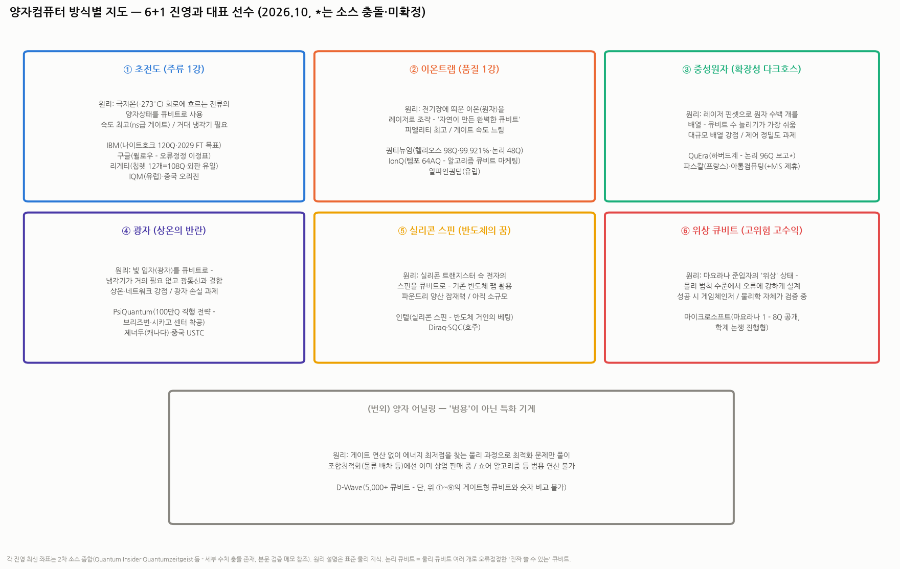

# 배경지식 — 양자컴퓨터 작동 방식 유형별 지도: 6+1 진영, 선수 명단, 그리고 같은 진영 안의 차이

> 작성일: 2026-10-12 · 카테고리: 해외주식/배경지식 (☞ `종목분석/리게티컴퓨팅_심층분석리포트`의 배경지식편)
> **검증 메모**: 2026년 각 진영 최신 좌표(IBM 나이트호크 120Q·2026 말 '검증된 양자우위' 목표·2029 FT 목표, 퀀티뉴엄 헬리오스 98Q·2큐비트 피델리티 99.921%·논리 48큐비트, IonQ 템포 64AQ, QuEra 논리 96큐비트 보고, PsiQuantum 브리즈번·시카고 센터 착공, MS 마요라나 1(8Q), 리게티 Cepheus-108Q·99.1%)는 업계 2차 소스(Quantum Insider·Quantumzeitgeist 등) 종합 — **일부 수치는 소스 간 충돌(QuEra 원자 수 등)이 있어 * 표기**. 물리 원리 설명은 표준 지식. 승자 전망류 서술은 주관 표기.

---

## 0. 아주 쉬운 버전 — 전체 그림 먼저

양자컴퓨터의 공통 과제는 하나다: **"양자 상태(중첩·얽힘)를 유지하는 '큐비트'를 어떻게 물리적으로 만들고, 오래 살려두고, 정확히 조작하느냐"**. 이 '어떻게'의 답이 6개 진영으로 갈라져 있고, 아직 승자가 정해지지 않았다 — 비유하면 **1900년대 초 자동차 산업**이다: 증기차·전기차·가솔린차가 공존했고, 당시엔 어느 엔진이 이길지 아무도 몰랐다.

읽는 데 필요한 용어 둘만 먼저:
- **피델리티**: 연산 1회의 정확도. 99%와 99.9%는 오류율 10배 차이 — 큐비트 '수'보다 중요한 품질 지표
- **논리 큐비트**: 물리 큐비트 여러 개(수십~수천 개)를 묶어 오류정정한 '진짜 쓸 수 있는' 큐비트 — 업계의 진짜 스코어보드는 이제 물리 개수가 아니라 **논리 큐비트 수**로 넘어가는 중

---

## 1. ① 초전도 — 주류 1강 (IBM·구글·리게티)

- **원리**: 금속 회로를 절대영도 근처(-273°C)로 식히면 저항이 0이 되고(초전도), 그 회로를 도는 전류가 양자적으로 행동한다 — 이 '인공 원자'가 큐비트. 마이크로파 펄스로 조작한다
- **장점**: 게이트 속도 최강(나노초 — 이온트랩의 수천 배), 반도체 공정으로 제작(집적·양산 친화), 가장 성숙한 생태계
- **단점**: 거대한 희석냉각기(샹들리에처럼 생긴 그것) 필수, 큐비트 수명이 짧아(마이크로초) 빠른 오류정정 필수, 칩이 커질수록 배선 지옥
- **같은 진영 안의 차이 (질문의 핵심)**:
 - **IBM — '로드맵 기계'**: 매년 로드맵을 공표하고 기계처럼 집행하는 정공법. 나이트호크(120Q, 사각 격자 — 기존 헤비헥스보다 회로 깊이에 유리)로 2026년 말 '검증된 양자우위', **2029년 결함허용(FT) 컴퓨터**(스탈링)가 공약. 강점은 소프트웨어(Qiskit)+기업 생태계
 - **구글 — '이정표 사냥꾼'**: 판매보다 과학 이정표에 집중 — 2019 양자우위 선언, 2024 **윌로우**(오류정정의 핵심 증명: 큐비트를 늘릴수록 논리 오류가 '줄어드는' 임계점 통과). 상업화는 느긋, 연구는 최선두
 - **리게티 — '외판하는 독립군'**: 셋 중 유일하게 **칩·시스템을 외부에 판다**(Novera·Cepheus). 전략도 다름 — 큰 칩 대신 **9큐비트 칩렛을 타일링**(12개=108Q)해 수율로 승부. 체급(R&D 자금)은 거인의 수십 분의 1 (☞ 리게티 리포트)
 - 기타: IQM(유럽 관학 시장), 중국 오리진·USTC(주쿵즈 계열)
- **투자 접근**: IBM·구글은 양자가 주가에 '옵션'일 뿐인 거대 기업 — 순수 노출은 리게티가 사실상 유일한 상장 초전도 순수주

## 2. ② 이온트랩 — 품질 1강 (퀀티뉴엄·IonQ)

- **원리**: 원자에서 전자를 떼어낸 이온을 전기장으로 진공 속에 띄워 두고, 레이저로 상태를 조작 — 큐비트가 인공물이 아니라 **자연이 만든 원자 그 자체**라 완전히 균일하고 수명이 길다
- **장점**: **피델리티 최강**(퀀티뉴엄 99.921% — 초전도 대비 오류율 수 분의 1), 모든 큐비트가 서로 연결 가능(all-to-all — 회로 짜기 유리), 긴 수명
- **단점**: 게이트가 느리다(마이크로초~밀리초 — 초전도의 수백~수천 배), 이온 수를 늘리면 제어 레이저가 기하급수로 복잡 — **확장성의 벽**
- **같은 진영 안의 차이**:
 - **퀀티뉴엄(하니웰+케임브리지퀀텀, 비상장) — '품질의 왕'**: QCCD(이온을 칩 위에서 물리적으로 이동시키는 구조)로 업계 최고 피델리티. 헬리오스 98Q에서 **논리 큐비트 48개(물리 2개당 논리 1개라는 경이적 효율 보고)** — 오류정정 경쟁의 선두 주장. IPO 예상 단골
 - **IonQ(상장) — '마케팅과 M&A의 공격수'**: 자체 지표 'AQ(알고리즘 큐비트)'로 소통(템포 64AQ) — 타사와 직접 비교가 어려운 지표라는 비판도 상존. 양자 네트워킹 회사 인수 등 M&A로 몸집 확장. 리게티와 함께 '양자 테마 바스켓'의 주포
- **투자 접근**: 품질 논리로는 이온트랩이 선두지만, 속도·확장성 한계 때문에 "소수의 고품질 큐비트" 단계까지의 리더라는 평가(주관)

## 3. ③ 중성원자 — 확장성 다크호스 (QuEra·파스칼)

- **원리**: 이온화하지 않은 중성 원자를 **레이저 핀셋(광집게)**으로 수백 개씩 격자 배열 — 리드버그 상태로 들떠 상호작용시킨다
- **장점**: **큐비트 수 늘리기가 가장 쉽다**(수백~수천 원자 배열 시연), 배열을 계산 중에 재구성 가능(유연한 연결)
- **단점**: 게이트 피델리티가 초전도·이온 대비 과제, 제어 정밀도
- **선수들**: **QuEra**(하버드·MIT 혈통, 비상장 — 논리 큐비트 96개 보고*로 오류정정 경쟁 선두권 주장, 단 원자 수 등 세부는 소스 충돌), **파스칼**(프랑스), **아톰컴퓨팅**(MS와 제휴)
- **관전 포인트**: 2023~26년 가장 가파르게 치고 올라온 진영 — '오류정정 시대'의 복병

## 4. ④ 광자 — 상온의 반란 (PsiQuantum·제너두)

- **원리**: 빛 입자(광자) 하나하나를 큐비트로 — 광자는 환경과 거의 상호작용하지 않아 **냉각기가 거의 필요 없고**, 광섬유로 그대로 전송된다(양자 네트워크와 천연 호환)
- **장점**: 상온 동작(일부 검출기만 냉각), 기존 반도체 광학 공정(글로벌파운드리 등) 활용, 네트워킹
- **단점**: 광자는 저장이 안 되고 쉽게 손실됨 — 확률적 게이트를 물량으로 보정해야 해서 **애초에 초대규모가 아니면 작동하지 않는 방식**
- **선수들**: **PsiQuantum(비상장, 조 단위 펀딩)** — 중간 단계를 건너뛰고 **"100만 큐비트 FT 머신 직행"**이라는 올인 전략: 브리즈번·시카고에 발전소급 센터 착공. 성공하면 단숨에 선두, 실패하면 중간 성과물이 없음 — 업계에서 가장 바이너리한 베팅. **제너두**(캐나다, 가우시안 보손 샘플링), 중국 USTC(주장 광자 실험)
- **같은 진영 차이**: PsiQuantum(단일광자·FT 직행) vs 제너두(연속변수 방식) — 같은 '광자'라도 수학이 다르다

## 5. ⑤ 실리콘 스핀 · ⑥ 위상 — 장기 베팅 둘

- **실리콘 스핀(인텔·Diraq)**: 실리콘 트랜지스터 속 전자 하나의 스핀을 큐비트로 — **기존 반도체 팹에서 찍을 수 있다**는 궁극의 양산 잠재력. 아직 수십 큐비트 수준으로 후발이지만, '수백만 큐비트가 필요해지는 순간' 파운드리 논리가 폭발할 수 있는 장기 카드
- **위상 큐비트(마이크로소프트)**: 마요라나 준입자의 위상적 성질로 **물리 법칙 수준에서 오류에 강한** 큐비트를 만들겠다는 구상 — 성공 시 오류정정 부담이 획기적으로 줄어 게임체인저. 마요라나 1(8Q)을 공개했지만 **기반 물리 자체가 학계 검증 논쟁 중**(과거 논문 철회 이력도) — 6개 진영 중 가장 고위험·고수익. MS는 동시에 아톰컴퓨팅(중성원자)에도 베팅하는 양다리
- **(번외) 어닐링(D-Wave, 상장)**: 게이트 연산 없이 에너지 최저점을 찾는 **최적화 전용** 기계 — 5,000+ '큐비트'를 자랑하지만 게이트형과 숫자 비교 자체가 무의미하다(범용 연산·쇼어 알고리즘 불가). 대신 물류·배차 같은 조합최적화에선 **이미 상업 매출**을 내는 실용파

## 6. 종합 비교표 + 투자자용 정리

| | 속도 | 품질(피델리티) | 확장성 | 냉각 | 상장 순수주 |
|---|---|---|---|---|---|
| ① 초전도 | ★★★ | ★★ | ★★ | 극저온 필수 | **리게티** |
| ② 이온트랩 | ★ | ★★★ | ★ | 불필요(진공) | **IonQ** |
| ③ 중성원자 | ★ | ★★ | ★★★ | 불필요(레이저) | (비상장 위주) |
| ④ 광자 | ★★ | ★★ | ★★★(이론상) | 거의 불필요 | (PsiQuantum 비상장) |
| ⑤ 실리콘 스핀 | ★★ | ★ | ★★★(잠재) | 극저온 | (인텔 내 일부) |
| ⑥ 위상 | ? | ★★★(이론상) | ? | 극저온 | (MS 내 일부) |
| 어닐링 | — | — | — | 극저온 | **D-Wave** |

**투자자용 3줄 정리 (주관)**:
1. **"어느 방식이 이기나"는 아직 베팅 불가** — 1900년의 자동차처럼, 각 진영이 서로 다른 축(속도/품질/확장성)에서 1등이다. 지금 바뀌는 건 스코어보드 자체: 물리 큐비트 수 자랑 → **논리 큐비트·피델리티 경쟁**으로 이동 중(퀀티뉴엄 48, QuEra 96* 보고가 그 신호)
2. **상장 순수주는 사실상 3개뿐**(리게티·IonQ·D-Wave) — 나머지 강자들은 비상장(퀀티뉴엄·PsiQuantum·QuEra)이거나 거인의 부서(IBM·구글·MS·인텔)다. 그래서 상장 3인방은 펀더멘털과 무관하게 **'양자 테마'라는 하나의 바스켓**으로 같이 움직인다 — 리게티 리포트의 내러티브 사이클 프레임이 셋 모두에 적용된다
3. **다음 빅 이벤트 감시**: IBM의 2026년 말 '검증된 양자우위' 공약(연말), 퀀티뉴엄 IPO 여부, 논리 큐비트 스코어 경쟁 — 이 셋이 테마의 다음 점화 플러그 후보다

---

## 참고 출처 (검증)

- [Quantum Insider — 2026 양자 칩 기업 지형](https://thequantuminsider.com/2026/06/05/how-many-quantum-chip-companies-are-there/) · [— 주요 76개사 정리](https://thequantuminsider.com/2025/09/23/top-quantum-computing-companies/) · [Quantumzeitgeist — 방식별 하드웨어 기업 가이드](https://quantumzeitgeist.com/top-quantum-hardware-companies/)
- [permutations — 2025~26 돌파구와 FT 로드맵(IBM 나이트호크 120Q·2029 FT, 퀀티뉴엄 헬리오스 99.921%·논리 48Q, QuEra 논리 96Q, MS 마요라나 1)](https://www.permutations.app/research/quantum-computing-2026.html) · [entangledfuture — 2026 하드웨어·펀딩 현황(PsiQuantum 센터 착공, IonQ 템포 64AQ)](https://entangledfuture.com/guides/state-of-quantum-computing-2026/)
- 물리 원리(초전도·이온트랩·리드버그·광자·스핀·마요라나·어닐링): 표준 지식 · 리게티 세부: `종목분석/리게티컴퓨팅_심층분석리포트` 검증분

**저장소 연계**: `종목분석/리게티컴퓨팅_심층분석리포트`(초전도 진영의 상장 순수주) · `시장브리핑/테마부활의역사`(테마 바스켓 사이클) · `반도체/배경지식/HBM 시리즈`(칩렛·패키징 개념의 원류)

> 유의: 2026년 수치는 2차 소스 종합으로 세부 충돌 존재(* 표기) — 개별 수치 인용 시 각사 1차 발표 확인 권장. 별점·전망은 주관. 매수 추천 아님.
