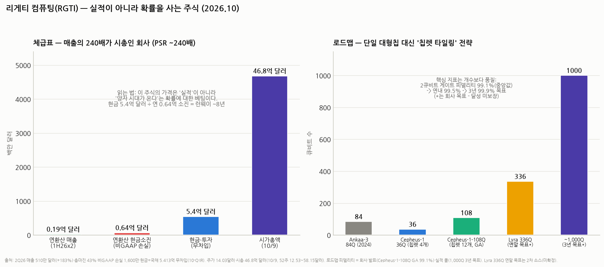

# 리게티 컴퓨팅(RGTI) 심층분석 — 실적이 아니라 '확률'을 사는 주식

> 작성일: 2026-10-11 · 카테고리: 해외주식/종목분석 (해외주식 ② — ①서비스나우 시리즈와 달리, 이건 이익이 '없는' 회사를 읽는 법의 교본)
> **검증 메모**: 2Q26(매출 510만 달러 +183%·총마진 43%·영업손실 -2,810만·GAAP 순손실 -5,260만(워런트 평가손 포함)·비GAAP 손실 -1,600만·현금+미국채 5억 4,130만 달러 무차입)·1H26 매출 954만 달러·주가 14.03달러/시총 46.8억 달러(10/9, 52주 12.53~58.15)·YTD -36.7%·애널 평균 목표가 29.5달러·Cepheus-1-108Q 출시(9큐비트 칩렛 12개, 2큐비트 게이트 피델리티 중앙값 99.1%, 연내 99.5% 목표)·3년 내 ~1,000큐비트·99.9%·40ns 목표(실적 콜)·차기 실적 11월은 IR·10-Q·보도 검증. **Lyra 336Q 연말 목표는 2차 소스(회사 최신 확인 못 찾음 — 미확정 표기).** 경쟁사 비교·양자 산업 서술 일부는 통용 지식(정성 표기).

---

## 0. 아주 쉬운 버전 (여기만 읽어도 됨)

**뭐 하는 회사?** **양자컴퓨터를 직접 만드는** 미국 회사다(2013년 창업, 버클리 — 창업자는 IBM 출신 물리학자 채드 리게티). 방식은 IBM·구글과 같은 **초전도 큐비트**(절대영도 근처로 냉각한 회로) 계열이고, 칩 설계→자체 팹(Fab-1, 업계 최초의 전용 양자 팹)→시스템·클라우드까지 수직통합이 특징. 지금 파는 건 ① 연구기관용 온프레미스 양자컴퓨터(Novera QPU — 2Q26 매출 급증의 주역) ② 클라우드 접속(QCS) ③ 정부 연구 계약이다.

**숫자의 현실부터 직시하자**: 분기 매출 **510만 달러**(한화 ~70억 원 — 비츠로셀 분기 매출의 1/10도 안 된다)에 시총 **46.8억 달러**(~6.5조 원). **PSR ~240배** — 삼양식품이 PER 19배, 서비스나우가 PSR ~9배인 세계와 완전히 다른 행성이다. 이 가격은 실적의 값이 아니라 **"양자컴퓨팅이 상업화되는 미래가 오고, 그때 리게티가 살아남아 있을 확률"에 대한 복권 가격**이다.

**그 복권의 조건은 나쁘지 않다**: ① **현금 5.4억 달러·무차입** — 연 현금소진(~6,400만 달러) 기준 **런웨이 약 8년**: 복권치고는 유효기간이 매우 길다 ② 기술 이정표를 실제로 깨는 중(108큐비트 칩렛 시스템 GA, 피델리티 99.1%) ③ 다만 주가는 이미 한 번 광풍(52주 고점 58달러)과 겨울(현재 14달러, -76%)을 왕복했다.

**한 줄 평**: 이 종목의 분석은 "얼마 버나"가 아니라 **"기술 이정표 달성 확률 × 희석 속도 × 시장의 꿈 농도"**를 읽는 게임이다 — 아래에서 그 세 가지를 뜯는다.

---

## 1. 사업 구조 — 뭘 팔아서 510만 달러를 벌었나

| 축 | 내용 | 비고 |
|---|---|---|
| **온프레미스 QPU 판매 (Novera)** | 9큐비트(확장형) 연구용 양자컴퓨터를 연구소·국가기관에 통째로 판매 | 2Q26 +183% 성장의 주역 — '양자컴퓨터를 실제로 파는' 몇 안 되는 회사 |
| 클라우드 (QCS) | AWS Braket·Azure Quantum 경유 또는 직접 접속 과금 | 아직 소액 |
| 정부·연구 계약 | 미 공군연구소(AFRL)·DARPA 벤치마킹 프로그램·영국 NQCC 납품 등 (통용) | 기술 검증+매출의 바닥 |

**수직통합이 정체성**: 자체 전용 팹(Fab-1)에서 칩을 직접 굽는다 — IBM·구글(자체 사용)을 빼면 '칩을 만들어 남에게 파는' 초전도 진영은 리게티가 사실상 유일하다. 이게 Novera 같은 '양자컴퓨터 판매업'을 가능하게 하는 기반.

## 2. 기술 로드맵 — 칩렛 전략과 '피델리티'라는 진짜 지표

- **칩렛 타일링 전략**: 큰 칩 하나를 키우는 대신(수율 급락), **9큐비트짜리 작은 칩을 타일처럼 이어 붙인다** — 4개로 36Q, **12개로 108Q(Cepheus-1-108Q, 출시 완료)**. 반도체에서 본 칩렛 논리(수율·확장성)와 같다. 다음 단계는 Lyra 336Q(연말 목표 — 2차 소스, 미확정), 3년 내 ~1,000큐비트
- **큐비트 '수'보다 '질'이 진짜 지표다**: 양자컴퓨터의 쓸모는 큐비트 개수가 아니라 **2큐비트 게이트 피델리티**(연산 한 번의 정확도)가 결정한다 — 99%와 99.9%는 0.9%p 차이가 아니라 **오류율 10배 차이**고, 오류정정(유용한 계산의 전제)에 필요한 물리 큐비트 수를 수십 배 바꾼다. 리게티 현재 **중앙값 99.1% → 연내 99.5% → 3년 99.9% 목표** — 이 숫자의 진행이 이 회사 가치의 심장박동이다
- **업계 지형(정성)**: 초전도(리게티·IBM·구글 — 빠른 게이트, 대규모 냉각 필요) vs 이온트랩(IonQ·Quantinuum — 높은 피델리티, 느린 속도) vs 어닐링(D-Wave — 범용 아님) vs 중성원자·광자 등. 리게티는 초전도 진영의 '독립군 소형주' — 같은 방식의 IBM·구글이라는 거인과 기술 경쟁을 하면서, 주식시장에선 IonQ·D-Wave와 '양자 테마 바스켓'으로 묶여 움직인다

## 3. 재무 — 복권의 유효기간 계산

| 항목 | 수치 (2Q26) | 해석 |
|---|---|---|
| 매출 | 510만 달러 (+183%) / 1H26 954만 | Novera 인도 인식 — 분기별 울퉁불퉁(장비 매출 특성) |
| 총마진 | 43% (전년 31%) | 하드웨어 팔면서 이 마진이면 양호한 출발 |
| 영업손실 | -2,810만 달러 (R&D 확대) | 연 ~1.1억 달러대 영업적자 체제 |
| **GAAP 순손실** | **-5,260만 달러** | 절반가량이 **워런트·언아웃 평가손(비현금)** — SPAC 상장 잔재. 서비스나우 §GAAP 해설과 같은 원리로, 실력은 비GAAP(-1,600만)에 가깝다 |
| **현금+미국채** | **5.413억 달러, 무차입** | 비GAAP 소진(연 ~6,400만) 기준 **런웨이 ~8년** — 양자 섹터 최상급 체력 |
| 희석 | 주가 급등기마다 유상증자(ATM)로 곳간을 채워 온 역사 | 현금 5.4억의 출처가 곧 기존 주주 희석 — **이 회사의 진짜 '비용'은 손실이 아니라 희석**이다 |

**체급 감각**: 시총 46.8억 달러 = 연환산 매출의 ~240배. 전통 밸류에이션(PER·PSR·DCF)은 전부 무의미하고, 가격의 지배 변수는 **섹터 내러티브**(양자 테마의 꿈 농도)다 — 52주 레인지 12.53~58.15달러(4.6배 왕복)가 그 증거. 테마부활의역사 리포트의 프레임으로는 전형적인 '내러티브 사이클 주식'이다.

## 4. 리스크 — 이 복권이 휴지가 되는 경로

1. **상업화 시점의 불확실성 (본질)**: "유용한 양자 우위"(실제 산업 문제에서 고전 컴퓨터를 이기는 것)가 언제 오는지 아무도 모른다 — 젠슨 황의 "15~30년" 발언 한 마디에 섹터가 반토막 났던 전례(2025 초)가 보여주듯, **이 주식의 최대 변수는 리게티가 아니라 '권위자의 말'**이다
2. **거인과의 기술 경쟁**: 같은 초전도 방식의 IBM(로드맵 기계처럼 집행)·구글(윌로우 — 오류정정 이정표)이 연 수십억 달러를 쓴다 — 리게티의 연 R&D는 그 수십 분의 1. 칩렛·팹 수직통합이라는 차별화가 자본 열세를 이겨야 하는 구조
3. **희석의 쳇바퀴**: 주가 급등 → 증자 → 희석 → 테마 냉각 → 급락의 사이클 반복 — 장기 보유자의 수익률을 갉아먹는 구조적 비용
4. **실적 변동성**: 장비 몇 대 인도 여부로 분기 매출이 2~3배 출렁 — 성장률 숫자에 과잉 반응하지 말 것
5. **상장폐지·밈 주식 꼬리위험은 아님**(현금 풍부·나스닥 안정권)이나, 고점 추격 매수의 손실 폭(-76%)이 보여주듯 **진입 가격이 수익률의 거의 전부**인 종목

## 5. 시나리오 (12~24개월, 가설)

| | 가정 | 함의 |
|---|---|---|
| Bull | Lyra 336Q 인도 + 피델리티 99.5% 달성 + 대형 정부/기업 수주 | 테마 재점화 — 52주 고점(58달러) 재도전형 랠리 |
| Base | 로드맵 순항하나 상업화는 여전히 먼 상태 | 내러티브 사이클 왕복 — 현금은 든든, 주가는 테마 베타 |
| Bear | 피델리티 목표 미달 or 권위자발 '양자 겨울' 재점화 | 52주 저점(12.5달러) 하회 — 단, 현금 가치(주당 ~1.6달러)가 궁극 바닥은 아님에 유의(소진 지속) |

**개인 의견(가설)**: 이 종목은 포트폴리오에서 '분석해서 비중 싣는 주식'이 아니라 **'소액으로 사서 잊어버리는 콜옵션'**으로 분류하는 게 정직하다. 그 옵션 중에서는 조건이 좋은 편이다 — 현금 8년치(시간), 실제로 깨지는 이정표(진행), 수직통합 팹(차별화). 매수·추가의 트리거는 실적이 아니라 딱 두 개만 보면 된다: **① 피델리티 숫자(99.1→99.5→99.9)의 진행 ② 테마 냉각기(고점 대비 -70%대)인가 과열기인가** — 지금은 후자 조건은 충족된 영역(고점 -76%)이고, 전자는 11월 실적 콜과 Lyra 발표가 다음 체크포인트다.

---

## 참고 출처 (검증)

- [StockTitan — 2Q26: 매출 510만 달러·GAAP 손실 5,260만·비GAAP 1,600만·현금 5.413억](https://www.stocktitan.net/news/RGTI/rigetti-computing-reports-second-quarter-2026-financial-i812eesegntu.html) · [Investing.com — 매출 +183%·마진 43%·손실 확대 슬라이드](https://ng.investing.com/news/company-news/rigetti-q2-2026-slides-revenue-jumps-183-as-losses-widen-93CH-2646303) · [리게티 IR — 2Q26 결과 프레젠테이션](https://investors.rigetti.com/static-files/c631c8e5-b37b-4077-84bf-f4d408b40203)
- [야후 — Cepheus-1-108Q 출시(+34.9%): 9Q 칩렛 12개·피델리티 99.1%·연내 99.5% 목표](https://finance.yahoo.com/markets/stocks/articles/why-rigetti-computing-rgti-34-060510609.html) · [야후 — 2Q26 콜: 3년 내 ~1,000큐비트·99.9%·40ns 목표](https://finance.yahoo.com/quote/RGTI/earnings/RGTI-Q2-2026-earnings_call-666028.html) · [SEC 8-K — 로드맵 발표 원문](https://www.sec.gov/Archives/edgar/data/0001838359/000110465926098877/tm2623611d1_ex99-1.htm)
- [MarketBeat — 주가 14.03달러·시총 46.8억·52주 12.53~58.15·YTD -36.7%](https://www.marketbeat.com/stocks/NASDAQ/RGTI/) · 애널 평균 TP 29.5달러(구글 파이낸스 집계) · [Bitget — Lyra 336Q 연말 목표(2차 소스·미확정)](https://www.bitget.com/news/detail/12560605390920) · [postquantum — 회사·기술 개요](https://postquantum.com/quantum-computing-companies/rigetti/)
- 업계 지형(초전도 vs 이온트랩 vs 어닐링)·정부 계약(AFRL·DARPA·NQCC)·젠슨 황 발언 파동: 통용 지식(정성)

**저장소 연계**: `서비스나우_심층분석리포트`(이익 있는 성장주 읽기 — 대조군) · `시장브리핑/테마부활의역사`(내러티브 사이클 프레임 — 이 종목의 본질) · `거시및정책/배경지식/채권금리해부`(장기금리 5%대 = 꿈 주식의 할인율 중력) · `반도체/HBM 시리즈`(칩렛 개념의 반도체판)

> 유의: 분기 수치는 10-Q 기준이나 워런트 평가손 등으로 GAAP 변동성 큼. Lyra 일정 미확정. 경쟁사 수치 비교는 생략(통용 서술만). 런웨이 계산은 비GAAP 소진 기준 단순 나눗셈. 원화 환산 변동성 별도. 매수 추천 아님.
