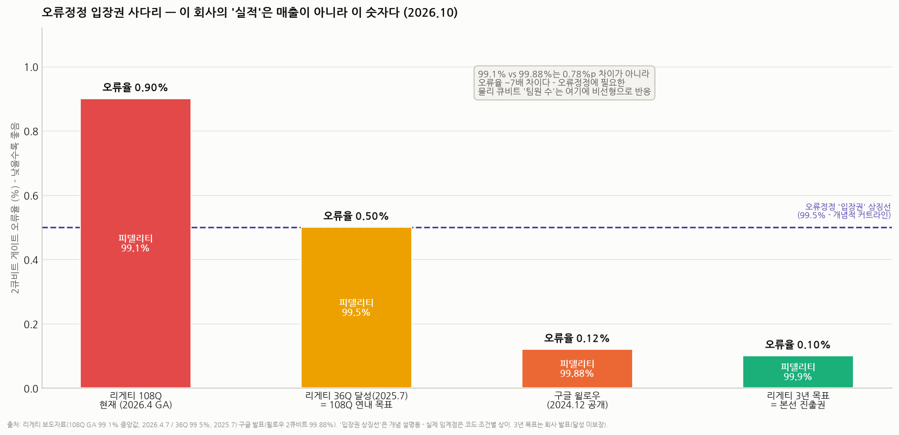
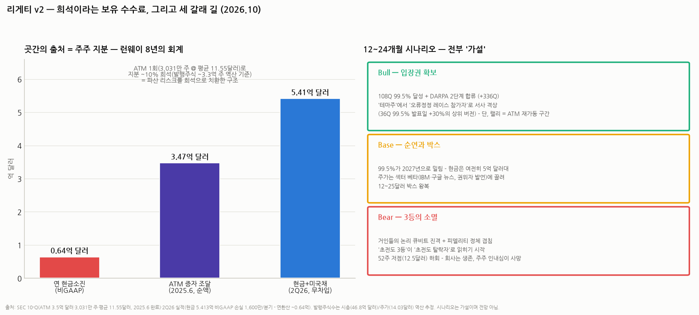

# 리게티 컴퓨팅(RGTI) 심화분석 v2 — 이 콜옵션의 가격표를 뜯어보자

> 작성일: 2026-10-14 · 카테고리: 해외주식/종목분석 · **선행 문서**: [v1 심층분석](리게티컴퓨팅_심층분석리포트.md)(체급·재무·리스크 개관) · [양자컴퓨터 방식별 지도](../배경지식/배경지식_양자컴퓨터_방식별지도.md)(§1.5 초전도 원리 10단계 / §1.6 초전도 진영 내부전 — **이 문서의 기술 파트는 §1.5~1.6을 전제로 한다**)
>
> **검증 메모**: 주가 14.03달러·시총 46.8억 달러(10/9)·2Q26 재무(매출 510만 달러 +183%·비GAAP 손실 1,600만·현금+미국채 5.413억 무차입)는 v1에서 검증한 수치 유지. 신규 검증: 노베라 가격(시작가 90만 달러)·구매 고객(페르미랩 SQMS·2025.9 2대 570만 달러 수주)·DARPA QBI 결과(Stage A 선정 → 2025.11 Stage B 11개사 명단에서 제외)·ATM 증자(2025.6, 3.5억 달러·3,031만 주·평균 11.55달러)·리버레인 실시간 디코더 실증(arXiv 2410.05202)·구글 윌로우 99.88%·IBM 나이트호크 110년 샘플링 주장(2026.9 arXiv, 검증 중). Lyra 336Q·발행주식수(~3.3억 주)는 미확정/역산 추정 표기. '내재 확률' 계산은 전부 예시용 산수다.

---

## 0. 아주 쉬운 버전 — v1에서 한 발 더

v1의 결론은 "이 주식은 실적이 아니라 확률을 사는 **소액 콜옵션**"이었다. v2의 질문은 그 다음이다: **그 콜옵션의 가격은 적정한가? 행사 조건은 구체적으로 뭔가? 옵션 매도자(= 회사)는 내 프리미엄으로 뭘 하고 있나?**

다섯 줄 요약:

1. **기술 등수는 3등이다** — 같은 초전도 진영에서 구글(품질 99.88%·오류정정 실증 유일)·IBM(규모·로드맵·생태계)에 모두 밀린다. 이건 감정이 아니라 숫자다
2. **그런데 3등이어도 장사가 된다** — 아직 아무도 '성능'을 못 파는 시장이라, 리게티는 "연구자가 뜯어볼 수 있는 실험 장비"(노베라, 90만 달러부터)라는 다른 상품을 판다. 연매출 ~0.19억 달러가 그 시장의 실제 크기다
3. **진짜 승부처는 '오류정정 입장권'** — 피델리티 99.5%(연내 목표)가 입장권, 99.9%(3년 목표)가 본선 진출권이다. 이 숫자의 진행이 주가의 심장박동
4. **경고 신호도 켜져 있다** — 기술 심사위원(DARPA)이 2025년 11월 2단계 진출 11개사를 뽑으면서 리게티를 제외했다. IBM·IonQ·퀀티뉴엄·QuEra는 들어갔다
5. **옵션의 숨은 비용은 희석** — 2025년 6월 한 번의 증자로 주식 수가 ~10% 늘었다. 현금 5.4억 달러(런웨이 8년)의 출처가 바로 그것. 회사는 안 망하지만, 내 지분은 계속 얇아지는 구조다

**판정 미리보기**: 콜옵션이라는 v1 판정은 유지하되, v2에서는 그 옵션의 **행사 조건표·감점 요인·숨은 수수료**까지 명시한다. 결론은 §9.

---

## 0.3 용어 사전 (먼저 읽으면 아래가 쉬워진다)

| 용어 | 뜻 | 비유 |
|---|---|---|
| **피델리티** | 게이트 연산 1회의 정확도. 99.1%는 1,000번에 9번 틀린다는 뜻 | 타자의 타율 — 99%와 99.9%는 0.9%p가 아니라 **오류율 10배** 차이 |
| **오류정정 임계점** | 물리 큐비트를 묶어 '안 죽는 논리 큐비트'를 만들 때, 묶는 게 득이 되기 시작하는 피델리티 커트라인 | 수능 커트라인 — 못 넘으면 어느 대학(코드) 갈지 고르는 게 무의미 |
| **논리 큐비트** | 물리 큐비트 수백~수천 개로 오류정정한 '진짜 쓸 수 있는' 큐비트 | 잘 잊는 개인들을 묶어 만든, 잊지 않는 조직 |
| **FT (결함허용)** | 오류정정이 상시 작동하며 긴 계산을 끝까지 해내는 단계 — 상업화의 관문 | 시제품이 아니라 '양산차'가 되는 순간 |
| **칩렛 타일링** | 작은 칩(9Q)을 검사해 좋은 것만 이어 붙여 큰 칩을 만드는 리게티 전략 | 조립식 패널 주택 — 불량 패널 하나 때문에 집 전체를 버리는 걸 피한다 |
| **ABAA** | 완성된 조셉슨 접합에 전기 신호를 걸어 주파수를 사후 미세조정하는 리게티 제조 기술 | 출고 후 조율이 가능한 피아노 — '인공 원자의 개체 차'를 공정에서 깎는다 |
| **DARPA QBI** | 미 국방고등연구계획국의 양자 벤치마킹 사업 — "2033년까지 실용 양자컴퓨터가 가능한가"를 기업별로 실사하는 프로그램 | 국가대표 선발전 — 떨어져도 끝은 아니지만, 심사평은 공개된다 |
| **ATM 증자** | 시장에 주식을 조금씩 흘려 파는 방식의 유상증자 | 주가가 오를 때마다 곳간을 채우는 수도꼭지 — 대가는 기존 주주 지분 희석 |
| **PSR** | 시총 ÷ 연매출. 리게티는 ~240배 | 연 매출의 240년치를 선불로 낸 가격 |

---

## 0.5 시나리오 스토리 — 2027년 겨울, 세 개의 헤드라인

**헤드라인 A (Bull)**: "리게티, 108Q에서 99.5% 달성 — DARPA 2단계 합류·Lyra 336Q 출하". 입장권을 손에 쥐자 내러티브가 '테마주'에서 '오류정정 레이스 참가자'로 격상된다. 2025년 7월 36Q 99.5% 발표 때 하루 +30%였다 — 108Q에서의 재현은 그보다 무겁다. 52주 고점(58달러) 재도전형 랠리. 단, 랠리 꼭대기에서 회사는 어김없이 ATM 수도꼭지를 연다.

**헤드라인 B (Base)**: "리게티, 99.5% 목표 2027년 중반으로 순연 — 현금은 여전히 5억 달러". 로드맵은 살아 있지만 입증은 밀린다. 주가는 섹터 베타(IBM·구글 뉴스, 권위자 발언)에 끌려 12~25달러 박스를 왕복한다. 이 시나리오의 함정은 '아무 일도 안 일어나는 것'이 아니라, **섹터 이벤트 때마다 바스켓으로 묶여 출렁이는 것**이다.

**헤드라인 C (Bear)**: "구글, 논리 큐비트 100개 시연 — 초전도 레이스 사실상 2파전 굳히기". 리게티 자체의 악재가 아니어도, 거인들의 진격이 "3등에게 자리가 남나"라는 질문을 키운다. 여기에 피델리티 정체나 '양자 겨울' 발언이 겹치면 52주 저점(12.5달러) 하회. 현금 8년치가 있으니 회사는 멀쩡하다 — **죽는 건 회사가 아니라 주주의 인내심**이다.

---

## 1. 기술 포지션 정밀 진단 — '3등'의 내용물

(원리는 [방식별 지도 §1.5](../배경지식/배경지식_양자컴퓨터_방식별지도.md), 3사 비교는 §1.6 참조. 여기서는 투자 판단에 필요한 뼈대만.)

### 1.1 숫자로 보는 격차

| | 리게티 | 구글 | IBM |
|---|---|---|---|
| 대표 칩 | Cepheus-1-108Q (2026.4 GA) | 윌로우 105Q | 나이트호크 120Q |
| 2큐비트 피델리티 | **중앙값 99.1%** | **99.88%** | 비공개(게이트 수로 발표 — 회로당 5,000개) |
| 오류정정 실증 | 없음 (디코더 배관만) | **임계점 돌파 유일 입증** | qLDPC 베팅·실시간 디코딩 480ns |
| 확장 전략 | 칩렛 타일링(패키지 안) | 단일칩 품질 우선 | 모듈러(냉각기 수준, →1,080Q) |
| 연 R&D 체력 | ~1억 달러대 | 수십억 달러급(알파벳) | 수십억 달러급 |
| 상업 모델 | **장비 외판 + 클라우드** | 없음(연구) | 풀스택·생태계 |

99.1% vs 99.88%는 0.78%p 차이로 보이지만 **오류율로는 0.9% vs 0.12% — 약 7배 차이**다. 오류정정에 필요한 물리 큐비트 '팀원 수'는 오류율에 비선형으로 반응하므로, 이 격차는 체감보다 크다.

### 1.2 그래도 손에 쥔 차별화 세 장

1. **칩렛 + ABAA**: '인공 원자의 개체 차'라는 초전도의 숙명적 약점(§1.5-[10])을 **수율 공학으로 정면 돌파**하는 독자 노선. 칩렛 4→12개 확장에서 커플러 간섭으로 반년을 까먹은 건 비용이지만, 그 과정 자체가 남들이 안 가본 길의 데이터다
2. **Fab-1 수직통합**: 설계→자체 전용 팹→시스템까지. '칩을 만들어 남에게 파는' 초전도 회사는 사실상 유일 — 외판 사업(§3)의 기반
3. **속도**: 게이트 ~60ns(목표 40ns)는 구글과 같은 체급 — 품질이 따라오면 속도는 이미 준비돼 있다

### 1.3 오류정정 입장권 — 이 회사 가치의 심장박동

오류정정은 피델리티가 임계점을 넘어야 시작되는 게임이다(감시자 큐비트도 실수하므로, 커트라인 아래에선 묶을수록 독). 리게티의 로드맵이 코드 선택이 아니라 **99.1 → 99.5 → 99.9라는 숫자에 집착하는 이유**가 그것이다.

- **99.5% (연내 목표)** = 입장권. 36Q에서는 이미 달성(2025.7 — 발표 당일 주가 +30%). 숙제는 **108Q 전체에서의 재현** — 칩렛 숫자를 3배로 늘리고도 품질을 지킬 수 있느냐는 칩렛 전략 자체의 검증이기도 하다
- **99.9% (3년 목표)** = 본선 진출권. 이때부터 오류정정 오버헤드가 현실적 크기로 내려온다
- **배관 공사는 선행 완료**: 리버레인과 1μs 미만 실시간 디코더를 Ankaa-2에 통합 실증(2024, arXiv 2410.05202) — 큐비트 수명 100μs 안에 오류를 해독하는 필수 인프라. 입장권만 따면 바로 뛸 수 있게 신발끈은 묶어둔 상태

**투자 번역**: 이 주식의 '실적 발표'는 분기 매출이 아니라 피델리티 숫자다. 108Q 99.5% 달성 공시가 사실상의 어닝 서프라이즈이고, 미달·순연이 어닝 미스다.

---

## 2. DARPA 신호 — 심사위원이 준 감점을 어떻게 읽나

2025년, 미 국방부 산하 DARPA가 "2033년까지 실용(유틸리티급) 양자컴퓨터가 가능한가"를 기업별로 실사하는 QBI를 가동했다. 리게티는 1단계(Stage A, 최대 100만 달러·6개월)에 15개사 중 하나로 선정됐으나 —

**2025년 11월 발표된 2단계(Stage B, 최대 1,500만 달러) 11개사 명단에서 빠졌다.** 명단에는 IBM, IonQ, 퀀티뉴엄, QuEra, Atom Computing, Diraq, Nord Quantique, Photonic, Quantum Motion, SQC, 재너두가 올랐다 — 초전도 상장 순수주 중에서는 사실상 리게티만 누락된 그림이다. 회사는 "DARPA의 건설적 피드백을 받았고 대화가 계속되고 있으며 수개월 내 합류를 낙관한다"고 밝혔다(3Q25 실적 발표).

**세 갈래 해석**:
- **액면 그대로(감점)**: 가장 기술적으로 깐깐한 제3자 심사위원이, 돈이 아니라 기술 계획을 보고 리게티를 한 번 걸렀다. 구글은 애초에 불참한 심사라 사실상 '리게티 vs 나머지 상장 양자주'의 비교평가였는데 IonQ·D-Wave 아닌 IonQ·퀀티뉴엄·QuEra가 통과했다 — **"상장 양자주는 다 같은 테마"라는 바스켓 사고에 대한 반증**
- **완화 요인**: DARPA 스스로 "탈락 확정이 아니다"라고 명시했고 재합류 통로가 열려 있다. 또 QBI의 질문("2033년 유틸리티급")은 회사의 자금력·계획의 완결성을 크게 보는데, 리게티의 체급(연 R&D 1억 달러대)이 불리하게 작용했을 개연성
- **투자 함의**: DARPA Stage B 합류 여부는 **공짜로 외부 기술 실사를 대신 받아 보는 촉매**다. 합류하면 감점 회복 + 최대 1,500만 달러, 불발이 길어지면 "심사위원의 첫 판단이 맞았다"는 쪽에 무게

---

## 3. 외판 사업의 실체 — 성능이 아니라 '주권과 경험'을 판다

"기술 3등인데 어떻게 파나"의 답: **지금은 아무도 성능을 못 파는 시장**이다(구글·IBM 기계도 돈 되는 실무 계산은 못 한다). 리게티가 파는 건 다른 상품이다.

| 실구매 사례 (검증) | 내용 |
|---|---|
| 페르미랩 SQMS | 미 국립 가속기 연구소 산하 초전도 양자 센터 — 9Q 칩 구매 |
| 비공개 미 국립연구소 | 9Q 칩 구매 |
| 2025.9 수주 | 노베라 2대 **570만 달러**(아시아 기술 제조기업 + 캘리포니아 응용물리·AI 스타트업) |
| 영국 NQCC | 공동 시스템 운영(리버레인 협업 포함) |

- **상품 구성**: 노베라 QPU 시작가 **90만 달러**(냉각기·제어는 구매자 부담 — 풀 시스템 자작 시 ~200만 달러 미만). 플래그십 108Q는 판매가 아니라 **클라우드 대여**(자사 QCS + 아마존 Braket)
- **고객의 구매 동기**: 계산이 아니라 **연구 그 자체** — 극저온 제어 기술 습득, 오류정정 실험, 인력 양성, 그리고 각국의 '양자 주권'(자국 땅·자국 인력이 만지는 기계). 큐비트 9개면 충분한 용도들이다. 음대 연습실 피아노는 콩쿠르용 스타인웨이일 필요가 없다
- **경쟁 구도에서의 틈새**: 구글은 아예 안 팔고, IBM은 통째 시스템+자사 운영이라 속을 못 뜯어본다. **"뜯어보고 싶은 연구자"에겐 리게티가 거의 유일한 선택지** — 기술 3등이어도 성립하는 포지션
- **냉정한 크기 감각**: 이 시장의 전부가 연환산 매출 ~0.19억 달러다. 노베라 몇 대에 분기 매출이 2~3배 출렁인다(2Q26 +183%의 정체). 외판은 ① 생존 현금 보태기 ② 정부·연구소 레퍼런스 쌓기이지, 시총 46.8억 달러를 정당화하는 사업이 아니다

---

## 4. 희석의 회계 — 이 옵션의 숨은 수수료

v1에서 "진짜 비용은 손실이 아니라 희석"이라 했다. v2에서는 그 실례를 장부로 보자.

**2025년 6월 ATM 증자 (검증)**:
- 규모 **3.5억 달러** 전량 소화 — **3,031만 주**를 평균 **11.55달러**에 매각(수수료 3%, 순조달 3.467억 달러)
- 발표일 주가 -9.2% (희석 우려) → 완료 후 총현금 ~5.75억 달러·무차입
- 현 발행주식 ~3.3억 주(시총÷주가 역산, 추정) 기준 **한 번의 증자로 지분 ~10%가 얇아진 셈**

**이 구조의 양면**:
- **회사 입장(합리적)**: 주가가 테마로 급등할 때마다 비싼 값에 종이를 팔아 현금을 쌓는다 — 그 결과가 런웨이 8년이라는 양자 섹터 최상급 체력. 파산 리스크를 주주 희석으로 치환한 것
- **주주 입장(비용)**: 내가 산 콜옵션의 기초자산(주당 가치)이 랠리 때마다 잘게 쪼개진다. **"주가 2배 = 내 돈 2배"가 성립하지 않는 종목**이다. 다음 랠리에서도 ATM 재가동을 기본 시나리오로 깔아야 한다(쉘프 등록은 이미 갖춰진 회사다)
- **체크 포인트**: 분기 10-Q의 발행주식수 추이. 주식 수 증가율이 곧 이 옵션의 '보유 수수료율'이다

---

## 5. 밸류에이션 — PSR 240배가 아니라 '내재 확률'로 읽기

PSR 240배는 정보가 아니다(전통 지표가 무의미하다는 신호일 뿐). 이 주식의 가격은 이렇게 분해하는 게 정직하다:

> **시총 46.8억 달러 = (FT 시대가 오고 × 리게티가 그 시장의 유의미한 공급자로 생존할 확률) × 그때의 기업가치의 현재가**

**예시용 산수** (숫자는 전부 가정 — 결론이 아니라 사고 틀):
- FT 상업화 시대(2033~2035 가정)에 리게티가 연매출 20억 달러급 공급자로 생존, 그때 PSR 10배 = 기업가치 200억 달러라고 치자
- 연 10% 할인으로 10년 당기면 현재가 ~77억 달러
- 그렇다면 현 시총 46.8억 달러가 내재한 성공 확률은 **~60%** — 꽤 후한 가격이다
- 성공 시 가치를 더 크게(500억 달러) 보면 내재 확률은 ~24%로 내려온다 — 보는 꿈의 크기에 따라 "싸다/비싸다"가 뒤집히는 구조

**이 산수가 주는 실전 교훈 두 가지**:
1. **이 종목의 밸류에이션 논쟁은 숫자 싸움이 아니라 서사 싸움이다** — 할인율·성공 확률·꿈의 크기 중 뭘 바꿔도 목표가가 2~3배 움직인다. 애널 평균 목표가 29.5달러(현 주가의 2배)도 그 서사 중 하나일 뿐
2. **그래서 진입 가격이 수익률의 거의 전부다** — 같은 복권을 52주 동안 12.5달러에도 58달러에도 팔았다(4.6배). 내재가치가 안 잡히는 종목에서 유일하게 통제 가능한 변수는 '테마 온도계'(고점 대비 낙폭)다. 현재 고점 -76%는 냉각기 영역

**섹터 상대 비교(참고)**: 주가는 IonQ·D-Wave와 '양자 바스켓'으로 동행하지만, §2의 DARPA 결과가 보여주듯 기술 실사는 이들을 다르게 평가한다 — 바스켓 매수가 아니라 종목 선택을 한다면 그 차이(이온트랩 진영은 피델리티 우위, 리게티는 속도·외판·수직통합)를 알고 골라야 한다.

---

## 6. 촉매 캘린더 (12개월)

| 시기 | 이벤트 | 방향성 |
|---|---|---|
| 2026.11 | **3Q26 실적 + 로드맵 업데이트**(회사 예고: 하반기 중 공식 로드맵 갱신) | 피델리티 진행·Lyra 윤곽 |
| 연내 | **108Q 피델리티 99.5% 달성 여부** — 최대 단일 촉매 | 달성 시 '입장권' 서사 / 순연 시 어닝 미스급 |
| 연말~ | Lyra 336Q (2차 소스, 미확정) | 칩렛 전략 2차 검증 |
| 수시 | **DARPA Stage B 합류 여부** | 합류 = 감점 회복 + 외부 실사 통과 |
| 섹터 | IBM '2026년 말 커뮤니티 검증 양자우위' 판정, 구글 후속 발표, 권위자 발언 | 바스켓 전체의 조류 — 리게티 주가의 베타 |
| 랠리 시 | **ATM 재가동 가능성** | 급등 추격 매수의 역풍 요인 |

---

## 7. 리스크 맵 — v1 + v2 추가분

1. (v1) 상업화 시점 불확실 — 권위자 한 마디에 섹터가 반토막 난 전례
2. (v1) 거인과의 자본 격차 — 연 R&D 수십 배 차이
3. (v1) 희석의 쳇바퀴 — §4에서 실측치로 확인
4. **(v2 신규) 기술 서열의 고착**: 구글·IBM이 오류정정 단계로 진입하는 동안 입장권(99.5%)을 못 끊으면, '초전도 3등'이 '초전도 탈락자'로 읽히기 시작한다
5. **(v2 신규) DARPA 감점의 장기화**: 재합류가 계속 불발되면 외부 실사 실패 서사가 굳는다
6. **(v2 신규) 칩렛 전략 자체의 리스크**: 4→12개 확장에서 이미 커플러 간섭으로 반년 지연 — 12→36개(336Q)는 더 어려운 숙제다. 칩렛은 수율 문제를 '연결 문제'로 치환한 것이지 소멸시킨 게 아니다

---

## 8. 함께 보면 좋은 질문들 (이 저장소의 연결 고리)

- 초전도 큐비트가 물리적으로 어떻게 작동하나 → [방식별 지도 §1.5](../배경지식/배경지식_양자컴퓨터_방식별지도.md)
- IBM·구글과 구체적으로 뭐가 다른가, 모듈러 vs 칩렛 → 같은 문서 §1.6 + 보론
- 왜 리게티엔 오류정정 코드가 없나 → 같은 문서 §1.6 보론('입장 커트라인')
- 내러티브 사이클 주식 일반론 → `시장브리핑/테마부활의역사` · 꿈 주식의 할인율 중력 → `거시및정책/배경지식/채권금리해부`

---

## 9. 종합 판정

**v1 판정(소액 콜옵션) 유지, 단 조건표를 명시한다.**

- **사도 되는 이유**: ① 유효기간이 긴 옵션(현금 8년치) ② 행사 조건이 명확하고 측정 가능(99.5% → 99.9%) ③ 테마 온도계가 냉각기(고점 -76%) ④ 독자 포지션(외판·수직통합·칩렛)이 실존
- **싸지 않은 이유**: ① 기술 3등은 숫자로 확인되는 사실 ② DARPA 1차 심사에서 걸러진 전력 ③ 성공 시나리오를 꽤 후하게 깔아야 현 시총이 설명됨(§5) ④ 랠리마다 희석이라는 보유 수수료
- **실행 원칙**: 비중은 '잃어도 되는 돈', 추가 매수의 트리거는 주가가 아니라 **이정표**(108Q 99.5% / DARPA 합류 / 336Q 인도)로만. 급등 추격은 이 종목에서 구조적으로 불리하다(ATM) — 사는 날은 테마가 식은 날이어야 한다
- **손절이 아니라 '폐기' 기준**: 이 옵션을 버리는 건 주가 하락이 아니라 **① 피델리티 정체가 2개 분기 이상 지속 ② 거인들의 논리 큐비트 진격으로 초전도 3등 자리 자체가 소멸하는 신호**가 떴을 때다

---

## 참고 출처 (v2 신규 검증분)

- [리게티 IR — 노베라 2대 570만 달러 수주(2025.9.30)](https://investors.rigetti.com/news-releases/news-release-details/rigetti-announces-purchase-orders-two-quantum-computing-systems) · [Quantum Computing Report — 노베라 출시·시작가 90만 달러](https://quantumcomputingreport.com/rigetti-formally-announces-its-novera-qpu-devices-for-researchers/) · [리게티 — 108Q GA 보도자료(2026.4.7)](https://www.nasdaq.com/press-release/rigetti-announces-general-availability-108-qubit-system-2026-04-07)
- [The Quantum Insider — DARPA QBI Stage B 11개사(2025.11, 리게티 제외)](https://thequantuminsider.com/2025/11/07/darpa-advances-quantum-computing-initiative/) · [Quantum Computing Report — Stage B 명단·조건(최대 1,500만 달러)](https://quantumcomputingreport.com/darpas-quantum-benchmarking-initiative-qbi-advances-with-eleven-teams-moving-to-stage-b/) · [리게티 3Q25 실적 — DARPA 대화 지속·낙관](https://www.nasdaq.com/press-release/rigetti-computing-reports-third-quarter-2025-financial-results-provides-technology)
- [SEC 10-Q(2Q25) — ATM 3.5억 달러 전량 소화·3,031만 주·평균 11.55달러](https://www.sec.gov/Archives/edgar/data/1838359/000155837025011224/rgti-20250630x10q.htm) · [The Quantum Insider — ATM 완료·총현금 ~5.75억](https://thequantuminsider.com/2025/06/11/rigetti-finalizes-350-million-atm-offering-to-fuel-quantum-computing-scale-up/)
- [Barchart — 36Q 99.5% 달성(2025.7)·당일 +30%](https://www.barchart.com/story/news/33537351/rigetti-just-hit-a-new-quantum-computing-milestone-should-you-buy-rgti-stock-now) · [arXiv 2410.05202 — 리버레인 실시간 디코더 실증](https://arxiv.org/pdf/2410.05202) · 구글 윌로우 99.88%·IBM 110년 주장 출처는 [방식별 지도](../배경지식/배경지식_양자컴퓨터_방식별지도.md) 검증 메모 참조

> 유의: 주가·시총은 10/9 기준으로 이후 변동(9/30 자료엔 16달러대 기록도 있음 — 변동성 큰 종목). 발행주식수는 역산 추정. §5의 확률 계산은 사고 틀 예시이며 어떤 숫자도 전망치가 아님. Lyra 336Q 미확정. 매수 추천 아님.
